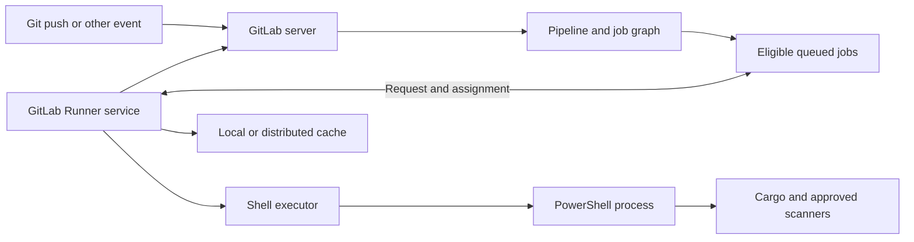
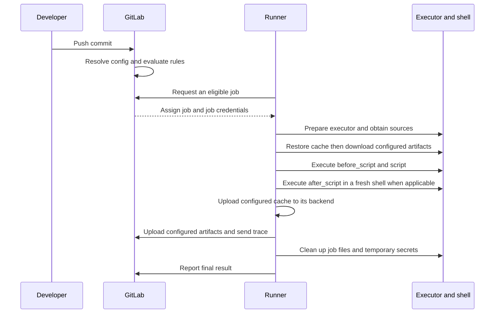

# Pipeline and job execution

GitLab evaluates included configuration, workflow and job rules to create a pipeline. A pipeline groups jobs for a ref and event. Stages supply default barriers. A job with a `needs` graph can start once its listed prerequisites are satisfied. Runner is the agent that requests work. Its executor prepares the runtime, its shell interprets generated commands and the script contains the work to run.

Runner polls GitLab, potentially using long polling. Tags, scope, protected-ref eligibility and capacity affect assignment. The runner prepares the executor and handles external secrets if configured. Cache and artifact operations depend on job configuration and earlier step outcomes. Cache upload occurs before artifact upload. Cleanup includes removal of temporary file variables. A Shell executor shares the host and its service identity across jobs, so separate trust boundaries at the VM or runner pool. See [GitLab job execution](https://docs.gitlab.com/ci/jobs/job_execution/) and [Shell executor](https://docs.gitlab.com/runner/executors/shell/).
