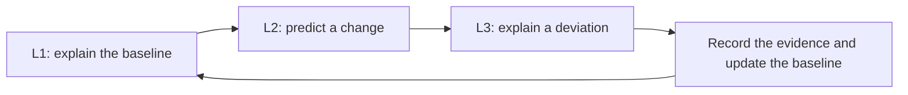

# Enterprise competency model

The goal is to become useful on an existing enterprise Rust delivery team. A new engineer should be able to explain the pipeline they inherit, review a change without accidentally moving a trust boundary, and investigate a failure using the evidence available to an operator. The same system looks different at each level. Understanding is demonstrated by a correct explanation, modification by a defensible proposed diff, and troubleshooting by a diagnosis that survives competing explanations.

All configurations and incident evidence in this module are illustrative and unexecuted. The documentation assessments use written evidence. Vendor support, project roles and runner behavior that depend on deployed versions belong in an assumptions register. Use the relevant official references before carrying a proposed change into an enterprise environment.

## Three levels and three kinds of evidence

**L1 · Understand** measures conceptual competence. Start with a pipeline event, ref and commit. Explain why GitLab creates particular jobs, when an eligible runner can request work, and what the shell executes. Identify configuration ownership across repository files, GitLab settings, runner service configuration and external policy systems. A successful explanation names the source of a behavior and distinguishes a fact in the fixture from an assumption about the environment. [L1 exercises](01-L1-UNDERSTAND.md)

**L2 · Modify** measures configuration competence. Translate a request into a narrow change, identify who can approve or apply it, and predict what happens on both the intended path and an unaffected path. Show a reviewable before and after. Include the expected effects on data transfer, credentials, policy enforcement and rollback. The expected output is a review artifact with explicit validation steps. [L2 exercises](02-L2-MODIFY.md)

**L3 · Troubleshoot** measures operational reasoning. Start at the last successful boundary and rank plausible causes. Choose evidence that separates the hypotheses, then revise the diagnosis as evidence arrives. Name the root cause and the smallest safe correction. Recovery evidence should verify the original outcome and show that the surrounding controls still hold. [L3 investigations](03-L3-TROUBLESHOOT.md)

## One scenario across the levels

The Ledger Gateway team maintains a Rust workspace that produces a Windows release executable. GitLab runs ordinary checks on merge requests and evaluates release candidates from its protected default branch. An earlier job produces coverage and a commit marker. Later jobs use the marker to establish which source revision they are evaluating. SonarQube supplies quality evidence, Nexus IQ evaluates dependency policy, and Fortify supplies source security evidence through an approved scan path. Each system has its own credential and policy owner.

At **L1**, draw the pipeline from push to result. Explain why a Cargo registry cache can accelerate a cold build while the commit marker must come from a particular producer. Locate the command that reads it and the GitLab declaration responsible for downloading it. If a Maven build previously wrote a file under `target`, explain why a later GitLab job on another machine needs an explicit way to obtain that file.

At **L2**, review a request to move release tests from a retired Linux executor to a Windows runner while preserving the merge request policy. Show which YAML keys and shell commands change. Identify the runner capability supplied by operations and the toolchain and artifact paths the team must agree on. Explain the expected results for a protected default branch push and an ordinary merge request. Keep the policy changes separate from the host migration so a reviewer can isolate the consequences.

At **L3**, investigate a Windows job that remains pending after the change. Compare its full tag set, runner scope, protection and capacity with the available fleet. If assignment is confirmed in the next run and Cargo is missing, treat that as a second boundary. Use the service account's executable resolution to test the toolchain hypothesis. Record which observation disproved the original explanation and which recovery result the team should expect.

## Technology competency matrix

L1 and L2 are prerequisites for an L3 target. An L2 primary target still requires recognizing when to escalate an incident.

| Technology | L1 evidence | L2 evidence | L3 evidence | Primary |
|---|---|---|---|---|
| Rust and Cargo | Explain ownership, features and lockfile | Review manifest and test changes | Isolate compiler, linker and resolution failures | L2 |
| GitLab CI/CD | Trace event to graph to script | Propose a scoped YAML change | Isolate admission, scheduling and execution failures | **L3** |
| Variables and permissions | Identify source, scope and reader | Propose least-privilege settings changes | Diagnose overrides and missing credentials safely | **L3** |
| Caching and artifacts | Explain reuse versus handoff | Revise keys and producer edges | Trace stale content, missing inputs and retention | **L3** |
| Windows runners | Explain host, executor, shell and identity | Adapt commands and routing | Diagnose eligibility, service environment and connectivity | **L3** |
| Actions migration | Map triggers, steps and outputs | Propose a parity-preserving translation | Diagnose event and permission drift | L2 |
| SonarQube, Nexus IQ, Fortify | Distinguish their evidence and roles | Review inputs, gate and failure policy | Separate policy decisions from coverage or operational failures | L2 |

## Offline study routine

For each exercise, write down the exact ref, pipeline source and job identity first. Then sketch the graph, mark where configuration comes from, and predict which observations would change if a single input were different. For a change exercise, record the approval owner beside each proposed edit. For an incident, keep a short evidence ledger with the observation, its source and the hypotheses it supports or weakens. Compare your work with the answer after committing to a prediction.

Advance when a reviewer can follow your reasoning without relying on facts you supplied verbally. The [validation rubric](04-SUMMARY-VALIDATION.md) defines thresholds and safety requirements. A passing offline assessment shows the ability to reason about enterprise systems from documentation and evidence. Supervised operation and runtime verification are tracked separately. [Future labs](../../FUTURE-LABS.md)
