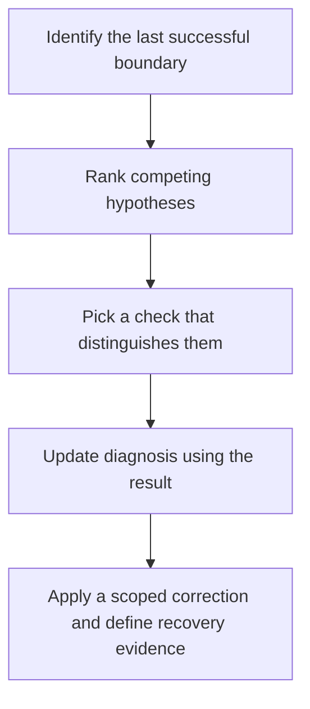

# L3 · Troubleshoot

L3 requires the ability to explain the baseline and assess the impact of a proposed configuration change. Given an incident, identify what failed, where it failed, why it failed, how the cause can be verified and how to correct it. All Ledger Gateway configurations, logs and observations here are illustrative and unexecuted. Use the [L2 change method](02-L2-MODIFY.md) to review each proposed correction.

## Triage by boundary

Record project, pipeline source, ref, commit, job ID and timestamps. Find the last step with evidence of success. A symptom describes what the operator sees. A hypothesis explains how it might have happened. Evidence is an observation that changes the credibility of a hypothesis. A root cause accounts for the failure and survives a check against alternatives. For example, a timeout is a symptom. A proxy change is a hypothesis until evidence from the failing client identifies the proxy as the boundary.



If there is no pipeline, start with event and ref, the configuration revision, include resolution and workflow rules. If the pipeline exists but the job is absent, examine job rules and required graph edges. For a pending job, inspect assignment. For a failed job, locate the first failing operation and distinguish it from later cleanup or report messages. [GitLab job execution](https://docs.gitlab.com/ci/jobs/job_execution/)

## Incident 1 · Pending job after a Windows pool change

The release test remains queued after a runner replacement. The release manager initially suspects an expired runner authentication token.

```yaml
release_test:
  tags: [windows-rust, msvc]
```

```text
Pipeline source: push; ref: protected main
Job status: pending; no assigned runner or execution trace
Replacement runner: online; project scope; idle; tags: windows-rust
Same runner completed a windows-rust-only job after this job queued
```

**Initial evidence and hypotheses** — GitLab admitted the job. Plausible causes include runner authentication, incomplete tags, incompatible protection, wrong scope and capacity. The recent successful assignment on the same runner weakens authentication and general connectivity explanations.

**Investigation** — Compare the entire job tag set with the actual runner tags. Check that the runner can serve the project and protected ref. The exercise assumes the scope and protected-ref checks pass. Confirm capacity and check the host capability before deciding whether the missing tag is a metadata error. Registration connects a manager to GitLab, while eligibility controls assignment of specific jobs. A host-side connectivity check alone cannot prove eligibility.

**Root cause and correction** — The replacement lacks `msvc`. An authorized runner operator restores the tag after confirming the MSVC toolchain contract, or routes the job to an already qualified runner. Recovery evidence is an assigned release job running on a qualified runner with the expected compiler and linker. Prevent recurrence by recording the tag and capability inventory in the pool replacement checklist. [Runner configuration](https://docs.gitlab.com/ci/runners/configure_runners/)

## Incident 2 · Cargo missing under the service identity

A Windows test job fails after checkout. The administrator can run Cargo from an interactive session and suspects the registry proxy.

```toml
[[runners]]
  executor = "shell"
  shell = "pwsh"
```

```text
Checkout: succeeded
whoami: CORP\svc-ledger-runner
Get-Command cargo: cargo was not found
Interactive administrator lookup: C:\Users\admin\.cargo\bin\cargo.exe
Service PATH inventory: approved Cargo bin directory absent
```

**Initial evidence and hypotheses** — GitLab assigned the job and the host reached the shell. Possibilities include a missing executable, an installation visible only to the administrator, incorrect service environment, a wrong working directory or a failed registry request.

**Investigation** — Locate the first failing operation. The shell fails resolving Cargo before a dependency request. Compare the service identity and executable lookup with the administrator session. Check whether the approved executable exists in a service-readable location, then verify the checkout path and manifest separately. If Cargo starts but fails dependency resolution, distinguish a stale lockfile from authentication or transport errors. For transport errors, test DNS, TCP, TLS and the approved proxy from the same service and client context. Avoid exposing tokens or weakening TLS validation.

**Root cause and correction** — The administrator's installation is outside the effective service environment. Provision an approved service-visible toolchain and update the service environment through Windows operations. Recovery evidence is a job trace showing the intended executable and successful locked resolution under the service identity. Prevent recurrence by validating executable paths and build tools in the runner acceptance record. [Windows runner installation](https://docs.gitlab.com/runner/install/windows/)

## Incident 3 · A cache hit masks a missing coverage handoff

Release packaging is blocked after a quality job starts. The team first suspects that SonarQube raised its coverage threshold.

```yaml
quality:
  needs:
    - job: coverage
      artifacts: false
  cache:
    key: shared-target
    paths: [target/]
```

```text
Cache shared-target: restored
Coverage producer: uploaded reports/lcov.info for current commit
Quality preflight: reports/lcov.info missing
Sonar submission: no task ID
```

**Initial evidence and hypotheses** — The quality job started. A threshold violation, stale workspace content, expired artifact, disabled transfer and scanner connectivity are initially plausible. The preflight failed before submission, so a server-side quality decision cannot explain the observed failure.

**Investigation** — Check the producer's job ID, commit, upload path and retention. Inspect the consumer edge and compare the cache path with the expected report path. A cache hit cannot establish a report's provenance. A persistent host might contain an older report, so require a current-commit marker alongside the payload.

**Root cause and correction** — The dependency orders jobs but disables artifact transfer. Enable the intended transfer and verify the marker and report path in a clean workspace. Prevent recurrence by reviewing required artifact paths and testing the predicted behavior when an input is absent. Recovery evidence includes the correct report, an analysis task ID and a separately confirmed gate decision.

## Gate and access triage

Distinguish analysis submission, processing and policy decision. For SonarQube, correlate analysis task, coverage paths and the quality gate. For Nexus IQ, confirm application, policy stage and matched dependencies before interpreting a block. For Fortify, confirm supported Rust scan mode, report ingestion and the policy decision. For a missing credential, compare source, scope, ref protection and caller permissions before rotating it. For endpoint errors, separate TLS trust, proxy and authorization evidence. [Vendor references](../concepts/README.md)

## Acceptance

For each incident, record two plausible alternatives, one observation that discriminates between them, the root cause, correction owner, recovery evidence and a preventive action. Explain why the first hypothesis failed. Apply the [L3 scoring criteria](04-SUMMARY-VALIDATION.md).
