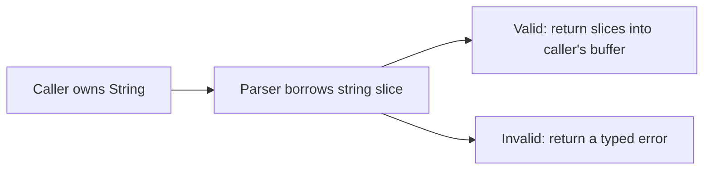
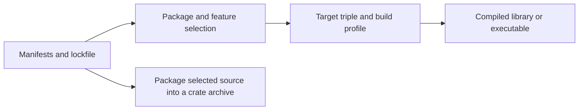
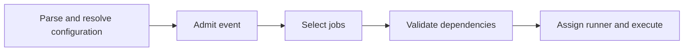
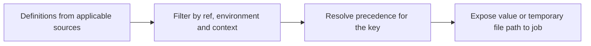

# Foundations · P0–P5

Read the relevant section before its exercise. The [roadmap](../../ROADMAP.md) sequences the work, and the concept guides explain the system you will apply it to.

## P0 · From Git event to job result

A **pipeline** is a graph of work for a particular event and ref. A **job** is an individual unit of work. A **stage** supplies default ordering between groups of jobs. GitLab builds the graph and makes jobs eligible. A **runner** requests work and orchestrates an assigned job. An **executor** provides its execution environment. A **shell** interprets the generated commands. The [architecture diagrams](../architecture/README.md) show both the component boundaries and the order of checkout, transfer, execution and cleanup.

A missing pipeline points toward configuration or event admission. A pending job has entered scheduling. A trace that reaches a shell command establishes that assignment and earlier preparation steps have occurred. Start investigating at the last boundary you can confirm. [Trace reading practice](../labs/p0-1-job-trace.md)

## P1 · Rust ownership and errors

An **owner** controls the lifetime of a value. Moving a non-Copy value such as a String transfers ownership, after which the old binding cannot be used for that value. A **borrow** gives temporary access through a reference. Shared references permit reading. A mutable reference gives exclusive access while that borrow is in use. A **lifetime** describes how long a reference can be used safely and can express a relationship between an input and a returned slice.

A **Result** carries either a success value or an error. The question-mark operator propagates an error from the current function. Compared with Java's pass-by-value of object references, passing an owned Rust String by value transfers ownership. A Rust trait defines shared behavior, broadly analogous to a Java interface, while an enum can carry different data in each variant and be handled exhaustively with a match. [Rust Book](https://doc.rust-lang.org/book/), [parser reading practice](../labs/p1-1-read-a-rust-library-and-cli.md)

## P2 · Cargo resolution and compilation

A **package** is described by Cargo.toml and can contain library or binary crate targets. A **crate** is a Rust compilation unit. A **workspace** groups packages under shared settings and a lockfile. **Cargo.lock** records the selected versions and sources. **Features** are additive capabilities requested by dependency edges. The same lockfile can support builds with different activated features.

The **target triple** identifies the destination platform. The **profile** controls compilation settings such as optimization and debug information. A workspace resembles a Maven reactor, while Cargo feature selection and locked resolution have their own rules. [Cargo Book](https://doc.rust-lang.org/cargo/), [resolution practice](../labs/p2-1-read-cargo-manifests-and-lockfile.md)

## P3 · GitLab configuration and job graphs

YAML defines mappings, lists and values. GitLab interprets those values as configuration. **Includes** bring other configuration into the pipeline definition. **Workflow rules** decide whether an event creates a pipeline. **Job rules** decide which jobs it contains. **Needs** expresses a prerequisite and can select artifact transfer. The shell interprets script strings only after Runner takes the job.

A YAML parser can accept a stage name that GitLab rejects. GitLab can accept a command string that the configured shell cannot execute. Check these layers separately. [GitLab YAML reference](https://docs.gitlab.com/ci/yaml/), [configuration practice](../labs/p3-1-read-a-complete-gitlab-ci-file.md)

## P4 · Variables and trust boundaries

**Eligibility** determines which variable definitions a job can receive. For example, a protected definition depends on the ref and context, and an environment-scoped definition must match the job's environment. **Precedence** then chooses among eligible definitions sharing a key. A project value can override the same key in repository YAML. A **file-type variable** gives the job a path to a temporary file, while an ordinary variable supplies its value directly. **Masking** affects log redaction and **hiding** affects UI retrieval. A process that receives the variable can still read it.

Review permissions separately. Permission to change repository YAML, edit a project variable, or administer a group are distinct decisions. [GitLab variables](https://docs.gitlab.com/ci/variables/), [precedence practice](../labs/p4-1-review-variable-permissions-and-precedence.md), [scope practice](../labs/p4-2-review-secret-and-scope-boundaries.md)

## P5 · Cache and artifact provenance

A **cache** is an optimization selected by key and retrieved from runner-local or distributed storage. A cache miss can be normal after a key change, and a hit only establishes that an archive was found. An **artifact** is output published by a job. A consumer can request a particular producer's output even on another host. Retention and access affect whether it is still retrievable.

Treat registry cache contents like reusable downloads in a Maven local repository. For a binary handoff, record the producing job and expected commit. A cross-project lookup by ref can select an earlier successful job while a newer one is still running. [GitLab caching](https://docs.gitlab.com/ci/caching/), [job artifacts](https://docs.gitlab.com/ci/jobs/job_artifacts/), [artifact practice](../labs/p5-2-trace-artifacts-and-dependency-edges.md)
