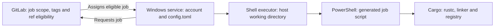
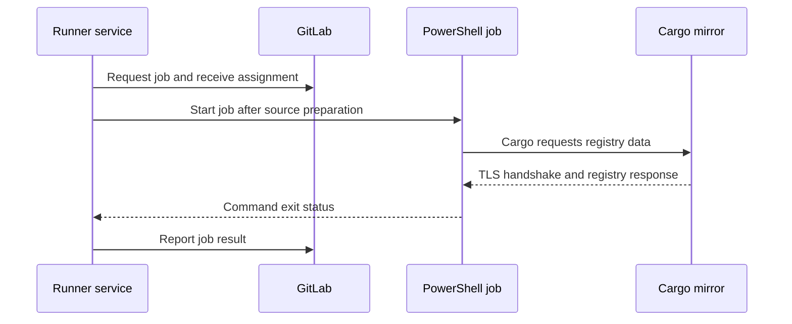

# Windows Shell Runner · Identity, execution and trust

GitLab decides whether a job is eligible for a runner. On a Windows host, the **Service Control Manager** starts the GitLab Runner process with a configured **service identity**, the Windows account whose permissions and process environment are inherited by the Shell job. **Runner registration** associates a manager with a GitLab runner record and stores its authentication material locally. Installing and starting a Windows service are separate operations. The **Shell executor** uses the host's installed tools. It does not create a container from the job's image setting. [Windows installation](https://docs.gitlab.com/runner/install/windows/), [Shell executor](https://docs.gitlab.com/runner/executors/shell/)

## Shell, tools and paths

The local configuration can select `pwsh` for PowerShell Core or `powershell` for Windows PowerShell. Check the job trace and actual version when diagnosing syntax, encoding or native argument differences. GitLab's generated PowerShell runs without loading a profile. A command added by an administrator's interactive profile is therefore poor evidence for a service job. Start with the service's account, executable lookup and the paths of the actual tools. Cargo may be available through a rustup shim while the service account still lacks the expected toolchain or MSVC linker environment. [GitLab Runner shells](https://docs.gitlab.com/runner/shells/)

Use `$env:CI_PROJECT_DIR` as the checkout root and `Join-Path` for child paths. Use `-LiteralPath` when a cmdlet must read an exact path. To run an executable named by a path variable, PowerShell uses its call operator `&`. Preserve argument boundaries by passing arguments separately. For line-based inputs, check the consumer's encoding and line-ending contract before treating a CRLF/LF difference as corruption.

PowerShell cmdlet failures and native process failures use different mechanisms. `-ErrorAction Stop` makes a cmdlet error terminating. For native tools, check `$LASTEXITCODE` immediately and propagate a failure before collecting outputs. Some PowerShell versions and settings can already turn a native failure into a terminating error. In either case the artifact step must be reachable only after successful compilation. This resembles checking Maven's process result before copying a JAR, with the extra need to account for PowerShell semantics. [PowerShell automatic variables](https://learn.microsoft.com/en-us/powershell/module/microsoft.powershell.core/about/about_automatic_variables), [PowerShell preference variables](https://learn.microsoft.com/en-us/powershell/module/microsoft.powershell.core/about/about_preference_variables)

## Network and certificate trust

A Windows job can involve multiple HTTPS clients. The Runner service contacts GitLab to request jobs. Git may contact a repository endpoint during checkout. Cargo contacts its registry or mirror, and scanners can contact separate vendor services. A successful request in one client does not establish connectivity or trust in another.

Read the failing client and URL from the trace, then separate name resolution, connectivity, proxy routing, TLS validation and HTTP authentication. Runner's GitLab CA configuration is not a general Cargo trust configuration. Cargo documents HTTP CA configuration through `http.ssl-cainfo` and `CARGO_HTTP_SSL_CAINFO`. The approved trust mechanism depends on the client and environment. Keep certificate verification enabled and use an approved CA bundle when the client requires one. [Runner TLS trust](https://docs.gitlab.com/runner/configuration/tls-self-signed/), [Cargo HTTP configuration](https://doc.rust-lang.org/cargo/reference/config.html#httpssl-cainfo)

## Where to look first

| Observation | First boundary to inspect |
|---|---|
| Job never assigned | GitLab scope, required tags, ref protection and capacity |
| Service cannot start | Windows service configuration, logon rights and Event Log |
| Job starts but cannot find Cargo | Service-context executable resolution and PATH |
| Cargo runs but cannot find the linker | Toolchain and native build tools in the service context |
| Cargo reports a mirror certificate error | The mirror endpoint, Cargo proxy route and Cargo CA trust |
| Build succeeds but executable is missing | Target triple, profile and collection path |

Apply the model in [P6.1 runner setup](../labs/p6-1-review-windows-runner-setup.md) and [P6.2 service-context diagnosis](../labs/p6-2-diagnose-windows-service-context.md).
