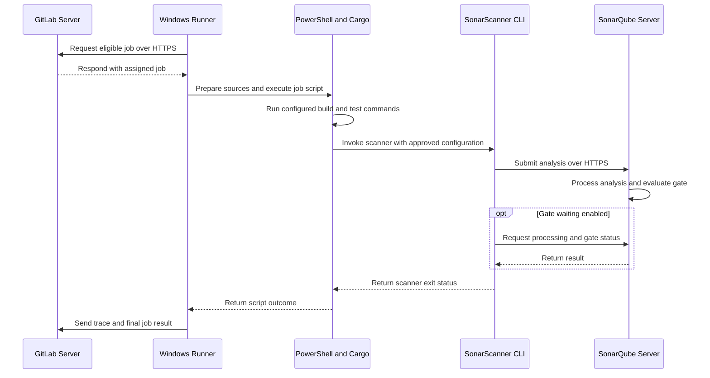
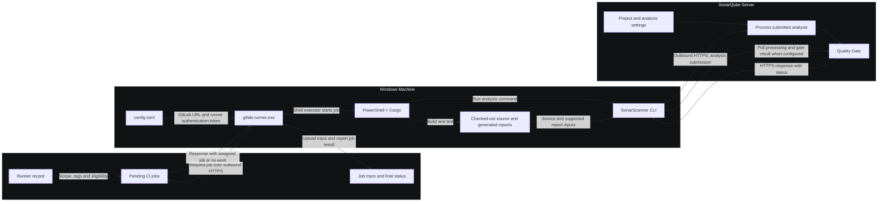

# GitLab, Windows Runner and SonarQube architecture

## Execution sequence

If a job remains pending, inspect GitLab routing and runner availability. If PowerShell cannot find the scanner, inspect the Windows job account and executable path. If analysis fails with a connection or certificate error, inspect the scanner-to-SonarQube path. If server processing succeeds but the gate fails, inspect the analysis and gate criteria before changing runner connectivity.

The diagram recreates the screenshot's GitLab Server and Windows Machine relationship and extends it with SonarScanner on Windows and a separate SonarQube server. It is an illustrative architecture. The screenshot does not establish where SonarQube is deployed, so this document assumes a service reachable from the Windows machine over HTTPS.

## Read the original connection

The Windows runner initiates the request for work. GitLab responds on that connection with an assigned job or a response indicating that no work was obtained. The response arrow represents the server's reply to the Windows request. The corresponding runner record in GitLab contains scope and routing information. The Windows `config.toml` contains the GitLab URL, runner authentication token and local execution settings.

Runner then starts the generated job script using the configured executor and shell. For the Shell executor shown here, PowerShell, Cargo and the scanner execute on the Windows host. They use the permissions and environment of the account running Runner, either an interactive user in a user-mode setup or a configured service identity. [GitLab runner registration](https://docs.gitlab.com/runner/register/), [Shell executor](https://docs.gitlab.com/runner/executors/shell/)

## Where SonarQube fits

SonarScanner CLI runs within the job and communicates with the SonarQube server. It reads the selected source and supported analysis inputs, submits analysis, and can wait for server processing and the Quality Gate. SonarQube stores and processes the analysis and evaluates the gate. The job command's exit result is then handled by the shell and Runner and reported to GitLab.

When `sonar.qualitygate.wait=true` is configured, scanner execution waits for the gate result. Review the timeout and failure policy so an analysis submission alone cannot be mistaken for a completed quality decision. Scanner/server compatibility, Rust support, coverage imports and branch or merge request analysis depend on the selected product versions and edition. [SonarScanner CLI](https://docs.sonarsource.com/sonarqube-server/analyzing-source-code/scanners/sonarscanner), [analysis parameters](https://docs.sonarsource.com/sonarqube-server/analyzing-source-code/analysis-parameters/)

## Configuration and credential boundaries

| Location | Responsibility |
|---|---|
| GitLab runner record | Scope, tags, protection and which jobs may be assigned |
| Windows `config.toml` | GitLab connection, runner authentication and executor/shell configuration |
| Repository `.gitlab-ci.yml` | Which jobs run, build/test commands, scanner invocation and failure handling |
| GitLab CI/CD settings or approved secret provider | Delivery of the Sonar credential to the eligible analysis job |
| Scanner/project configuration | SonarQube endpoint, project key and supported source/report parameters |
| SonarQube project settings | Analysis permissions, quality profiles and Quality Gate policy |

The runner authentication token and Sonar analysis token authorize access to different services. The Sonar credential must be authorized for the selected project. Each HTTPS client also needs appropriate network access and certificate trust. A successful Runner connection to GitLab does not establish that the scanner can reach or trust SonarQube. Follow the local [SonarScanner setup guide](sonar.md) for the related procedures, and the [Windows Runner concept guide](../../knowledge/concepts/windows-shell-runner.md) for service-account and TLS boundaries.

## Source screenshot

[Open the original screenshot](<Screenshot 2026-11-10 at 07.12.20.png>).

