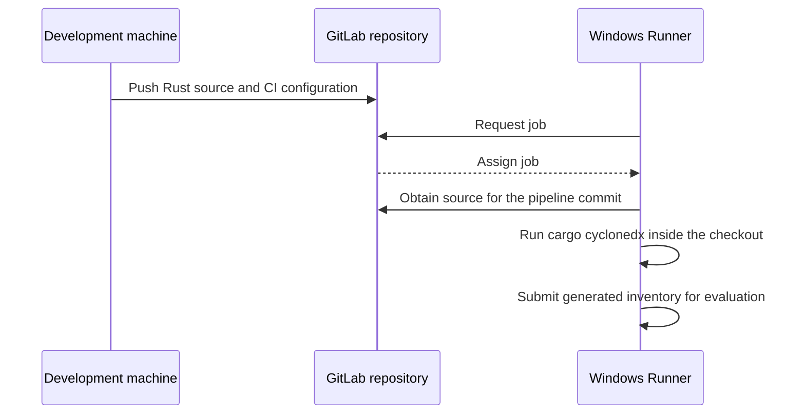

# Rust project location on the Windows runner

## Question 1

How 3.2 of [Integrating Nexus IQ & Fortify into a Rust GitLab pipeline on Windows] works as I have the rust project on a different machine than the runner?

## Answer 1

Your Rust project can stay on your development machine. **When a CI job runs, GitLab Runner obtains its own checkout from GitLab on the Windows runner machine.** The Shell executor runs the job commands inside that checkout. [GitLab Shell executor](https://docs.gitlab.com/runner/executors/shell/)

Section 3.2 combines two separate activities:

| Command | Where it belongs | Purpose |
|---|---|---|
| `cargo install cargo-cyclonedx --locked` | Windows runner machine, during tool setup | Installs the SBOM generator |
| `cargo cyclonedx --help` | Windows runner machine | Checks that the tool is available |
| `cargo cyclonedx --format json` | Inside the job’s checkout on the runner | Generates the project’s SBOM |

The execution flow is:

The section’s wording “inside your Rust project’s directory” refers to a **manual test**. For CI, section 3.6 places that generation command in `script`, where Runner normally starts in the project checkout. Local changes must be committed and pushed to be included.

One additional detail matters for Windows services: install or provision the generator so the **account running GitLab Runner** can find it. Installing it under your interactive administrator account may leave it unavailable to the service.

## Question 2

[Then, inside your Rust project's directory:] which machine exactly?

## Answer 2

**The Windows machine where GitLab Runner is installed.**

For a manual test, that machine needs a clone of your Rust repository, and you run the command in the directory containing `Cargo.toml`.

During CI, Runner obtains the checkout automatically and runs the command there.
