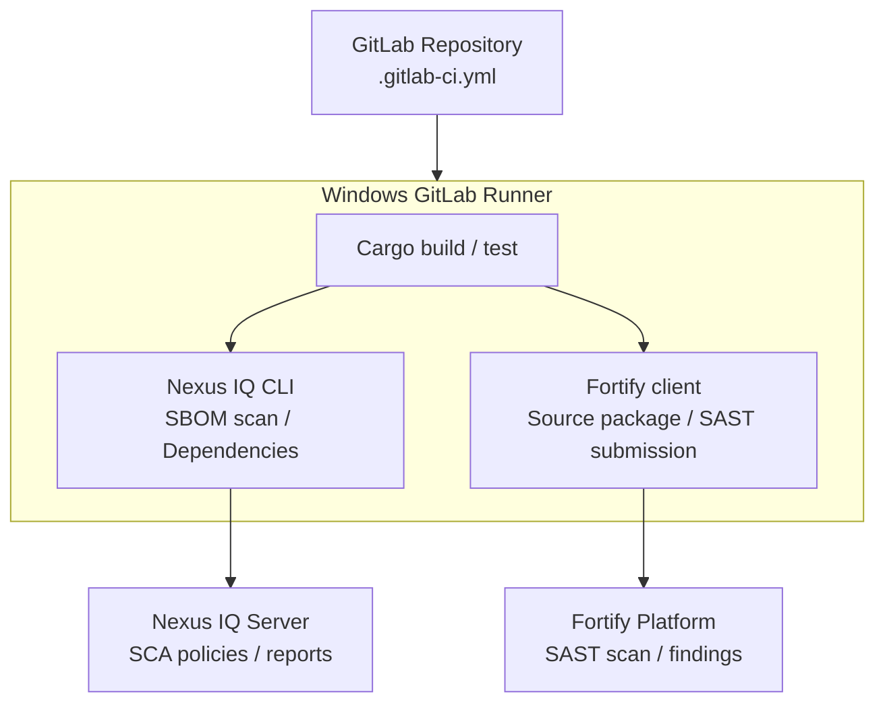
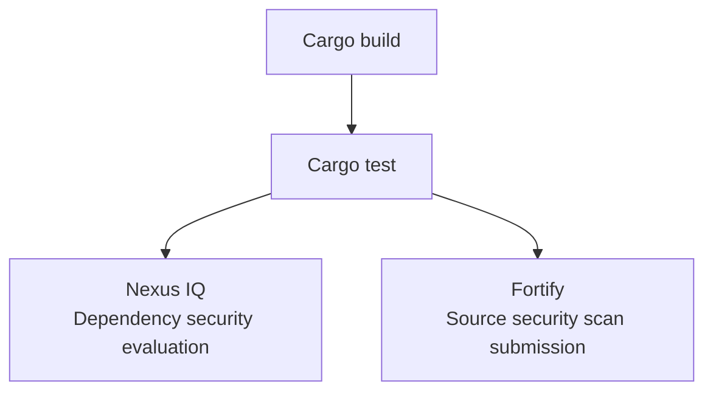

# Integrating Nexus IQ & Fortify into a Rust GitLab pipeline on Windows

**Target:** Your existing Windows GitLab Runner, using the Shell executor (PowerShell), with Rust/Cargo already installed.

The goal is to introduce two additional security validation jobs into your existing `.gitlab-ci.yml`:

- **Nexus IQ (Sonatype Lifecycle):** Software Composition Analysis (SCA), checking Rust dependencies for vulnerabilities and license-policy violations.
- **Fortify:** Static Application Security Testing (SAST), analyzing your Rust source code for potential security issues.

## 1. Target architecture



*Both scanner clients run on the Windows machine; the security platforms generally run remotely.*

## 2. What needs installing?

| Component | On Windows runner? | Purpose |
|---|---|---|
| Rust + Cargo | Already installed | Build and tests |
| GitLab Runner | Already installed | Executes CI jobs |
| Java JDK | Optional for Nexus IQ | Required for Java-based IQ CLI |
| `cargo-cyclonedx` | Yes | Generate Rust dependency SBOM |
| Nexus IQ CLI | Yes | Submit SBOM for policy evaluation |
| Nexus IQ Server | Normally no | Central SCA platform |
| Fortify `fcli` | Yes | Fortify authentication and automation |
| ScanCentral SAST Client | Usually yes | Package source for remote scanning |
| Fortify SSC / ScanCentral | Normally no | Central analysis infrastructure |

**Important distinction:** Nexus IQ and Fortify are not just local executables. In an enterprise environment, you normally install their clients on the runner and connect those clients to already-provisioned, licensed security services.

For Fortify, I will assume **OpenText Fortify Software Security Center (SSC) with ScanCentral SAST**. Fortify on Demand (FoD) has a different authentication and submission workflow.

---

## 3. Nexus IQ installation on Windows

### Step 3.1 — Check prerequisites

On the Windows machine, open PowerShell:

```powershell
rustc --version
cargo --version
java -version

Get-Command cargo
Get-Command java
```

Java is unnecessary if you select the Windows Nexus IQ CLI distribution with its bundled JDK.

### Step 3.2 — Install CycloneDX for Rust

Run:

```powershell
cargo install cargo-cyclonedx --locked
```

Validate:

```powershell
cargo cyclonedx --help
```

Then, inside your Rust project's directory:

```powershell
cargo cyclonedx --format json
```

This generates CycloneDX SBOM output for your Cargo project. The default output is placed alongside the relevant `Cargo.toml` files.

### Step 3.3 — Install Nexus IQ CLI

The simplest Windows option is the standalone distribution with a bundled JDK.

1. Open the [official Sonatype Windows CLI installation guide](https://help.sonatype.com/en/sonatype-iq-cli-with-bundled-jdk.html).
2. Download the Windows x86-64 ZIP.
3. Extract it, for example to `C:\Tools\nexus-iq`.
4. Locate `bin\nexus-iq-cli.bat`.

Run:

```powershell
& "C:\Tools\nexus-iq\bin\nexus-iq-cli.bat" --help
```

Alternatively, download the Java JAR and use `java -jar`. Both methods are documented by Sonatype.

### Step 3.4 — Configure Nexus IQ access

Your administrator needs to supply the Nexus IQ server URL, a valid application ID and a service-account token or credentials.

Test connectivity:

```powershell
Test-NetConnection iq.company.com -Port 443
```

Create the application in Nexus IQ and grant the service account permission to evaluate it.

Configure these in GitLab → **Settings → CI/CD → Variables**:

| Variable | Example | Secret? |
|---|---|---|
| `NEXUS_IQ_URL` | `https://iq.company.com` | No |
| `NEXUS_IQ_APP_ID` | `rust-demo` | No |
| `NEXUS_IQ_USER` | CI service account | Yes, preferably |
| `NEXUS_IQ_PASSWORD` | Service token/password | Yes, masked |

Sonatype recommends service accounts with minimum privileges for CI automation.

### Step 3.5 — Test a manual scan

From the directory containing your generated `bom.json`:

```powershell
$env:NEXUS_IQ_URL = "https://iq.company.com"
$env:NEXUS_IQ_APP_ID = "rust-demo"

# For a local manual test, obtain credentials securely.
# Avoid saving them in scripts or terminal history.

$auth = "$($env:NEXUS_IQ_USER):$($env:NEXUS_IQ_PASSWORD)"

& "C:\Tools\nexus-iq\bin\nexus-iq-cli.bat" `
    -s $env:NEXUS_IQ_URL `
    -i $env:NEXUS_IQ_APP_ID `
    -a $auth `
    ".\bom.json"

if ($LASTEXITCODE -ne 0) {
    throw "Nexus IQ evaluation failed"
}
```

Sonatype documents direct CycloneDX SBOM evaluation using its CLI.

For production, prefer the CLI's secure parameter-file or environment-variable mechanisms rather than command-line credentials, which can be visible in process arguments.

### Step 3.6 — Add Nexus IQ to `.gitlab-ci.yml`

This job assumes `cargo-cyclonedx` and the Nexus IQ CLI are installed on the runner, and the Rust project has one root `Cargo.toml`.

```yaml
nexus_iq_scan:
  stage: security
  tags:
    - windows
    - rust
  script:
    - |
      $ErrorActionPreference = "Stop"

      # Generate Rust dependency SBOM
      cargo cyclonedx --format json
      if ($LASTEXITCODE -ne 0) {
        throw "SBOM generation failed"
      }

      if (-not (Test-Path "bom.json")) {
        throw "bom.json not found"
      }

      # Execute Nexus IQ evaluation
      $auth = "${env:NEXUS_IQ_USER}:${env:NEXUS_IQ_PASSWORD}"
      $cli = "C:\Tools\nexus-iq\bin\nexus-iq-cli.bat"

      & $cli `
        -s $env:NEXUS_IQ_URL `
        -i $env:NEXUS_IQ_APP_ID `
        -a $auth `
        "bom.json"

      if ($LASTEXITCODE -ne 0) {
        throw "Nexus IQ evaluation failed"
      }

  artifacts:
    when: always
    paths:
      - bom.json
    expire_in: 7 days
```

If you have a Cargo workspace, you may get several BOM files instead of one; update the script to enumerate and evaluate the intended outputs.

This is a **real policy-evaluation job**, not just a connectivity check. Its failure behavior also depends on the configured Sonatype policies.

---

## 4. Fortify installation on Windows

Fortify requires more configuration than Nexus IQ because the available scanning capabilities depend on your licensed platform and scanner version.

### Step 4.1 — Verify Rust SAST support

Before installing anything, ask the Fortify administrator to confirm whether the organization's deployment supports Rust.

OpenText's 26.2 documentation identifies Rust among the languages supported by **AI-powered SAST**. This should not be confused with an assumption that every older, traditional Fortify SCA installation supports Rust.

Confirm the following:

- Fortify SSC URL and ScanCentral SAST controller availability.
- Sensor version and compatible ScanCentral Client version.
- Whether Rust AI-powered analysis is enabled and licensed.
- Application/version identifier and a CI authentication token.
- Whether source packages are permitted to leave the Windows runner.

### Step 4.2 — Install Fortify CLI (`fcli`)

Download the approved Windows distribution from [Fortify CLI releases](https://github.com/fortify/fcli/releases).

Extract it under a permanent directory, for example:

```text
C:\Tools\fortify\
    fcli\
        fcli.exe
    sc-client\
        ...
```

The exact extracted file structure depends on the release. Find the executable and test it:

```powershell
& "C:\Tools\fortify\fcli\fcli.exe" --version

& "C:\Tools\fortify\fcli\fcli.exe" --help
```

If your installation provides `fcli.bat` instead, use that launcher.

### Step 4.3 — Configure Fortify connectivity

Verify access to SSC:

```powershell
Test-NetConnection ssc.company.com -Port 443
```

In GitLab CI/CD variables configure:

| Variable | Purpose |
|---|---|
| `FORTIFY_SSC_URL` | SSC base URL |
| `FORTIFY_SSC_TOKEN` | CI automation token (masked) |
| `FORTIFY_APP_VERSION` | Target application/version |
| `FORTIFY_SENSOR_VERSION` | Compatible sensor version, if required |

Use a dedicated service account with restricted permissions.

### Step 4.4 — Authenticate to SSC

In PowerShell, assuming the variables are available:

```powershell
$fcli = "C:\Tools\fortify\fcli\fcli.exe"

& $fcli ssc session login `
    --url=$env:FORTIFY_SSC_URL `
    --token=$env:FORTIFY_SSC_TOKEN

if ($LASTEXITCODE -ne 0) {
    throw "Fortify login failed"
}
```

Validate the connection and sensor compatibility:

```powershell
& $fcli sc-sast sensor list --latest-only
```

Log out afterward:

```powershell
& $fcli ssc session logout
```

The Fortify CLI supports SSC sessions backed by service tokens and recommends logging out after CI operations.

### Step 4.5 — Install ScanCentral SAST Client

Once you know the compatible client version:

```powershell
& $fcli tool sc-client install `
    -v "<compatible-version>" -y
```

Verify that the client was installed:

```powershell
& $fcli tool sc-client list

& $fcli tool sc-client run -- package -h
```

The client can be installed through `fcli`; versions should match the ScanCentral sensors used on the server.

### Step 4.6 — Package the Rust source

From the Rust project root:

```powershell
& $fcli tool sc-client run -- `
    package -o fortify-package.zip

if ($LASTEXITCODE -ne 0) {
    throw "Fortify packaging failed"
}
```

Check the package:

```powershell
Test-Path ".\fortify-package.zip"
```

**Rust-specific caution:** This is a starting packaging command, not proof of Rust analysis support. Your Fortify deployment may require an AI-powered SAST-specific configuration or a different package preparation process. Verify that the package actually contains the Rust source files and that the server accepts the scan type.

For an enterprise environment, do not submit source code until its transfer to Fortify is approved under your organization's data-classification rules.

### Step 4.7 — Submit the scan

```powershell
& $fcli sc-sast scan start `
    --file="fortify-package.zip" `
    --publish-to=$env:FORTIFY_APP_VERSION

if ($LASTEXITCODE -ne 0) {
    throw "Fortify submission failed"
}
```

The current Fortify CLI supports `sc-sast scan start` for submitting source packages and publishing results to a configured application version.

Note that a successful submission does not necessarily mean the scan has finished or passed the organization's security gates.

## 5. Add Fortify to `.gitlab-ci.yml`

The example below logs in, packages the source, starts the scan and logs out. It uses a job-specific CLI state directory to reduce credential/session interference on a shared Windows runner.

```yaml
fortify_sast_scan:
  stage: security
  tags:
    - windows
    - rust
  script:
    - |
      $ErrorActionPreference = "Stop"

      $fcli = "C:\Tools\fortify\fcli\fcli.exe"

      # Isolate session state for this job
      $env:FCLI_STATE_DIR = Join-Path $env:CI_PROJECT_DIR ".fcli-state"

      try {
        # Authenticate
        & $fcli ssc session login `
          --url=$env:FORTIFY_SSC_URL `
          --token=$env:FORTIFY_SSC_TOKEN

        if ($LASTEXITCODE -ne 0) {
          throw "Fortify authentication failed"
        }

        # Prepare source package
        & $fcli tool sc-client run -- `
          package -o fortify-package.zip

        if ($LASTEXITCODE -ne 0) {
          throw "Fortify packaging failed"
        }

        # Submit scan
        & $fcli sc-sast scan start `
          --file="fortify-package.zip" `
          --publish-to=$env:FORTIFY_APP_VERSION

        if ($LASTEXITCODE -ne 0) {
          throw "Fortify scan submission failed"
        }
      }
      finally {
        & $fcli ssc session logout

        Remove-Item $env:FCLI_STATE_DIR `
          -Recurse -Force -ErrorAction SilentlyContinue
      }
```

**Limitations of this first version:**

The job confirms that the package was accepted for submission. It does not wait for completion, inspect findings, or enforce a Fortify security gate. Those should be added using a version-compatible Fortify CI action or scan-status/policy workflow.

Also, never upload `fortify-package.zip` as a broadly accessible GitLab artifact: it may contain proprietary application source code.

---

## 6. Complete GitLab CI pipeline

Here is how the two jobs fit together with your existing Rust validation pipeline.

```yaml
stages:
  - build
  - test
  - security

default:
  tags:
    - windows
    - rust

variables:
  CARGO_TERM_COLOR: "always"

cargo_build:
  stage: build
  script:
    - |
      cargo build --locked
      if ($LASTEXITCODE -ne 0) {
        throw "Cargo build failed"
      }

cargo_test:
  stage: test
  script:
    - |
      cargo test --locked
      if ($LASTEXITCODE -ne 0) {
        throw "Cargo tests failed"
      }

# Add the nexus_iq_scan job from section 3.6
# Add the fortify_sast_scan job from section 5
```

This uses stage ordering so that security validation runs after build and test. GitLab jobs within the same stage can execute in parallel when runner capacity permits.

The resulting sequence is:



## 7. Verification checklist

Validate each layer before enabling its job in the pipeline.

- [ ] **Runner executes PowerShell** — GitLab job starts on Windows
- [ ] **Rust and Cargo are available** — `cargo --version` succeeds
- [ ] **CycloneDX is installed** — `cargo cyclonedx --help` succeeds
- [ ] **Nexus IQ CLI is installed** — CLI help command succeeds
- [ ] **Nexus IQ server is reachable** — TLS connection succeeds
- [ ] **Nexus IQ evaluates an SBOM** — Report appears under the correct application
- [ ] **Fortify fcli is installed** — `fcli --version` succeeds
- [ ] **Fortify SSC authentication works** — SSC session login succeeds
- [ ] **ScanCentral Client is compatible** — Client version matches sensor requirements
- [ ] **Rust package is accepted** — Fortify starts the intended Rust SAST analysis
- [ ] **Scan completes** — Results appear for the correct application version
- [ ] **Security policies are enforced** — A disallowed finding causes CI failure

## 8. Recommended implementation order

| Phase | Scope | Difficulty |
|---|---|---|
| P1 | Install CycloneDX and generate Rust SBOM | Low |
| P2 | Install Nexus IQ CLI and connect to IQ Server | Medium |
| P3 | Add and validate Nexus IQ CI job | Medium |
| P4 | Install Fortify CLI and connect to SSC | Medium |
| P5 | Verify Rust SAST support and package source | High |
| P6 | Submit Fortify scan from GitLab CI | Medium |
| P7 | Wait for scan completion and enforce security gates | High |

For your Rust GitLab Runner learning project, **I would implement Nexus IQ first**, because dependency scanning through CycloneDX provides a more straightforward Rust integration.

Fortify is the more uncertain integration: you need to verify your organization's licensed Rust scanning capability before considering the CI job production-ready.

One final distinction matters: **a working scanner installation is not equivalent to a working security gate**. Your end state should verify three separate things: the tool executes, the remote platform analyzes the correct project, and the pipeline fails when the configured security policy is violated.

Documentation: [Sonatype IQ CLI](https://help.sonatype.com/en/sonatype-iq-cli.html) · [Fortify CLI](https://fortify.github.io/fcli/) · [Cargo CycloneDX](https://github.com/CycloneDX/cyclonedx-rust-cargo)
