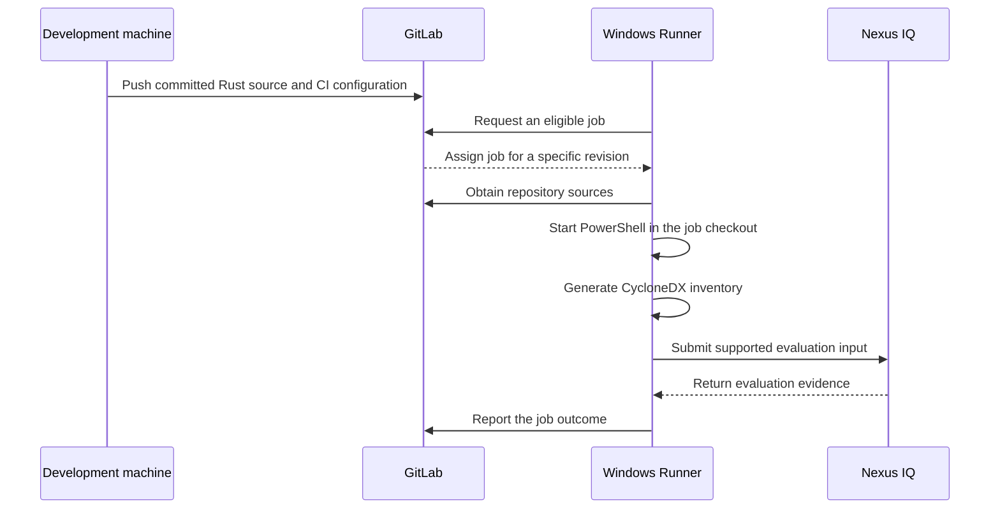

# Where CycloneDX runs when the Rust project is on another machine

In [section 3.2 of the Nexus IQ and Fortify integration guide](rust_gitlab_nexus_iq_fortify_windows.md#step-32--install-cyclonedx-for-rust), “inside your Rust project's directory” means **a project checkout on the Windows machine where GitLab Runner executes the job**.

Your development machine and the runner can hold separate checkouts of the same repository. GitLab connects the two through the committed source. The runner operates on the pipeline's selected revision.

## Which machine performs each task?

| Activity | Machine and context |
|---|---|
| Edit Rust code and `.gitlab-ci.yml` | Your development machine |
| Commit and push the changes | Your development machine sends them to GitLab |
| Store the repository and coordinate jobs | GitLab server |
| Install or provision `cargo-cyclonedx` for Shell jobs | Windows runner machine, with the tool available to the runner's account |
| Generate the SBOM during a manual check | Windows runner machine, inside a separately obtained project clone |
| Generate the SBOM during CI | Windows runner machine, inside the job's checkout |
| Evaluate the submitted dependency evidence | The configured Nexus IQ integration and server |

The distinction is between **installing a tool** and **running it against a project**. Installation makes the Cargo subcommand available. Generation reads the project metadata from the selected checkout. [GitLab Shell executor](https://docs.gitlab.com/runner/executors/shell/), [CycloneDX Rust generator](https://github.com/CycloneDX/cyclonedx-rust-cargo)

## Manual interpretation of section 3.2

These commands are illustrative and unexecuted. They explain the guide's procedure.

On the Windows runner machine, the installation step is:

```powershell
cargo install cargo-cyclonedx --locked
cargo cyclonedx --help
```

For a manual generation check, that machine also needs a clone of the Rust repository. Suppose an operator has obtained a clone at the following fictional path:

```powershell
Set-Location -LiteralPath 'C:\Projects\ledger-gateway'
Get-Item -LiteralPath 'Cargo.toml' -ErrorAction Stop
cargo cyclonedx --format json
if ($LASTEXITCODE -ne 0) {
    throw 'SBOM generation failed'
}
```

The directory must be the intended Cargo project or workspace location. Confirm the generator's output naming and workspace behavior for the approved version. The input revision is whichever commit the manual clone has checked out. A manual result made under an administrator account establishes that account's environment, while a runner service job may use a different account and PATH.

## What changes during a CI job?

Under normal source checkout configuration, Runner obtains the pipeline revision from GitLab before starting the job's `script`. The script starts in the project's checkout directory. GitLab exposes its path through `CI_PROJECT_DIR`. Source strategies such as `GIT_STRATEGY: none` or `empty` change those assumptions and require a deliberate source-provisioning design. [GitLab source handling](https://docs.gitlab.com/ci/runners/configure_runners/#git-strategy)



An illustrative job fragment makes the location explicit:

```yaml
nexus_iq_scan:
  stage: security
  tags: [windows, rust]
  script:
    - |
      Set-Location -LiteralPath $env:CI_PROJECT_DIR -ErrorAction Stop
      Get-Item -LiteralPath 'Cargo.toml' -ErrorAction Stop | Out-Null
      cargo cyclonedx --format json
      if ($LASTEXITCODE -ne 0) {
        throw 'SBOM generation failed'
      }
```

This fragment assumes the enclosing pipeline defines the `security` stage and an eligible Windows Shell runner with PowerShell Core, Cargo and the approved generator. It demonstrates generation; the evaluation command and its supported input contract belong to the [integration guide](rust_gitlab_nexus_iq_fortify_windows.md#step-36--add-nexus-iq-to-gitlab-ciyml).

GitLab Runner manages the job checkout, so the operator normally does not manually clone the repository for every CI run. Committed and pushed files are available at the selected revision. Local edits that exist only on the development machine are outside that checkout. Untracked local settings or generated files need an explicit, approved provision or artifact handoff if a job requires them.

## Windows service identity

For the Shell executor, installed tools must be accessible in the environment of the account running Runner. A typical `cargo install` places executables under the invoking user's Cargo home. Installing under an administrator's account may therefore leave `cargo-cyclonedx` unavailable to a separate service identity.

The relevant runtime evidence is the job account, resolved Cargo and generator commands, and the actual project directory. A successful interactive check and a successful service job are separate observations. See the [Windows Runner concept guide](../../knowledge/concepts/windows-shell-runner.md) for the account, PATH and toolchain relationships.

The sequence in section 3.2 therefore has two uses: an operator can test generation manually in a clone on Windows, and the CI script can perform generation in Runner's own checkout. Both operate on source present on the Windows execution machine.
