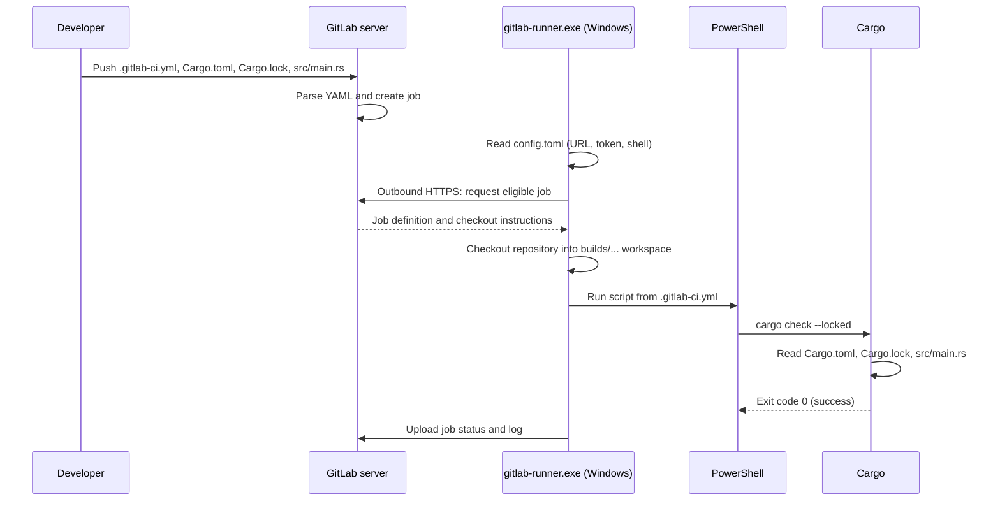

# GitLab Runner on Windows — Files, folders, locations and ownership

**Scenario:** One Windows machine, no Windows administrator rights, no permanent environment-variable changes, a GitLab project with a one-job `cargo check --locked` pipeline. The GitLab Runner uses the **Shell executor** and **Windows PowerShell** and runs in a terminal, not as a Windows service.

## 1. The three locations to distinguish

1. **GitLab server:** stores your repository, `.gitlab-ci.yml`, runner record, CI job history and logs. It does **not** need a path or URL pointing to the Windows machine.
2. **Windows runner folder:** stores `gitlab-runner.exe` and the runner's local configuration, including the secret authentication token. The runner connects **outbound** to GitLab.
3. **Windows Rust installation and job workspace:** Cargo/Rust executables and the temporary checkout of the repository. Cargo reads the checked-out `Cargo.toml` and `Cargo.lock`.

The Windows runner is the *execution agent*, not the project source of truth. The project files live in GitLab and are checked out when a job runs.

## 2. Suggested folder tree (illustrative)

```text
C:\Users\<you>\
├── gitlab-runner-lab\
│   ├── gitlab-runner.exe              # downloaded manually; keep
│   ├── config.toml                    # created by registration; SECRET; keep
│   ├── .runner_system_id              # runner-generated machine identity; if present
│   ├── builds\                        # job workspaces; generated when jobs run
│   │   └── ...\                       # actual layout varies by runner/configuration
│   │       └── your-repository\       # temporary Git checkout
│   │           ├── .gitlab-ci.yml
│   │           ├── Cargo.toml
│   │           ├── Cargo.lock
│   │           ├── src\main.rs
│   │           └── target\            # Cargo-generated build data, if created
│   └── cache\                         # possible runner-local cache area
├── .cargo\                            # typical rustup user installation
│   ├── bin\
│   │   ├── cargo.exe
│   │   ├── rustc.exe
│   │   └── rustup.exe
│   ├── registry\                       # registry metadata/cache, when needed
│   └── git\                            # Cargo Git dependency cache, when needed
└── .rustup\                            # installed toolchains and rustup metadata
    └── toolchains\...
```

**Important:** This tree is a conceptual example, not a promise of exact paths. The job checkout layout depends on runner settings, version and `--working-directory`; Rust may be installed somewhere else. `target/` normally appears in the checkout root for this single-crate example, unless `CARGO_TARGET_DIR` or Cargo configuration changes it. `.runner_system_id` may be generated in the runner configuration directory. The `builds/` and `cache/` directories may be elsewhere if configured.

## 3. Main files and who creates them

| File / folder | Usually resides | Created by | Purpose | Keep / commit? |
|---|---|---|---|---|
| `gitlab-runner.exe` | `~/gitlab-runner-lab/` | You download it | Runner application: registers, polls GitLab, executes jobs | Keep locally; **don't commit** |
| `config.toml` | Runner config directory, explicitly set with `--config` | `gitlab-runner register` | GitLab URL, token, executor, shell, optional build/cache settings | Keep securely; **never commit** |
| `.runner_system_id` | Runner config directory (when generated) | Runner | Identifies the local runner manager/system | Keep with local runner state; don't commit |
| `cargo.exe` | Often `~/.cargo/bin/` | Rust installer/rustup | Cargo package/build command | Keep installed; don't commit |
| `rustc.exe` | Often `~/.cargo/bin/` | Rust installer/rustup | Rust compiler (may be a rustup proxy) | Keep installed; don't commit |
| `rustup.exe` | Often `~/.cargo/bin/` | Rust installer/rustup | Manages Rust toolchains | Keep installed; don't commit |
| `Cargo.toml` | GitLab repository root; checked out into `builds/` | You | Rust package manifest and dependencies | **Commit** |
| `Cargo.lock` | GitLab repository root; checked out into `builds/` | Cargo (`generate-lockfile`) | Resolved dependency versions | **Commit** for this application |
| `src/main.rs` | GitLab repository `src/`; checked out into `builds/` | You | Minimal Rust application | **Commit** |
| `.gitlab-ci.yml` | GitLab repository root; checked out into `builds/` | You | Pipeline definition; GitLab reads it to create jobs | **Commit** |
| `target/` | Job checkout or configured target dir | Cargo | Intermediate build/check outputs | Usually don't commit; may cache deliberately |
| `builds/` | Runner working area | Runner | Git checkout and job workspace | Generated; don't commit |
| `cache/` | Runner-defined cache location | Runner | Reusable CI cache data, if configured | Generated; don't commit |
| `.git/` | Within checked-out project | Git / Runner | Checkout metadata | Generated in job; not a separate tracked file |

`~` here means the current Windows user's home directory, e.g. `C:\Users\Alice`. The table describes the **local runner**, not GitLab's own server-side storage.

## 4. `config.toml`: the key connection file

Registration associates a GitLab-side runner record with the Windows runner manager. A simplified local example:

```toml
concurrent = 1

[[runners]]
  name = "windows-cargo-local"
  url = "https://gitlab.example.com/"
  token = "glrt-REDACTED"
  executor = "shell"
  shell = "powershell"
```

- `url` is **GitLab's URL**, not the Windows machine's address.
- `token` authenticates the runner to GitLab. It is a **secret**; never paste the real value into issues, screenshots or Git.
- `executor = "shell"` means the job runs directly on Windows.
- `shell = "powershell"` selects Windows PowerShell; use `pwsh` only if you intentionally configure PowerShell 7.
- `concurrent = 1` limits total concurrent jobs for this runner process in this simple lab.

This is a **minimal illustrative fragment**. Registration may write other fields. Do not replace the generated file blindly. Runner tags such as `windows-cargo` are managed in GitLab, not normally in this TOML file.

### Why `--config` matters

A runner launched from a nonstandard directory might otherwise look for configuration in a different default location. Use an explicit config path consistently for both registration and execution:

```powershell
$runnerDir = Join-Path $HOME 'gitlab-runner-lab'
Set-Location $runnerDir
.\gitlab-runner.exe register --config .\config.toml
.\gitlab-runner.exe run --config .\config.toml --working-directory .
```

The `register` command asks for the GitLab URL, runner authentication token and `shell` executor. The final `run` command **keeps running** and requests jobs. You do not install a Windows service.

## 5. Cargo files: where they come from

For a minimal repository:

```text
repository/
├── .gitlab-ci.yml
├── Cargo.toml
├── Cargo.lock
└── src/
    └── main.rs
```

**`Cargo.toml`:**

```toml
[package]
name = "hello_cargo_ci"
version = "0.1.0"
edition = "2021"

[dependencies]
```

**`src/main.rs`:**

```rust
fn main() {
    println!("Hello from Cargo CI!");
}
```

Run `cargo generate-lockfile` in the repository once, then commit `Cargo.lock` alongside the other source files. `cargo check --locked` requires the lockfile to be consistent with the manifest; it does not silently rewrite it.

**`.gitlab-ci.yml`:**

```yaml
stages:
  - test

cargo_check_windows:
  stage: test
  tags:
    - windows-cargo
  script:
    - 'cargo --version'
    - 'rustc --version'
    - 'cargo check --locked'
    - 'if ($LASTEXITCODE -ne 0) { throw "Cargo check failed" }'
```

The tag must match the runner's GitLab-side tags. GitLab reads the committed YAML, assigns the job to an eligible runner, and the runner checks out the repository into its workspace before invoking PowerShell.

## 6. Execution flow: which file is read at each point?



**Key distinction:** `.gitlab-ci.yml` is the *recipe* stored in GitLab. `config.toml` is the *runner connection and execution configuration* stored on Windows. `Cargo.toml` is the *Rust project's build manifest* stored in the repository. They solve different problems.

## 7. No-admin and no-permanent-PATH operation

For this lab, store the runner executable and configuration in a directory you own, e.g. `$HOME\gitlab-runner-lab`. Start the runner from an ordinary PowerShell window.

If Rust is installed under `$HOME\.cargo\bin` but Cargo is not already available on PATH, use a **temporary change only in the PowerShell process launching the runner**:

```powershell
$env:PATH = "$(Join-Path $HOME '.cargo\bin');$env:PATH"
$runnerDir = Join-Path $HOME 'gitlab-runner-lab'
Set-Location $runnerDir
.\gitlab-runner.exe run --config .\config.toml --working-directory .
```

This environment is inherited by the runner's child job processes. It **does not** change Windows user or system environment variables permanently. Alternatively, configure a managed Rust installation already accessible to the user; no PATH edit is then needed.

**Caveat:** Installing Rust may still be constrained by corporate application-control policies or prerequisites (such as the MSVC toolchain). A user-local Rust installation is possible in many environments, but not guaranteed on a locked-down corporate laptop. For a basic `cargo check`, choose a toolchain compatible with the machine and its available build dependencies.

## 8. How to locate the real files on your machine

Run in a normal PowerShell terminal:

```powershell
# Runner executable and config
Get-ChildItem (Join-Path $HOME 'gitlab-runner-lab') -Force

# Where PowerShell resolves the Cargo command
Get-Command cargo -ErrorAction SilentlyContinue

# Check common Rust locations
Test-Path (Join-Path $HOME '.cargo\bin\cargo.exe')
Test-Path (Join-Path $HOME '.rustup\toolchains')

# Check runner registration/connectivity
Set-Location (Join-Path $HOME 'gitlab-runner-lab')
.\gitlab-runner.exe verify --config .\config.toml
```

`verify` checks the runner's GitLab registration/connectivity; it does **not** prove that the Windows machine can execute a Cargo job. The CI job itself is the definitive test.

For a running job, the GitLab job log typically prints its working directory and checkout path. You can temporarily add `Get-Location` and `Get-Command cargo` to the CI script for diagnostics. **Avoid printing `config.toml` or tokens into logs.**

## 9. Persistence and cleanup

| Item | When the terminal closes | When the machine restarts | Delete manually? |
|---|---|---|---|
| `gitlab-runner.exe` | Remains on disk | Remains on disk | Only when uninstalling lab |
| `config.toml` | Remains on disk | Remains on disk | Only when retiring runner; revoke runner/token in GitLab |
| Running runner process | Stops | Does not auto-start | N/A |
| Cargo/rustup installation | Remains on disk | Remains on disk | Only if uninstalling Rust |
| `builds/`, `target/`, `cache/` | May remain | May remain | Clean carefully when jobs are stopped |
| GitLab repository / pipeline logs | Remain on GitLab per retention policies | Unaffected | Governed in GitLab |

A Shell runner may retain workspace files across jobs; do not treat its workspace as a secure isolation boundary. Use only trusted projects on this learning machine. GitLab Runner can also remove or overwrite working-tree files during checkout/cleanup; **never store personal files inside its build directories**.

## 10. Final mental model

| Question | Answer |
|---|---|
| Where is the Windows machine's URL entered in GitLab? | **Nowhere.** The runner calls GitLab over outbound HTTPS. |
| What links the Windows runner to GitLab? | The GitLab URL and runner authentication token in `config.toml`, associated with the runner record. |
| Which file decides what job to execute? | `.gitlab-ci.yml` in the GitLab repository. |
| Which file defines the Rust package? | `Cargo.toml`; `Cargo.lock` pins resolved dependencies. |
| Who downloads the project onto Windows? | GitLab Runner, using its Git checkout workflow. |
| Where does Cargo run? | Inside the runner's job workspace, through PowerShell. |
| Must `gitlab-runner.exe` be installed as a service? | **No.** For this lab, run it directly in a normal terminal. |
| Must Windows environment variables be permanently modified? | **No.** Use an existing PATH or a temporary `$env:PATH` for the runner process. |

**Success condition:** `gitlab-runner.exe` stays running; GitLab shows the runner online; the `windows-cargo` job checks out the repository; `cargo check --locked` exits successfully.

**References:** [GitLab Runner configuration](https://docs.gitlab.com/runner/configuration/advanced-configuration/) · [GitLab Runner commands](https://docs.gitlab.com/runner/commands/) · [Shell executor](https://docs.gitlab.com/runner/executors/shell/) · [Cargo manifest](https://doc.rust-lang.org/cargo/reference/manifest.html)
