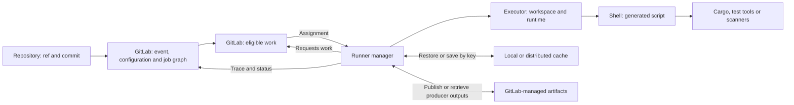
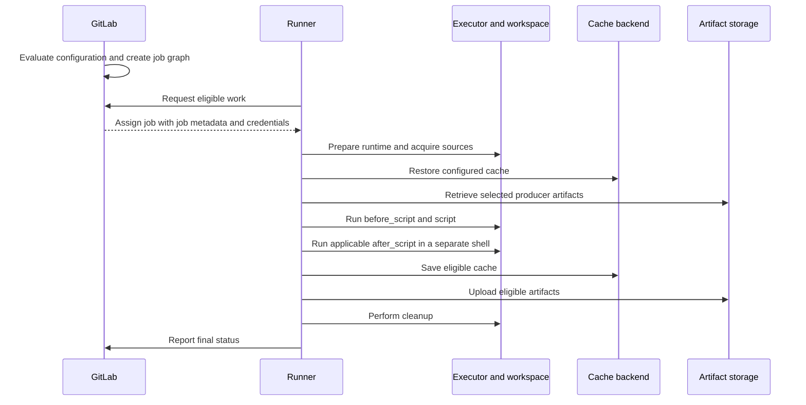

# P0.02 · Components and execution flows

## 2. Responsibilities, relationships and usage

Three separate decisions explain most early pipeline failures. First, GitLab evaluates whether the event is admitted and which jobs are included. Second, graph prerequisites determine when an included job can be offered. Third, an available runner must match the job's scope, tags and protected-ref requirements. A job can be present in the graph and still have no matching runner. Conversely, adding runner capacity cannot make a job excluded by rules appear. Use stage ordering for broad phase barriers and explicit graph edges where a consumer has a narrower dependency. [GitLab workflow](https://docs.gitlab.com/ci/yaml/workflow/), [job rules](https://docs.gitlab.com/ci/jobs/job_rules/), [runner routing](https://docs.gitlab.com/ci/runners/configure_runners/)

The runner initiates requests to GitLab. With **long polling**, a request can be held while there is no suitable work, then released on a queue change or timeout. GitLab's documented implementation uses Workhorse notifications backed by Redis. Treat those as server implementation details when diagnosing a deployment. From the job's perspective the important distinction is between a request that did not obtain work and a job that was assigned and subsequently failed. Check runner availability and request capacity as well as eligibility when analyzing queue delays. [GitLab long polling](https://docs.gitlab.com/ci/runners/long_polling/)

## 3. Execution, communication and alternate paths

The following sequence is the successful path for a job configured to transfer files. Hooks, secrets, source handling, cache and artifact steps depend on configuration and the outcome of earlier steps.

Runner prepares the executor and obtains external secrets if configured. Source acquisition depends on the Git strategy and can involve fetch, checkout, hooks and submodules. Cache restoration happens before artifact downloads. A cold cache can be normal, while a required artifact that cannot be downloaded can prevent the script from starting. When configured, the main shell runs `before_script` and `script` together. An applicable `after_script` runs in a new shell context. Files in the workspace can persist between those contexts, while a variable set by the main script does not automatically carry over. Finalization can save cache, upload artifacts and clean up file variables. A successful tool invocation alone does not establish that the job completed or that its output was published. [GitLab job execution flow](https://docs.gitlab.com/ci/jobs/job_execution/), [after_script](https://docs.gitlab.com/ci/yaml/#after_script)

The runner authentication token identifies the runner to GitLab. The **CI job token** is issued for a job and gives limited access while that job runs. They serve different identities. Keep both out of diagnostic output. Runner streams job trace output during execution and reports the result separately. For example, a trace can show a completed compiler invocation followed by an artifact upload failure. [Runner registration](https://docs.gitlab.com/runner/register/), [CI job token](https://docs.gitlab.com/ci/jobs/ci_job_token/), [job logs](https://docs.gitlab.com/ci/jobs/job_logs/)

| Alternate path | Boundary and evidence |
|---|---|
| Event rejected or configuration invalid | Check the event, configuration errors and effective workflow. There may be no runnable graph to inspect. |
| Job omitted or waiting for prerequisites | Check job rules and the graph. An omitted job has no execution. A job waiting on its producer has a different cause from one waiting for runner assignment. |
| Job pending for assignment | Check eligible runner scope, all required tags, ref protection and available capacity. Checkout has not started. |
| Source acquisition fails | An assigned runner attempted to prepare sources. Normal cache restore, artifact download and main script do not proceed after the failed source step. |
| Main script fails | Use the first failing command and exit status. Finalization and uploads may still occur under their own conditions. |
| Job canceled | Before assignment there is no execution to finalize. After assignment, work may be interrupted. Whether finalization runs depends on the cancellation path, job state and deployed GitLab and Runner versions. Verify the trace and final status. |

Previous: [Concepts](01-concepts.md). Next: [Enterprise architecture](03-enterprise-architecture.md).
