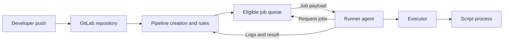

# P0.1 — The vocabulary of enterprise CI/CD

> **Purpose:** Build a precise mental model before reading YAML or operating a runner. This chapter defines entities; it does not teach installation.

## 1. Continuous integration and continuous delivery

**Continuous integration (CI)** means integrating changes frequently and using automated checks to detect regressions. A CI pipeline might compile Rust crates, run unit tests, lint code, and assess dependencies. **Continuous delivery (CD)** keeps a tested release candidate ready for deployment; **continuous deployment** goes further and deploys qualifying changes automatically. Neither term implies a particular tool.

A *pipeline* is GitLab's execution graph for a particular event and context (for example, a push or merge request). A *job* is an executable unit within that graph. A *stage* is a coarse ordering mechanism; jobs in the same stage can run concurrently if runners are available. The `needs` keyword adds explicit directed dependencies and can allow a job to start before an entire preceding stage finishes.

| Term | Precise meaning | Common misconception |
|---|---|---|
| Pipeline | Set of jobs created from evaluated CI configuration | A pipeline is not a running process on one machine |
| Job | A unit GitLab queues and a runner executes | A job is not the same as a shell command |
| Stage | Ordering/grouping label | Stages are not physical servers |
| Script | Shell commands in a job | GitLab server does not execute these commands |
| Runner | Agent that acquires and executes jobs | Runner is not synonymous with Windows host |
| Executor | Runner strategy for creating an execution environment | A shell executor is not a container |
| Artifact | Persisted job output for later retrieval/use | Artifact is not a cache |
| Cache | Best-effort reusable files to accelerate jobs | Cache is not guaranteed to exist |

## 2. Distinguish control plane and execution plane

The **GitLab server** holds repositories, users, project settings, pipeline records, job state, and CI configuration. It decides which jobs are eligible to run and exposes job requests through its API. The **runner** is a separately deployed agent that contacts GitLab, requests eligible work, prepares an execution environment, runs commands, and reports status and logs. The **executor** determines how that environment is prepared: shell, Docker, Kubernetes, and other supported options have different isolation properties.



**Why this matters:** If a job is pending, inspecting the Cargo build script is premature. If a script fails after checkout, debugging pipeline creation rules is usually premature. Correct diagnosis starts by locating the failing boundary.

## 3. Configuration surfaces

`.gitlab-ci.yml` describes pipeline behavior and jobs. Included YAML files may contribute additional configuration. `config.toml` describes runner-side settings on the runner host. GitLab project/group UI or API stores access controls, variables, runner associations, and policies. The operating system controls the service account, PATH, filesystem, certificate trust, and installed toolchains. `Cargo.toml` defines Rust package metadata, dependencies, features, and targets; `Cargo.lock` records resolved versions.

| Question | Start looking in |
|---|---|
| Why was no pipeline created? | `workflow:rules`, trigger context, project CI configuration |
| Why is a job pending? | Runner eligibility, tags, protection, runner status, capacity |
| Why does `cargo` not resolve? | Runner host PATH, executor image/environment |
| Where is a scanner token defined? | Project/group variables or approved secret integration |
| Why was a dependency downloaded again? | Cache keys, cache availability, Cargo paths, runner storage |

## 4. The meaning of 'environment'

The word *environment* is overloaded. A GitLab **deployment environment** (for example, staging) is a named deployment target and associated history/policies. A job's **execution environment** is the filesystem, processes, tools, and variables in which its script runs. A GitLab **environment-scoped variable** is a variable whose availability depends on the job's environment scope. These are related but not interchangeable.

Similarly, a **project runner** is scoped for use by a project, whereas a **group runner** can serve eligible projects within a group; an **instance runner** can serve eligible projects more broadly, subject to settings and permissions. Scope controls eligibility, not necessarily host isolation.

## 5. A conceptual example, not a deployment recipe

```yaml
stages: [build, test]

build:
  stage: build
  tags: [windows, rust]
  script:
    - cargo build --locked

test:
  stage: test
  tags: [windows, rust]
  script:
    - cargo test --locked
```

This YAML declares two jobs. It does **not** create a Windows machine, install Rust, register a runner, or guarantee that both jobs use the same workspace. Stage ordering means `test` normally waits for successful completion of earlier-stage jobs; runner selection and capacity determine where and when execution occurs.

## 6. Synthesis and knowledge check

The essential distinction is **definition versus execution**: GitLab defines and schedules work; runner infrastructure executes it. Configuration exists at multiple administrative and technical layers. A reliable engineer identifies the owning layer before changing a setting.

1. Why can a valid YAML file still produce a pending job?
2. Why can two jobs in one pipeline have different working directories?
3. Which component actually launches PowerShell on a Windows shell runner?
4. Why is a cache not a reliable substitute for an artifact?

**Expected understanding:** Explain these answers without appealing to a particular example project. See P0.2 for responsibilities and P0.4 for the chronological execution lifecycle.
