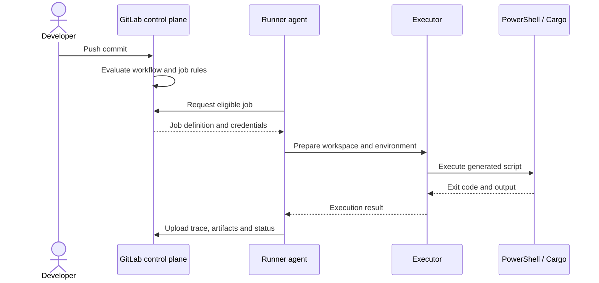
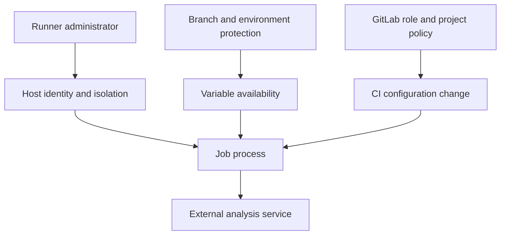

# P0.2 — Component ownership and responsibility boundaries

> **Central question:** When a pipeline behaves unexpectedly, which component owns the decision or action?

## 1. Decompose the platform into responsibilities

GitLab CI/CD is a distributed system, even when a small installation has only one runner. Repository storage, pipeline orchestration, execution, secret distribution, caching, and reporting are different concerns. Conflating them leads to security mistakes and slow troubleshooting.

| Component | Owns | Does not own |
|---|---|---|
| GitLab repository | Source revisions and tracked CI files | Installed Windows tools |
| CI configuration compiler | YAML includes, rules evaluation, job definitions | Running `cargo build` |
| GitLab scheduler/API | Job state, eligibility, runner/job coordination | Shell process implementation |
| Runner agent | Job acquisition, executor coordination, log/artifact transfer | GitLab project membership policy |
| Executor | Preparation of execution context | Definition of pipeline business rules |
| Shell/PowerShell | Parsing and executing command text | CI scheduling |
| Cache backend | Best-effort reusable file storage | Guaranteed handoff of build outputs |
| Artifact storage | Persisted job outputs | Dependency resolution |
| External scanners | Their own analysis and policy results | GitLab runner scheduling |

## 2. Responsibility boundaries in a sequence



This sequence shows logical ownership, not a promise about network request count or precise ordering of every runner implementation detail. GitLab Runner may execute several lifecycle scripts for preparation, user commands, and cleanup.

## 3. The runner and its executor are separate concepts

A runner is a long-lived service/agent with registration identity and a concurrency configuration. The executor is selected in runner configuration and determines the job's execution substrate. A Windows **shell executor** typically runs PowerShell on the host; a container executor prepares containers. With shell execution, job code can access host resources permitted to the service account, so it is not an appropriate trust boundary for arbitrary untrusted contributions.

A runner can process multiple jobs over time. A job is ephemeral; its GitLab record persists after execution, but the script process does not. Do not assume that sequential jobs share state merely because they have matching tags or run on the same physical machine.

## 4. Security responsibilities are distributed

GitLab roles determine who can change project settings or CI definitions. Protected branches and protected variables can restrict exposure. Runner administrators control the machine and service account. Network teams may control proxies and TLS interception. Scanner owners define policies and access tokens. **No single YAML setting substitutes for all of these controls.**

Consider a malicious merge-request change that prints a secret. Masking reduces accidental disclosure in logs but is not a comprehensive defense against deliberate exfiltration. The real design question is whether the untrusted job should receive the secret at all. Protected variables, separate trusted pipelines, and runner isolation address different parts of that risk.



## 5. What belongs in each file?

```yaml
# .gitlab-ci.yml — pipeline-facing decisions
rust-check:
  tags: [windows, rust]
  variables:
    CARGO_TERM_COLOR: always
  script:
    - cargo fmt --all -- --check
    - cargo test --locked
```

```toml
# config.toml — runner-facing decisions (illustrative)
[[runners]]
  name = "windows-rust-shell"
  executor = "shell"
  shell = "powershell"
```

```toml
# Cargo.toml — Rust project metadata
[package]
name = "sample-service"
version = "0.1.0"
edition = "2021"
```

The first file does not set the Windows service identity; the second does not declare which Git branch should build; the third does not configure GitLab permissions. A sound change request starts with identifying its owning file and administrator.

## 6. Ownership-based diagnostic questions

- **No pipeline record:** Check repository configuration, includes, workflow rules, event context, and CI validation.
- **Pipeline exists, job omitted:** Check job rules and stage/needs relationships.
- **Job pending:** Check matching runner tags, runner status, protection, eligibility and capacity.
- **Job started, command not found:** Check executor environment, installed tools, PATH and service account.
- **Scan runs but policy rejects:** Inspect scanner output and server-side policy, not runner registration.
- **Artifact unavailable:** Inspect producing job, artifact paths/expiry, and downstream artifact download configuration.

## 7. Conclusions

The most transferable enterprise skill is **ownership localization**: identify whether a failure belongs to orchestration, runner execution, operating system, language toolchain, storage, or external policy. Once ownership is clear, changes become smaller and more auditable.

**Self-test:** A job works on a Linux runner but fails on Windows with `bash: command not found`. Name the likely execution mismatch, the GitLab job fields to inspect, and the runner-host settings to verify. Explain why changing `Cargo.toml` is unlikely to help.
