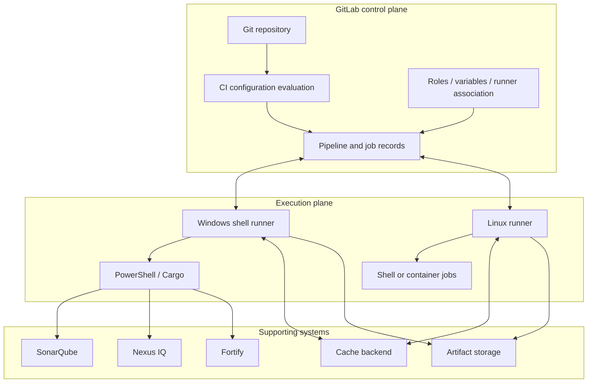
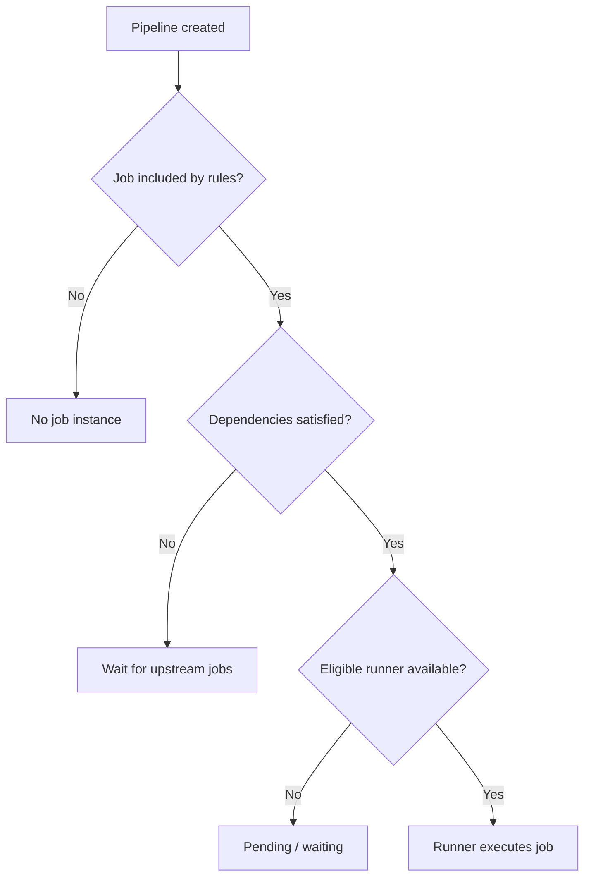
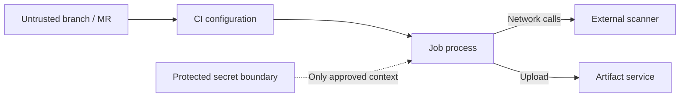

# P0.3 — Architecture, topology, and cross-component relationships

> **Scope:** This chapter studies system shape rather than a chronological job trace. See P0.4 for execution order.

## 1. Logical architecture versus physical deployment

A logical architecture separates source control, CI orchestration, job execution, storage, and external analysis. A physical deployment maps those roles onto machines and services. One GitLab instance may coordinate many Windows and Linux runner hosts. Multiple runner agents may share a host, and a single runner agent may execute several jobs subject to concurrency and executor behavior.

The arrows to external scanners are conceptual; some integrations use local CLI tools, some use remote APIs, and some delegate work to separate scanning infrastructure. Do not assume all scanners support the same Rust inputs or authentication method.

## 2. Scheduling is not execution

The GitLab scheduler considers job readiness and runner eligibility. A job may be runnable in the dependency graph but still lack an eligible runner. Tags are matching criteria: a job requiring `windows` and `rust` generally needs a runner carrying both tags. Protected runner configuration and project/group scope may further restrict matching. A runner's available capacity matters even when tags match.

This is a teaching simplification; GitLab job status and scheduling details vary with pipeline design, manual jobs, resource groups, and version.

## 3. Storage relationships: repository, workspace, cache, artifacts

The repository is authoritative for tracked source. The job workspace is a working copy prepared by an executor. A cache is optional reusable material, often dependency downloads or intermediate build products. An artifact is an explicit output of a job, such as a compiled binary or report, stored by GitLab or configured object storage for later retrieval.

| Store | Intended lifetime | Reliability for downstream jobs | Typical Rust content |
|---|---|---|---|
| Git repository | Version-controlled | Source of truth | `src/`, `Cargo.toml`, `Cargo.lock` |
| Job workspace | Job/executor dependent | Do not assume shared | Checkout and `target/` |
| Cache | Best effort | Not a correctness dependency | Cargo registry and git cache |
| Artifact | Configured retention | Explicit downstream handoff | Test reports, binary, SBOM |

A common architectural error is relying on the same runner host for state transfer. Jobs can be reassigned to other hosts. Even when the same machine is used, cleanup and concurrent work can invalidate assumptions.

## 4. Trust boundaries and external dependencies

The runner agent obtains job data and short-lived credentials to perform authorized operations. The job process may receive variables and project content. External scanners and artifact repositories require separate credentials and network access. Network trust, certificate validation, and authorization therefore cross multiple boundaries.

A secure enterprise design distinguishes *trusted protected branches* from untrusted contribution contexts, and avoids placing powerful credentials on shared shell runners processing untrusted code.

## 5. Topology choices and tradeoffs

**Single Windows shell runner:** simple to understand and close to native Windows toolchains, but weak isolation and limited scalability. **Dedicated Windows runner per trust zone:** improves separation at operational cost. **Linux container runners for generic work plus Windows runners for Windows-specific tasks:** often reduces host coupling. **Shared runners across projects:** improve utilization but increase governance and isolation complexity.

The correct topology depends on operating system requirements, scanner support, licenses, organizational trust boundaries, performance, and administrative responsibility—not on a single YAML example.

## 6. Architectural review checklist

- Where are pipeline definitions stored and how are includes governed?
- Which runner scopes can serve the project?
- What isolation exists between jobs and between projects?
- Which caches are local versus shared?
- Which reports must be preserved as artifacts?
- Which external services require outbound network connectivity?
- Which jobs can access protected credentials?
- What happens if a runner is offline or a scanner is unavailable?

**Conclusion:** Architecture determines operational behavior long before individual script lines execute. Use the topology to reason about security, portability, capacity, and failure domains. Then use P0.4 to trace a job through that architecture.
