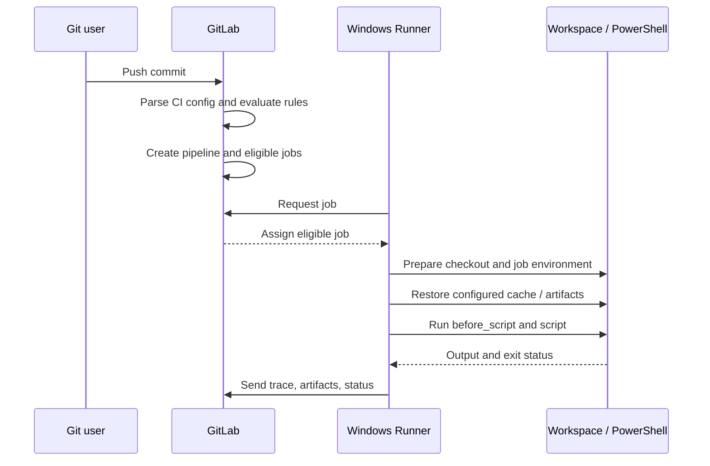
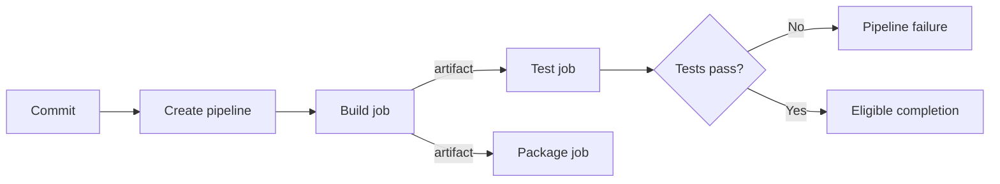

# P0.4 — From commit to completed job: execution lifecycle

> **Goal:** Follow a GitLab CI job through time and identify exactly when configuration, scheduling, execution, and result collection occur.

## 1. Phase I — Event and pipeline creation

A push, merge request, schedule, API call, or other supported event can initiate pipeline creation. GitLab locates the CI configuration for the relevant ref, processes supported includes, validates configuration, and evaluates pipeline-level `workflow:rules`. It then evaluates job inclusion rules. A syntactically valid YAML file can still produce no pipeline or omit particular jobs because rules exclude them.

```yaml
workflow:
  rules:
    - if: '$CI_PIPELINE_SOURCE == "merge_request_event"'
    - if: '$CI_COMMIT_BRANCH == $CI_DEFAULT_BRANCH'
    - when: never

stages: [check, build]

format:
  stage: check
  script:
    - cargo fmt --all -- --check

compile:
  stage: build
  script:
    - cargo build --locked
```

This example intentionally omits runner tags; it does not guarantee a Windows runner will be selected. The expressions are evaluated by GitLab when creating the pipeline, not by PowerShell during execution.

## 2. Phase II — Dependency and runner eligibility

A job becomes eligible according to its stage/`needs` dependencies and manual/conditional controls. An eligible runner must also match the job's tags, runner scope, protection rules, and capacity. A runner agent requests work from GitLab; GitLab does not simply open an arbitrary inbound PowerShell session on the runner machine.



## 3. Phase III — Prepare workspace and inputs

Once a job is acquired, the runner executes its preparation steps. Depending on executor and settings, this may include creating directories, obtaining the repository, cleaning prior state, restoring a cache, and downloading artifacts from upstream jobs. The `CI_PROJECT_DIR` variable identifies the job's project directory. Its absolute value depends on the runner's environment and configuration; never hardcode a path observed in another runner's log.

```powershell
# Illustrative PowerShell job commands
Write-Host "Project directory: $env:CI_PROJECT_DIR"
Set-Location $env:CI_PROJECT_DIR
cargo --version
cargo build --locked
```

PowerShell variable expansion uses `$env:NAME`, unlike a POSIX shell's `$NAME`. A YAML script line is handed to the configured shell; the shell interprets quoting, redirection, exit status, and command lookup.

## 4. Phase IV — Execute user scripts

The runner arranges lifecycle commands including `before_script`, `script`, and `after_script` according to GitLab semantics. `before_script` and `script` run together in the main execution context; `after_script` runs separately and has different failure/timeout and working-directory implications. Do not assume variables or directory changes made only in the main script survive into `after_script`.

```yaml
rust-test:
  tags: [windows, rust]
  before_script:
    - cargo --version
  script:
    - cargo test --locked
  after_script:
    - Write-Host "Job cleanup/reporting phase"
```

A job's exit status is significant: a nonzero command result generally fails the job unless configuration or script handling changes that behavior. A successful Cargo command does not prove that artifact upload, scanner policy, or a later job will succeed.

## 5. Phase V — Collect outputs and finish

GitLab Runner uploads configured artifacts and reports according to artifact conditions. It can save a cache according to the cache policy. Job logs (trace) and terminal status are reported back to GitLab. Artifacts may have retention limits; caches can be evicted or unavailable. `after_script` timing and artifact capture order are worth understanding when generating reports.

| Observable symptom | Lifecycle boundary to inspect |
|---|---|
| Pipeline never appears | Event, CI configuration, `workflow:rules` |
| Job absent from pipeline | Job `rules`, inclusion conditions |
| Job remains pending | Dependencies, tags, runner scope/capacity |
| Checkout fails | Runner preparation, Git/network/credentials |
| `cargo` not found | Executor shell, PATH, host installation |
| Test succeeds but report missing | Artifact path, report generation, upload |
| Later job cannot read build output | Artifact handoff and `needs`/dependencies |

## 6. One job versus multiple jobs

A pipeline is not one continuous shell session. Every job has its own lifecycle. With a shell executor, reuse of host directories is possible but is not a valid correctness contract. Transfer required outputs using artifacts; use cache only for optional acceleration. `needs` controls graph dependencies and can also control artifact downloads when configured.



## 7. Review questions

1. At what point is `workflow:rules` evaluated, and can PowerShell change its decision afterward?
2. Which process resolves `$env:CI_PROJECT_DIR`?
3. Why might a pending job have no job script log?
4. Why should an output needed by another job be an artifact rather than only a cache?
5. How can a successful script still be followed by an unsuccessful job outcome?

**Conclusion:** Separate the *control-plane timeline* (event, configuration, job readiness) from the *execution timeline* (preparation, shell, uploads). That separation is the foundation of reliable troubleshooting.
