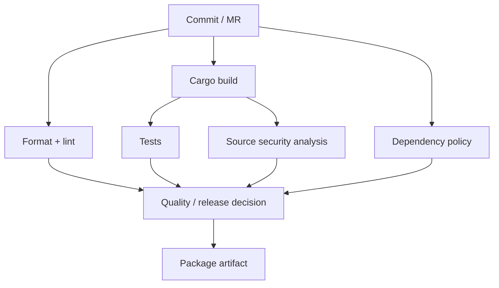
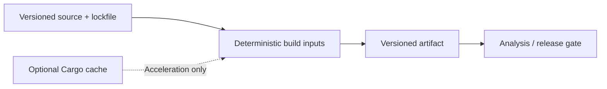

# P0.5 — Enterprise CI/CD architecture patterns and design decisions

> **Focus:** Compare reusable architectural choices. These are patterns to recognize in existing projects, not instructions to build a production system today.

## 1. Separate build, verification, and release concerns

A mature pipeline rarely consists of one enormous script. Compilation, unit testing, linting, software composition analysis, static security analysis, packaging, and deployment have different dependencies and failure semantics. Separate jobs can provide clearer logs, parallel execution, independent policy gates, and artifact traceability. However, over-fragmentation can increase startup, cache, and artifact-transfer overhead.



The diagram illustrates logical dependencies, not a promise that every scanner supports every Rust project or that every organization runs all gates on every commit.

## 2. Trust zones and runner isolation

A critical distinction is between jobs that can process untrusted contributions and jobs that can access protected secrets or publish releases. Shared Windows shell runners can expose host state to scripts and therefore require careful trust management. Sensitive release jobs are better isolated with restricted runner access, protected branches/environments, narrowly scoped credentials, and audited approvals.

| Pattern | Benefit | Risk/tradeoff |
|---|---|---|
| Shared shell runner | Low setup overhead, native tools | Weak isolation for untrusted jobs |
| Dedicated Windows runner | Predictable toolchain and permissions | Maintenance and idle capacity |
| Containerized generic jobs | Reproducible environment | Windows-specific needs may remain |
| Protected release runner | Separates privileged operations | More governance and configuration |
| Central CI templates | Consistent controls across repositories | Template changes can affect many projects |

## 3. Template governance and reuse

GitLab supports configuration reuse through `include`, `extends`, and other supported mechanisms. Organizations often centralize security scanning or standard build rules. This reduces drift, but it also creates dependencies on shared templates, versioned references, and permissions. An engineer reading a short project-level `.gitlab-ci.yml` may need to inspect included files to understand the actual job graph.

```yaml
# Illustrative composition, not a live integration
include:
  - local: '.gitlab/ci/rust-checks.yml'

variables:
  CARGO_TERM_COLOR: always
```

The referenced file must exist at the expected path and ref. For external template repositories, access controls and ref pinning become important. Avoid assuming that all included configuration is visible in the root file.

## 4. Reproducibility versus speed

Rust projects benefit from `Cargo.lock`, `cargo build --locked`, pinned toolchains where appropriate, and controlled dependency sources. Caching can accelerate builds but must not determine correctness. The desired invariant is: **a cache miss may slow a job, but should not change whether it can produce a correct result**. Build artifacts, by contrast, represent explicit outputs and can be retained for traceability.



True reproducibility also depends on compiler version, environment, platform libraries, and build scripts. A lockfile alone is not a complete reproducible-build guarantee.

## 5. Policy gates and failure strategies

A SonarQube quality gate, Nexus IQ policy decision, and Fortify security finding represent different categories of assessment. Their outputs should not be conflated. A pipeline must define which failures block merges/releases, which are advisory, how reports are preserved, and who can approve exceptions. Some scans can run in parallel; others need a built artifact or SBOM. Tool support for Rust and vendor versions must be verified before promising an integration path.

| Decision | Questions for an enterprise reviewer |
|---|---|
| Blocking or advisory | Does this finding prevent merge or release? |
| Scan placement | Source, dependency manifest, built artifact, or deployed service? |
| Credentials | Which scope and trust boundary needs the token? |
| Reporting | Which artifact/report records the result? |
| Exceptions | Who approves, how long valid, and how audited? |

## 6. Operational resilience patterns

Runner availability, external scanner outages, dependency registries, and object storage are separate failure domains. Timeouts, retries, and `allow_failure` are not interchangeable: retries may help transient failures; `allow_failure` changes how failures affect the pipeline result; neither should hide a persistent security policy violation. Concurrency controls and resource groups can prevent collisions when jobs mutate shared deployment targets.

## 7. Architecture review exercise (offline)

An organization has two Windows shell runners serving many projects. Merge-request jobs and release jobs use the same runners; release tokens are available as ordinary project variables. Build jobs cache the whole `target/` directory under one shared key. A scanner outage is handled by marking all security jobs `allow_failure: true`.

Evaluate the design under four headings: trust boundary, cache correctness, policy integrity, and operational resilience. Propose a prioritized architecture improvement list without changing any live environment. A strong answer separates immediate security exposure from longer-term performance optimization.

## 8. Conclusions

Enterprise pipeline architecture is a series of explicit tradeoffs among security, reproducibility, speed, maintainability, and auditability. The most important patterns are separation of responsibilities, controlled trust boundaries, reliable artifact handoff, optional caching, and independent policy ownership. A good engineer can explain why a pattern exists before editing the YAML that implements it.
