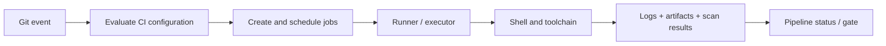
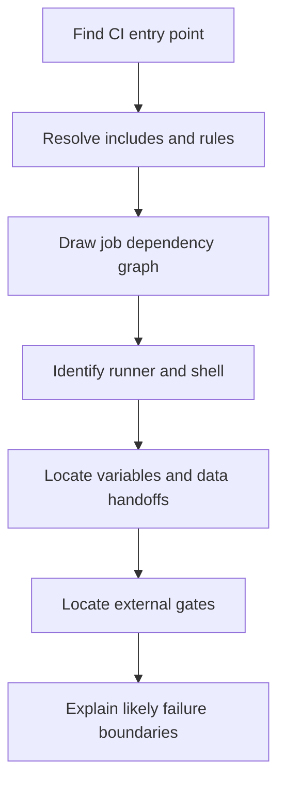

# P0.6 — Synthesis, validation, and readiness to continue

> **Purpose:** Integrate the architecture concepts from P0.1–P0.5. This chapter is intentionally a synthesis and assessment guide, not another glossary.

## 1. The complete mental model

GitLab CI/CD has two cooperating planes. The control plane stores source and configuration, evaluates rules, creates pipeline/job records, and coordinates eligible work. The execution plane consists of runners, executors, operating-system processes, and the tools invoked by job scripts. Supporting systems store caches and artifacts, enforce policies, and provide external scanning or dependency services.



The diagram is a conceptual map. In practice, independent jobs may execute on different hosts and report their own results. No single runner is required to execute an entire pipeline.

## 2. Seven distinctions to retain

| Distinction | Why it matters |
|---|---|
| Pipeline vs job | Pipeline is a graph; job is an execution unit |
| Stage vs `needs` | Coarse ordering vs explicit dependency graph |
| Runner vs executor | Agent acquiring work vs execution strategy |
| GitLab variables vs shell variables | Different definition and evaluation contexts |
| `.gitlab-ci.yml` vs `config.toml` | Pipeline specification vs runner configuration |
| Cache vs artifact | Optional acceleration vs explicit retained output |
| Pipeline status vs scanner policy | GitLab result may depend on external quality/security decisions |

## 3. How to approach an unfamiliar enterprise repository

Start by locating the CI entry point and included files. Identify what events create pipelines, which jobs are conditionally included, and how stages and `needs` form the execution graph. Next, identify runner tags and required execution environments. Map variables and secrets to their definition scopes without attempting to reveal secret values. Trace how dependencies, caches, and artifacts move between jobs. Finally, identify external policy services and their gate behavior.



This workflow deliberately begins with architecture, not with editing the first failed command.

## 4. L1 — Understand: conceptual assessment

**Scenario:** A pipeline has a `build` job tagged `windows` and a `test` job tagged `linux`. Both jobs are in the same pipeline. A new developer assumes they share a working directory and that `test` can read a file written by `build` without an artifact.

A passing answer must explain why the assumption is invalid, distinguish the logical pipeline from physical job execution, and identify artifacts as the explicit mechanism for required file transfer. It should also distinguish the runner agent from the shell or container that runs the command.

**Questions:**

1. Which layer evaluates `workflow:rules`?
2. What does a runner do before invoking the job script?
3. Why might a job remain pending even when the runner service is online?
4. Which settings are likely in GitLab UI, `config.toml`, and `.gitlab-ci.yml`?
5. Why should a dependency cache not be treated as a correctness requirement?

## 5. L2 — Modify: paper design exercise

**Requirement:** A Rust job must run on a Windows shell runner rather than an existing Linux runner. No live execution is allowed.

```yaml
rust-check:
  tags: [linux]
  script:
    - echo "$CI_PROJECT_DIR"
    - cargo test --locked
```

A candidate revision is:

```yaml
rust-check:
  tags: [windows, rust]
  script:
    - Write-Host "Project: $env:CI_PROJECT_DIR"
    - cargo test --locked
```

This is not sufficient by itself. The reviewer must verify that an eligible runner actually has matching tags, uses a compatible shell, has Rust/Cargo installed, and has the necessary filesystem/network access. A strong answer names those dependencies instead of claiming that changing tags automatically creates a Windows runner.

## 6. L3 — Troubleshoot: incident reasoning

**Incident:** A job is pending with a message indicating no suitable runners. The `.gitlab-ci.yml` is valid, and the Windows service is running. The job requests tags `windows` and `rust`, but the registered runner only has `windows`. What should happen next?

**Reasoning:** The job is waiting at the eligibility boundary, before user scripts start. Compare job tags to runner tags and inspect scope, protection, paused/online status, and capacity. Adding the missing tag to an appropriately authorized runner or changing the job's tag requirements may resolve the mismatch; neither option should be applied without confirming intended governance. Editing the Cargo script would not address the cause.

## 7. Readiness checklist

- [ ] I can draw the control plane and execution plane.
- [ ] I can explain how a pipeline differs from its jobs.
- [ ] I can distinguish runner registration, eligibility, executor, and shell.
- [ ] I can identify the owner of CI, runner, OS, and Cargo configuration.
- [ ] I can explain job scheduling versus job execution.
- [ ] I can explain cache and artifact roles without conflating them.
- [ ] I can locate a failure in the lifecycle from its symptoms.
- [ ] I can explain how secrets cross trust boundaries.
- [ ] I can read an architecture diagram and identify failure domains.
- [ ] I can articulate why examples are illustrative rather than complete deployments.

## 8. What P0 does not yet teach

P0 does not replace detailed Rust language instruction (P1), Cargo lifecycle instruction (P2), GitLab YAML semantics (P3), variable permissions (P4), cache design (P5), or Windows runner administration (P6). It supplies the mental model needed to study those subjects without confusing layers.

**Final conclusion:** Before making a CI/CD change, identify the decision point, responsible component, execution context, and affected trust boundary. This habit transfers across languages, runner operating systems, and scanner vendors.
