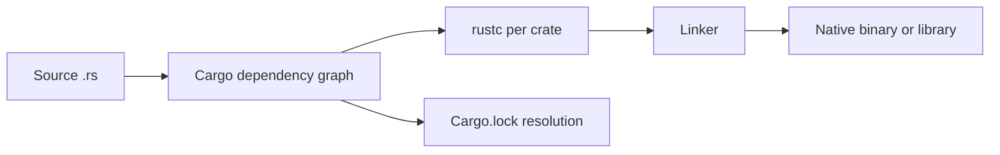
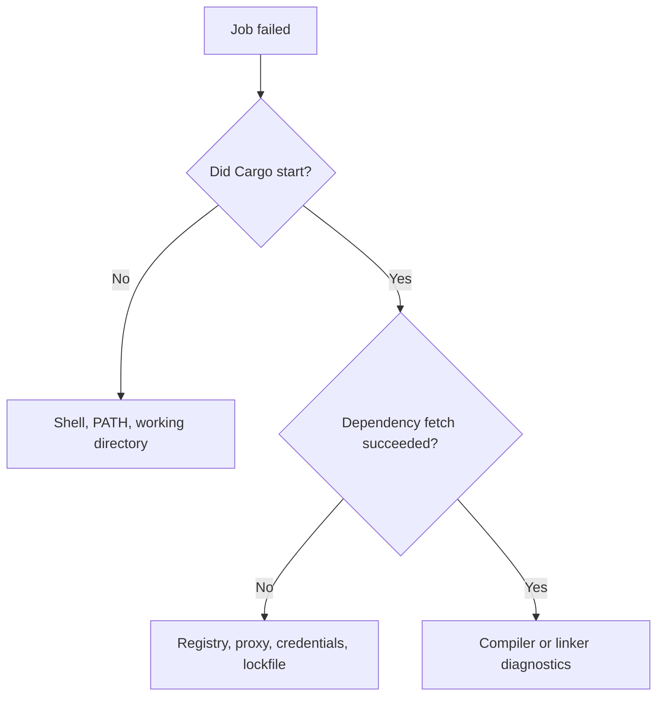

# P1.1 — Rust's model of programs

> **Goal:** Understand Rust as a compiled, statically typed language with explicit ownership, not as “Java with different syntax.” No installation is required to study this chapter.

## Why Rust exists in enterprise systems

Rust combines ahead-of-time compilation, memory safety without a garbage collector, expressive type checking and low-level control. It is useful in CLIs, infrastructure agents, parsers, network services and performance-sensitive components. It does **not** automatically make programs fast, secure or free from logical bugs. Rust's safety guarantees apply to safe Rust code; `unsafe` can introduce additional obligations.

### Compilation is a sequence, not a single command

A Cargo invocation coordinates packages, dependencies, compiler calls and output directories. `rustc` compiles crates; Cargo is the package/build orchestrator. A Rust binary is generally native code for a selected target, unlike the JVM bytecode produced by a typical Maven Java build. Cross-compilation requires an appropriate target and often a suitable linker.



## Basic language elements

A Rust program is made of items such as functions, structs, enums, traits, constants and modules. `let` binds a value; bindings are immutable by default. `let mut` permits reassignment or mutation when ownership and borrowing rules allow it. Expressions return values, and the final expression of a block can become the block's result without `return`.

```rust
fn classify(bytes: usize) -> &'static str {
    if bytes == 0 { "empty" } else if bytes < 1024 { "small" } else { "large" }
}
fn main() {
    let count: usize = 512;
    println!("{}", classify(count));
}
```

`usize` is pointer-sized, not necessarily 64-bit. The `&'static str` return type here is valid because the returned string literals have static lifetime. `println!` is a macro invocation: the exclamation mark is meaningful syntax, not punctuation.

### Types and inference

The compiler often infers local types, but public interfaces benefit from explicit signatures. `i32`, `u64`, `bool`, `char`, `f64`, tuples, arrays, slices and references are foundational. Rust deliberately avoids implicit numeric widening in many situations. An array `[T; N]` has fixed length known in its type; a `Vec<T>` is a growable collection, while `&[T]` is a borrowed slice view.

| Java mental model | Rust counterpart | Important difference |
|---|---|---|
| `final` local variable | `let` binding | Binding immutability and referent mutation are distinct |
| `ArrayList<T>` | `Vec<T>` | Owned, contiguous buffer; borrowing rules apply |
| `String` | `String` | Owned UTF-8 bytes; indexing by integer is disallowed |
| `String` literal | `&str` | Borrowed string slice, not owned allocation |
| Exception | `Result<T,E>` | Recoverable failure is explicit in the return type |

## Control flow and pattern matching

`if`, `loop`, `while`, `for` and `match` are language constructs. `match` is exhaustive for enums and can destructure nested values. It is a central way to handle variants rather than a more elaborate `switch`.

```rust
fn status(code: Option<u16>) -> &'static str {
    match code {
        Some(200..=299) => "ok",
        Some(_) => "failed",
        None => "not checked",
    }
}
```

`Option<T>` forces the caller to account for absence. Unlike a nullable reference in Java, `None` is part of the type contract. The compiler rejects an incomplete match over known enum variants.

## Where this matters in GitLab CI

A pipeline invoking `cargo build --locked` asks Cargo to compile a specific dependency resolution; it does not run Java-style bytecode. Compilation failures may be caused by language errors, feature flags, target configuration, native linkers or dependency availability. Read the first meaningful compiler diagnostic rather than treating every failed build as a runner problem.

### Read a failure in layers



## Conclusions and reading checks

Rust's most important difference from Java is not syntax: ownership, borrowing and explicit sum types move many failure modes into compile-time checks. Cargo is the workflow entry point, while `rustc` and the linker do the actual compilation. Explain why `String` and `&str` are not interchangeable, why `cargo build` can fail before compilation, and what the `!` means in `println!`. **Do not** infer that a successful compile establishes business correctness; tests and review remain necessary.
