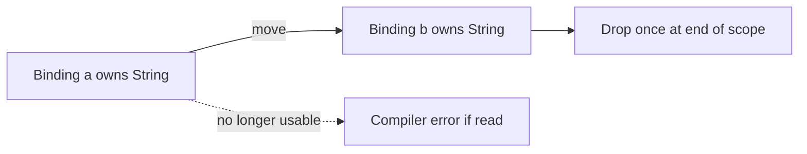
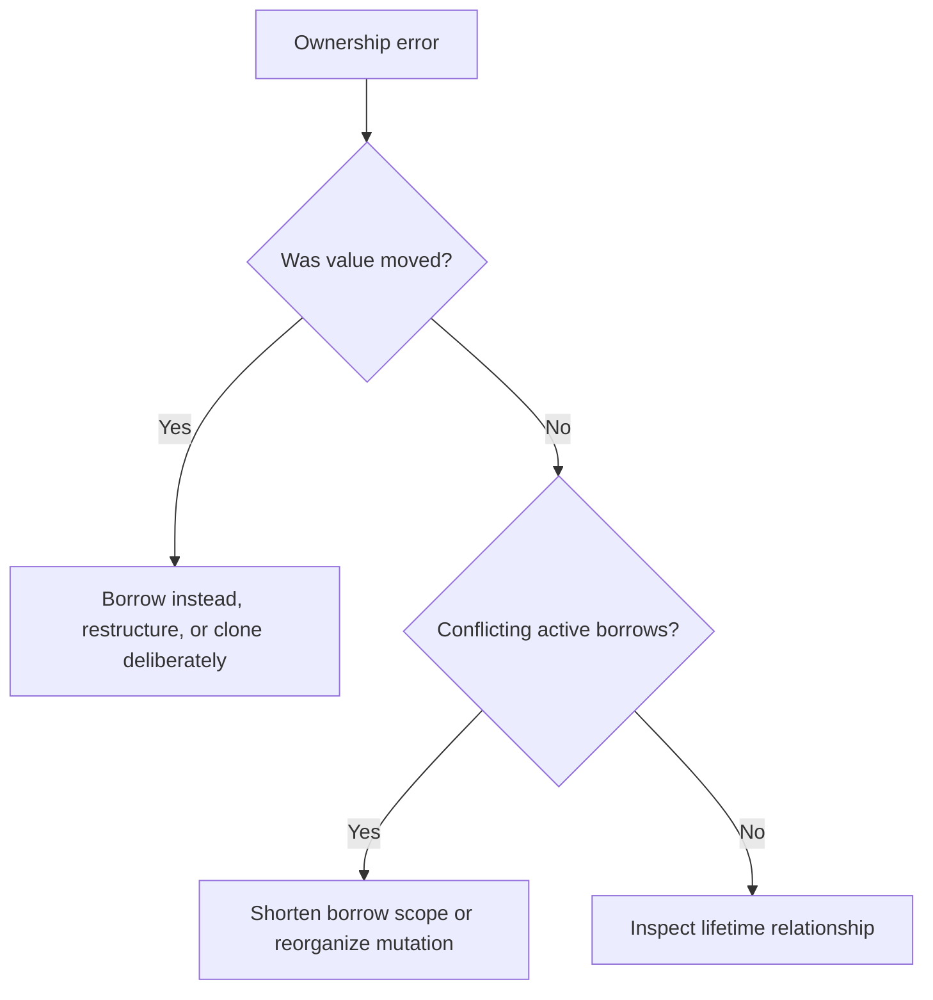

# P1.2 — Types, ownership and borrowing

> **Goal:** Explain moves, copies, immutable/mutable borrowing and lifetimes well enough to interpret common compiler diagnostics.

## The ownership contract

Rust associates each owned value with an owner. When that owner leaves scope, its value is normally dropped. Ownership can move between bindings or functions. For types such as `String`, assignment ordinarily moves ownership rather than copying heap data. This prevents two owners from independently freeing the same allocation.

```rust
let a = String::from("pipeline");
let b = a;
// println!("{a}"); // compile error: a was moved
println!("{b}");
```

Primitive types like `u32` commonly implement `Copy`, so assigning them duplicates their value. `Clone` is an explicit duplication operation, and may allocate or perform substantial work. Distinguish a cheap `Copy` from `String::clone()`.



## Borrowing instead of transferring ownership

A reference `&T` borrows access without taking ownership. Multiple immutable references can coexist. A mutable reference `&mut T` grants exclusive mutable access for its active borrow. These restrictions prevent many data races and invalid references at compile time.

```rust
fn length(s: &str) -> usize { s.len() }
fn append_suffix(s: &mut String) { s.push_str("-ok"); }

let mut name = String::from("build");
let size = length(&name);
append_suffix(&mut name);
println!("{name}: {size}");
```

The first function accepts a string slice, making it useful for both owned strings and literals. The second requires exclusive mutable access. Non-lexical lifetimes let the compiler end a borrow after its last use rather than always at the closing brace.

### Why an apparently innocent reference fails

```rust
fn invalid() -> &str {
    let temporary = String::from("local");
    &temporary // invalid: reference would outlive the owned value
}
```

A reference must never outlive the value it points to. Lifetimes describe relationships between reference validity intervals; they do not extend the lifetime of an owned allocation. The compiler rejects this function because `temporary` is dropped when the function returns.

## Lifetimes in public interfaces

```rust
fn longer<'a>(left: &'a str, right: &'a str) -> &'a str {
    if left.len() >= right.len() { left } else { right }
}
```

`'a` expresses a relationship: the returned borrow is valid no longer than the common valid region of the inputs. It does not mean the references are static. Lifetime annotations usually clarify constraints that the compiler cannot infer in a function signature; they are not manual memory allocation instructions.

## Ownership decisions in application design

| Situation | Prefer | Reason |
|---|---|---|
| Read-only text parameter | `&str` | Flexible borrowed view |
| Caller transfers a buffer | `String` or `Vec<u8>` | Explicit ownership transfer |
| Modify caller-owned collection | `&mut Vec<T>` | No unnecessary clone |
| Share immutable state across threads | `Arc<T>` when needed | Reference-counted shared ownership |
| Share mutable state across threads | `Arc<Mutex<T>>` when appropriate | Synchronization plus ownership; not a default |

`Rc<T>` is for single-threaded shared ownership; `Arc<T>` supports atomic reference counting, but neither makes arbitrary mutation thread-safe. `RefCell<T>` checks borrowing rules at runtime and can panic on a violation. These tools are escape hatches for particular designs, not substitutes for learning basic ownership.

## Typical compiler messages

“Borrow of moved value” means a value was used after ownership transfer. “Cannot borrow as mutable because it is also borrowed as immutable” means active aliases conflict. “Does not live long enough” indicates a reference could outlive its referent. Read the diagnostic's source spans and notes: they often show the move site, borrow site and later use.



## Enterprise relevance and conclusions

Ownership errors are common when adding logging, spawning tasks, handling async closures and sharing application state. Resist the instinct to add `.clone()` everywhere: it can hide design problems and increase allocations. First ask who should own the data and whether a function needs read-only access, mutation or transfer. **Review exercise:** Given a function that accepts `String` but only prints it, propose `&str` and explain why the call site becomes more flexible.
