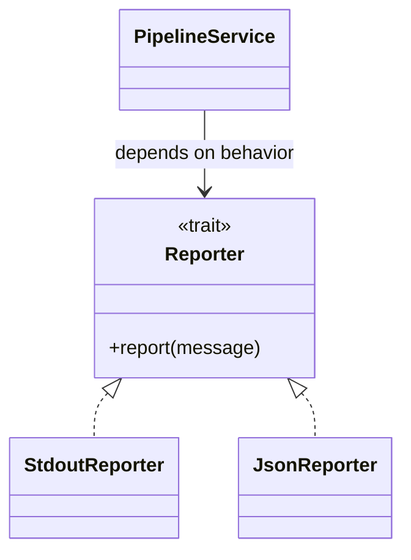

# P1.3 — Data modeling and abstraction with Rust

> **Goal:** Read enterprise Rust domain models and understand how structs, enums, traits and generics divide responsibilities.

## Structs model data; impl blocks define behavior

A `struct` groups named fields or tuple-like fields. Methods and associated functions are defined in `impl` blocks. Rust does not have Java-style class inheritance; composition and traits express reuse and behavior contracts.

```rust
#[derive(Debug, Clone)]
struct BuildRequest {
    project: String,
    revision: String,
    retries: u8,
}
impl BuildRequest {
    fn new(project: String, revision: String) -> Self {
        Self { project, revision, retries: 0 }
    }
    fn is_retry(&self) -> bool { self.retries > 0 }
}
```

`#[derive(...)]` asks the compiler to generate implementations of supported traits. It is not runtime reflection. `&self` borrows an instance; `&mut self` mutably borrows it; `self` consumes it.

## Enums are sum types

Rust enums can hold data inside each variant. They make state distinctions explicit and enable exhaustive matching. For an enterprise job runner client, an enum can encode outcomes without magic strings or nullable fields.

```rust
enum JobOutcome {
    Success { artifact: String },
    Failed { exit_code: i32 },
    Cancelled,
}
fn describe(outcome: &JobOutcome) -> String {
    match outcome {
        JobOutcome::Success { artifact } => format!("stored {artifact}"),
        JobOutcome::Failed { exit_code } => format!("exit {exit_code}"),
        JobOutcome::Cancelled => "cancelled".to_owned(),
    }
}
```

When adding a new variant, matches that previously handled every case may fail to compile. This can be desirable during refactoring: the compiler identifies consumers that must account for the new state.

## Traits define capabilities

A trait describes behavior that multiple types can implement. A trait can declare required methods and provide default implementations. Trait bounds constrain generic functions. Think “interface plus some default methods,” but remember that Rust trait coherence, object safety and dispatch differ from Java interfaces.

```rust
trait Reporter {
    fn report(&self, message: &str) -> Result<(), String>;
}
struct StdoutReporter;
impl Reporter for StdoutReporter {
    fn report(&self, message: &str) -> Result<(), String> {
        println!("{message}");
        Ok(())
    }
}
fn publish<R: Reporter>(reporter: &R, text: &str) -> Result<(), String> {
    reporter.report(text)
}
```

Here `R: Reporter` enables static dispatch, typically monomorphized for concrete types. `&dyn Reporter` instead uses dynamic dispatch through a trait object. The choice affects flexibility, code size and runtime dispatch but rarely dominates performance without measurement.



## Generics and associated types

Generic types like `Vec<T>` or `Result<T,E>` parameterize behavior over types. Constraints such as `T: Send + Sync` describe capabilities needed for thread safety. Associated types express a type chosen by an implementation, common in iterators (`Iterator::Item`). They are not simply Java generics with different syntax: Rust's trait system also supports blanket implementations and bounds on implementations.

## Visibility and encapsulation

Items are private to their module by default. `pub` exposes them subject to module visibility; `pub(crate)` restricts visibility to the crate. Fields may remain private even when a struct is public. This lets libraries expose stable constructors and operations while retaining freedom to change internal representations.

| Java concept | Rust concept | Watch for |
|---|---|---|
| Class | `struct` + `impl` | No class inheritance |
| Interface | `trait` | Static/dynamic dispatch options |
| Sealed hierarchy | `enum` | Data-bearing variants, exhaustive matches |
| Method overload | Distinct names or traits | No general inherent-method overload by argument list |
| Package-private | `pub(crate)` approximately | Visibility is module/crate based |

## Practical design and conclusion

When reading a Rust codebase, identify domain data (`struct`), valid states (`enum`), capabilities (`trait`) and generic boundaries. Favor enums over loose status strings when the state space is known. Favor traits at meaningful substitution points, not for every concrete type. **Review:** Explain why a new `JobOutcome::TimedOut` variant may force compile-time changes, and contrast `impl Reporter`, `R: Reporter` and `dyn Reporter`.
