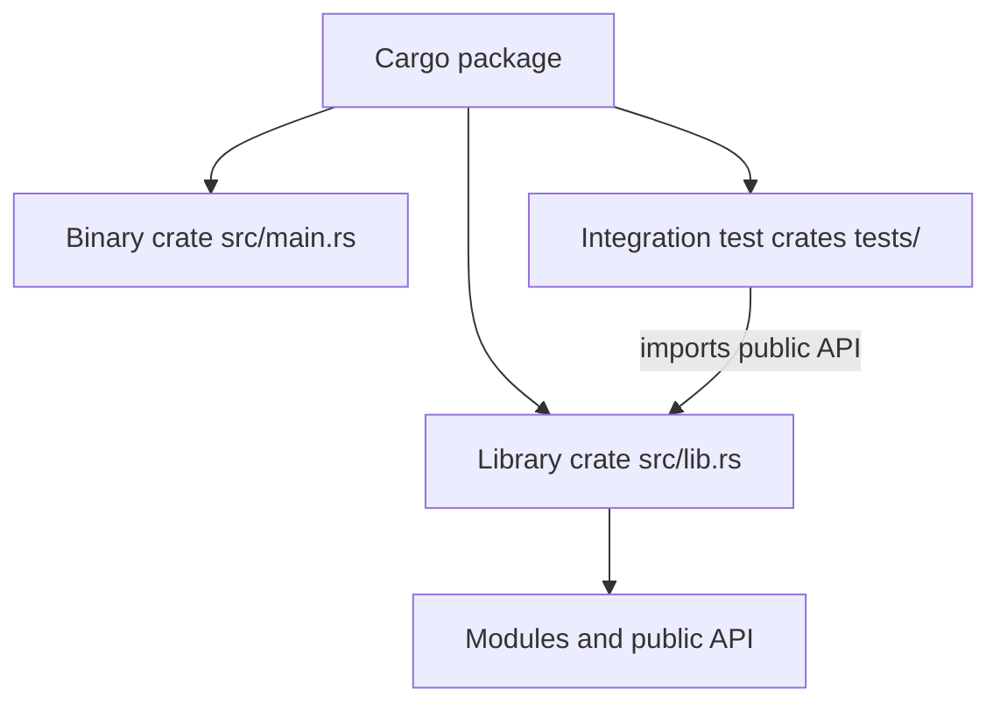

# P1.4 — Modules, crates and repository structure

> **Goal:** Navigate an unfamiliar Rust repository and locate entry points, public APIs, tests and build boundaries.

## Four distinct boundaries

A **module** organizes names and visibility inside a crate. A **crate** is a Rust compilation unit, usually a library or binary. A **package** is a Cargo manifest (`Cargo.toml`) that can contain one or more crates. A **workspace** groups packages for coordinated Cargo commands and dependency resolution. Confusing these concepts makes monorepo CI failures harder to diagnose.

```text
rust-service/
├── Cargo.toml          # package manifest
├── Cargo.lock          # resolved versions (commit for applications)
├── src/
│   ├── main.rs         # binary crate root
│   ├── config.rs       # module source
│   └── api/
│       ├── mod.rs      # module organization, one supported style
│       └── routes.rs
├── tests/
│   └── smoke.rs        # integration-test crate
└── .gitlab-ci.yml
```

A package may have `src/lib.rs` and `src/main.rs` together, yielding a library crate and a binary crate. Integration tests in `tests/` compile as separate crates and access only the library's public API.

## Module declarations and paths

```rust
// src/main.rs
mod config;
mod api;
fn main() {
    let mode = config::mode();
    println!("mode={mode}");
}
// src/config.rs
pub(crate) fn mode() -> &'static str { "local" }
```

`mod config;` declares a module and asks the compiler to find its source. `use` imports a path into scope; it does not fetch a dependency. `crate::`, `self::` and `super::` are explicit path anchors. A `pub` declaration is not necessarily accessible from outside the crate if an enclosing module is private.



## Cargo workspaces and enterprise monorepos

```toml
[workspace]
members = ["crates/core", "crates/cli"]
resolver = "3"  # requires compatible Cargo/Rust toolchain
```

A virtual workspace manifest has no `[package]` section. Member packages each have their own manifests. Workspaces can share a lockfile and target directory; they do not magically make all member APIs public or force every crate into one binary. Resolver settings are toolchain-version-sensitive; pin and document the Rust version before adopting newer manifest features.

### Navigation commands (reference only)

```powershell
cargo metadata --no-deps --format-version 1
cargo test --workspace --locked
cargo test -p core --locked
cargo tree -p core
```

These commands are examples, not instructions to run them now. `cargo metadata` exposes package/target relationships, `cargo tree` shows dependencies, and `-p` selects a package. A package name in Cargo may differ from the directory name.

## Locating architecture from source

Start at `Cargo.toml` to identify package names, features, workspace members and binaries. Read `src/main.rs` for process startup and `src/lib.rs` for reusable APIs. Search `mod`, `pub`, trait implementations and error types. Then inspect `tests/` and CI configuration to understand what the repository considers a valid build.

| Question | First place to inspect |
|---|---|
| What executable starts? | `src/main.rs` or `[[bin]]` target |
| What is reusable? | `src/lib.rs`, public modules |
| What dependencies exist? | `Cargo.toml`, `Cargo.lock` |
| What runs in CI? | `.gitlab-ci.yml`, included YAML files |
| Why does a feature compile locally but not CI? | Cargo feature flags, target, toolchain, workspace selection |

## Visibility and API boundaries

Module boundaries help enforce encapsulation but are not a security boundary. A crate can expose a deliberately small public surface. `pub(crate)` is often useful for internal helpers; public APIs should avoid leaking implementation-specific types unless intended. Circular module references and import paths can make a repository confusing, so map dependencies before restructuring.

## Conclusions

Read a Rust repository from manifests to crate roots to modules to public APIs, then connect those to CI commands. Do not assume “folder equals package” or “module equals crate.” **Review:** In a workspace with `core` and `cli`, explain which `cargo test` command checks all packages and which checks only `core`, and why an integration test cannot call a private function.
