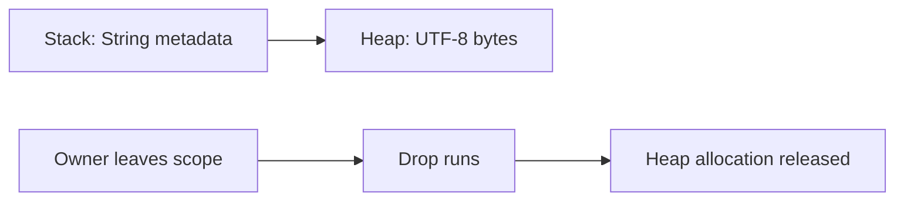
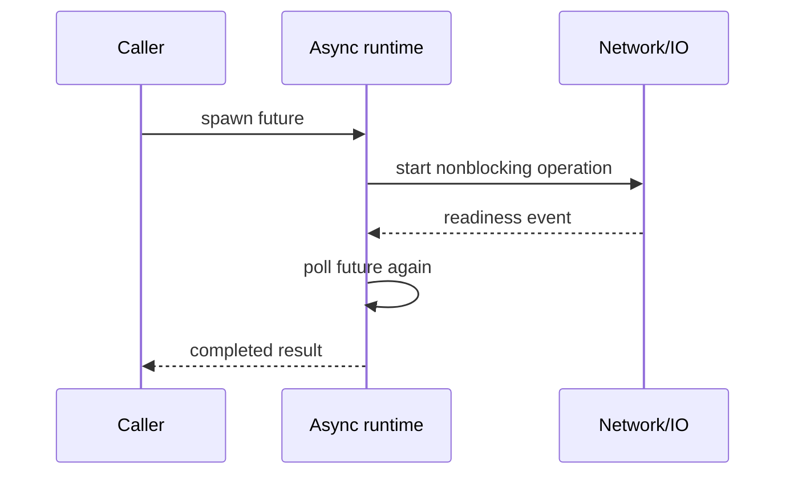

# P1.5 — Errors, memory behavior and concurrency

> **Goal:** Distinguish recoverable failures from programmer defects, understand memory-safety boundaries and recognize thread/async tradeoffs.

## Errors are part of the API

Rust normally uses `Result<T,E>` for recoverable failures and `Option<T>` for absence. `?` propagates a compatible error from the current function; it does not swallow failures. `panic!` represents an unrecoverable condition in the current execution path, not a normal replacement for `Result`.

```rust
use std::{fs, io};
fn load_config(path: &str) -> Result<String, io::Error> {
    let text = fs::read_to_string(path)?;
    if text.trim().is_empty() {
        return Err(io::Error::new(io::ErrorKind::InvalidData, "empty config"));
    }
    Ok(text)
}
```

`unwrap()` and `expect()` panic on `Err`/`None`. They can be reasonable in tests or proven invariants, but are risky for external input, network responses or CI tooling. In enterprise code, errors should preserve actionable context without logging secrets.

## Memory: stack, heap and drop

A stack frame holds local values, including small fixed-size values and pointers to heap allocations. `String` and `Vec<T>` own heap buffers; when the owning value is dropped, its buffer is released. Rust does not require a tracing garbage collector for these common cases. Reference-counted ownership can create cycles that leak memory, and safe code can still allocate too much or deadlock.



## Threads and shared state

`Send` indicates a type can safely transfer ownership between threads; `Sync` indicates shared references can be used across threads safely. These are marker traits with important compiler-enforced consequences. They do not guarantee an algorithm is free of deadlocks, starvation or race conditions at the business-logic level.

```rust
use std::{sync::{Arc, Mutex}, thread};
let counter = Arc::new(Mutex::new(0u32));
let mut handles = Vec::new();
for _ in 0..4 {
    let shared = Arc::clone(&counter);
    handles.push(thread::spawn(move || {
        let mut value = shared.lock().expect("mutex poisoned");
        *value += 1;
    }));
}
for h in handles { h.join().expect("worker panicked"); }
```

The mutex serializes access; the `Arc` shares ownership. This example does not imply a mutex is always the right choice. Message passing, immutable data and task-local state often simplify designs.

## Async is not synonymous with parallel

`async fn` returns a future. The future makes progress when polled by an executor. An async runtime such as Tokio schedules tasks and provides async I/O; the language does not automatically supply a runtime. CPU-heavy blocking work inside async tasks can starve the executor. Thread concurrency and async task concurrency solve different problems and can be combined.



## Error boundaries in CI

A Rust CLI's process exit code is what the runner observes. Printing an error while returning exit code zero can cause a misleading successful GitLab job. Conversely, a `cargo test` failure produces a nonzero status, and the shell executor reports the job as failed unless explicitly configured otherwise.

| Failure type | Rust mechanism | CI implication |
|---|---|---|
| Missing config file | `Result::Err` | CLI should surface context and fail clearly |
| Invalid business input | Validated `Result` | Decide whether expected or fatal for job |
| Assertion failure | Panic/test failure | Test job fails |
| Deadlock | Runtime stall | Job may time out, no compiler guarantee |
| Out-of-memory | Process/OS failure | Investigate limits and allocation patterns |

## Practical review and conclusions

When reviewing enterprise Rust, look for `unwrap()` near untrusted input, blocking calls inside async code, broad mutex lock scopes and missing error context. Ask whether a function returns an actionable `Result` and whether the process maps fatal errors to nonzero exit status. **Review:** Explain why `?` is safer than `unwrap()` for file I/O, why `Arc` alone does not make a mutable counter safe, and why async does not automatically make CPU-heavy work faster.
