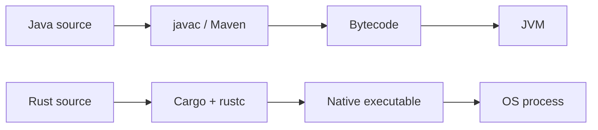

# P1.6 — Rust versus Java: an enterprise developer's bridge

> **Goal:** Transfer Java experience without importing incorrect JVM assumptions into Rust architecture and CI workflows.

## Execution and runtime model

Java source is typically compiled into bytecode and executed on a JVM with garbage collection, class loading and JIT compilation. Rust usually compiles ahead of time to native binaries. Rust has a standard library and runtime support from the operating system, but no mandatory JVM-like managed runtime or tracing GC. Build artifacts, startup behavior and deployment requirements therefore differ.



Rust executables may depend on native shared libraries, the selected target ABI and linker outputs. “Native” does not automatically mean portable across Windows and Linux. A GitLab Windows Runner cannot execute a Linux ELF binary without a compatible environment.

## Types and abstraction

| Java | Rust | Key distinction |
|---|---|---|
| Class + object | `struct` + `impl` | No class inheritance |
| Interface | `trait` | Trait bounds and static dispatch |
| `Optional<T>` | `Option<T>` | Exhaustive matching, idiomatic absence type |
| Checked/unchecked exception | `Result<T,E>` / panic | Recoverable errors explicit in signatures |
| GC-managed reference | Owner / `&T` / `&mut T` | Compile-time borrowing constraints |
| `CompletableFuture` | `Future` + executor | Future must be polled by a runtime |
| Maven module | Cargo package/workspace member | Compilation unit is crate |

Java's reference aliasing is common; Rust's borrowing rules constrain when aliases may mutate the same value. This changes API design, not just syntax. Instead of a setter-heavy object graph, Rust code often uses immutable values, ownership transfer and explicit state transitions.

## Dependency injection without assuming Spring

Rust applications may use constructor injection through concrete structs, trait objects or generic type parameters. There is no standard annotation-based container equivalent to Spring's `@Autowired`. A service may explicitly accept a repository implementation:

```rust
trait Store { fn save(&self, key: &str) -> Result<(), String>; }
struct Service<S: Store> { store: S }
impl<S: Store> Service<S> {
    fn submit(&self, key: &str) -> Result<(), String> { self.store.save(key) }
}
```

This is compile-time generic composition. A trait-object design using `Box<dyn Store>` would make the implementation choice more dynamic, with different tradeoffs. Neither approach is inherently superior.

## Build and test mental models

Maven lifecycle phases such as `compile`, `test` and `package` are not a direct one-to-one mapping to Cargo subcommands. `cargo build`, `cargo test`, `cargo check`, `cargo clippy` and `cargo fmt` are separate operations; some require components installed with the toolchain. `Cargo.lock` pins dependency resolution for reproducibility; CI often uses `--locked` to reject lockfile changes.

```yaml
rust_checks:
  tags: [windows]
  script:
    - cargo fmt --all -- --check
    - cargo clippy --workspace --all-targets -- -D warnings
    - cargo test --workspace --locked
```

This is an illustrative GitLab job for a Windows Shell runner with the required Rust components installed. The `--` separates Cargo arguments from those forwarded to Clippy or rustfmt. This is not a guarantee that every crate passes linting without configuration.

## Operational differences

Java production diagnostics often involve JVM flags, heap dumps, GC logs and classpath conflicts. Rust diagnostics may involve panic backtraces, native stack traces, symbol files, compiler target mismatches, feature flags and linker errors. Neither language removes the need for logs, metrics, tracing and incident response.

### Common transfer mistakes

- Treating every `clone()` as cheap, like copying a Java reference.
- Expecting `null` or exception propagation instead of `Option` and `Result`.
- Assuming all concurrency needs an async runtime.
- Assuming a Cargo workspace is the same as one Java module.
- Assuming `cargo build` on one operating system produces a binary for another.
- Adding abstraction layers merely to mimic Spring services.

## Conclusions and assessment

Use Java experience to recognize domain boundaries, dependency graphs, CI checks and test strategy. Relearn ownership, error handling and compilation boundaries deliberately. **L1:** Explain Rust's build artifact and memory model. **L2:** Translate a simple Java service interface into a trait-backed Rust service. **L3:** Given a CI failure, distinguish missing Rust target, compiler error and runner PATH problem.
