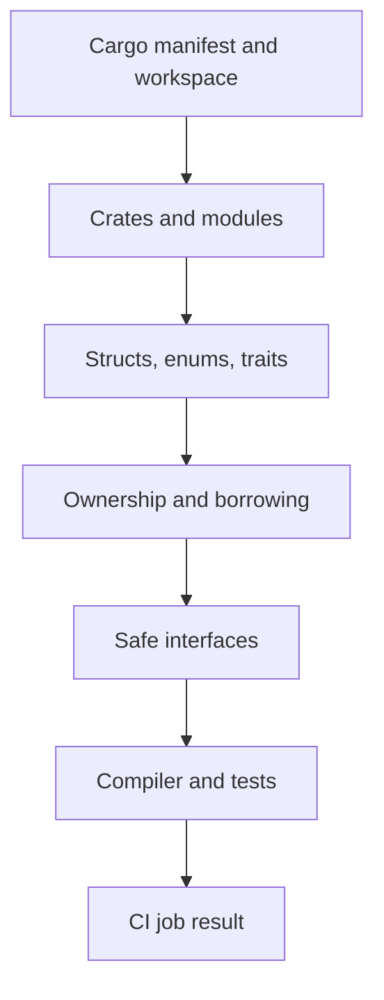
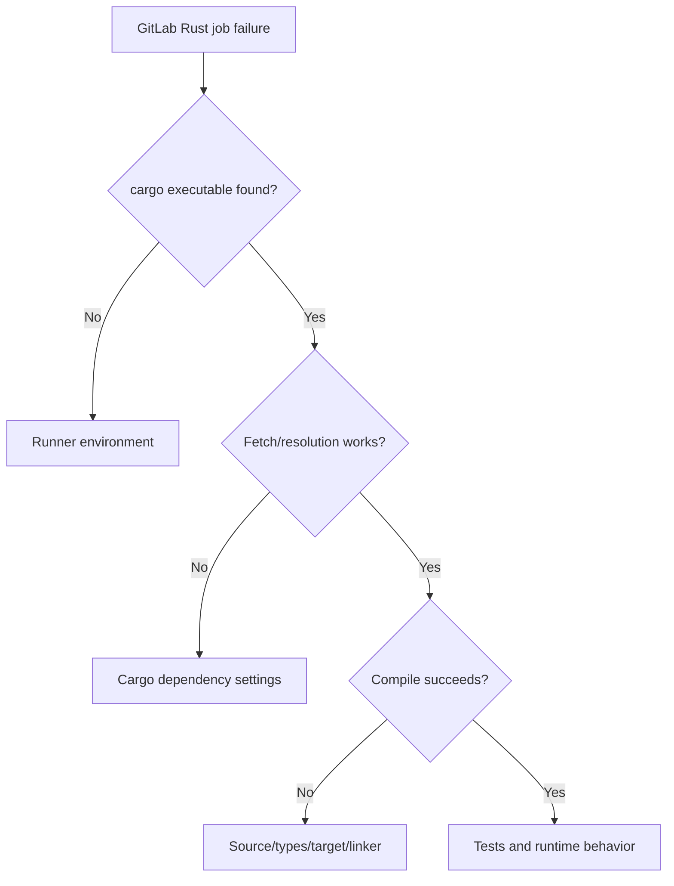

# P1.7 — Rust fundamentals: synthesis and readiness

> **Goal:** Consolidate P1 into a mental model suitable for reading an enterprise Rust repository and interpreting its CI diagnostics.

## The essential mental model

A Rust application is organized into crates and modules, compiled with explicit dependency and target settings, and governed by ownership and borrowing rules. Structs represent data, enums represent alternatives, traits represent capabilities, and generics connect reusable behavior to concrete types. `Option` and `Result` make absence and recoverable failure explicit. These are mutually reinforcing design choices, not unrelated syntax topics.

## Concepts that should now be distinct

| Distinction | Correct interpretation | Why it matters |
|---|---|---|
| `String` vs `&str` | Owned UTF-8 buffer vs borrowed string slice | API flexibility and allocation |
| Move vs clone | Ownership transfer vs explicit duplication | Avoid invalid uses and excess work |
| `&T` vs `&mut T` | Shared read-only vs exclusive mutable borrow | Aliasing safety |
| Struct vs enum | Product of fields vs choice of variants | Modeling valid states |
| Trait vs struct | Behavior contract vs concrete data | Dependency boundaries |
| Module vs crate | Namespace/visibility vs compilation unit | Code navigation |
| Package vs workspace | Cargo manifest vs coordinated package group | CI command scope |
| `Result` vs panic | Recoverable failure vs exceptional termination | Reliable process exit behavior |
| Threads vs async | OS-level concurrency vs polled futures | Runtime and performance choices |

## A practical repository-reading sequence

1. Open the root `Cargo.toml` and determine whether it defines a package or workspace.
2. Identify `src/main.rs`, `src/lib.rs`, `[[bin]]` and `[[test]]` targets where applicable.
3. Trace public modules and trait implementations; locate domain structs and enums.
4. Identify where ownership crosses service boundaries and where cloning is deliberate.
5. Inspect error types and use of `?`, `unwrap()` and `expect()`.
6. Locate tests and match them to `cargo test` commands in CI.
7. Review target/toolchain settings, feature flags and lockfile behavior.

The sequence is a reading guide, not a request to access your environment. In an unfamiliar enterprise repository, it often reveals the build graph faster than starting with individual functions.

## L1 — Understand: self-check

**Question 1:** Why can `let b = a` invalidate `a` for `String` but not for `u32`? A good answer mentions `Copy`, ownership transfer and the avoidance of double frees.

**Question 2:** What is the difference between a package, a crate and a module? A good answer identifies Cargo manifest, compilation unit and namespace boundaries.

**Question 3:** What is the role of a trait? A good answer distinguishes a behavior contract from a concrete implementation and explains generic versus dynamic dispatch at a high level.

**Question 4:** Why is `Option<T>` useful? A good answer describes absence as a type-level variant that callers must handle, rather than an implicit nullable reference.

## L2 — Modify: design exercise

A function currently accepts an owned `String` only to log its contents. Propose changing it to accept `&str`. Explain the call-site change and why the function no longer consumes ownership. If it must retain the text beyond the call, explain why it needs an owned copy or a different ownership design.

A second exercise: a service returns the string values `"ok"`, `"failed"` and `"cancelled"`. Propose an enum with variants and a `match` function that produces a human-readable label. Explain how adding a new variant affects exhaustive matches.

## L3 — Troubleshoot: diagnostic exercise

A Windows GitLab job fails with `cargo: The term 'cargo' is not recognized`. This is not an ownership or compilation error: the shell cannot locate Cargo. Investigate the runner service account's PATH, Rust installation and process environment. Another job starts Cargo but fails with `borrow of moved value`; that is a compiler diagnostic, not a runner scheduling issue. A third fails resolving a registry dependency; investigate network, proxy, credentials and lockfile state before changing Rust source.

## Readiness checklist

- [ ] I can explain owned values, moves, clones and borrows without calling them “garbage collection.”
- [ ] I can read a function signature using `&str`, `&mut T`, `Option` and `Result`.
- [ ] I can recognize structs, enums, traits and generic bounds in real code.
- [ ] I can navigate from `Cargo.toml` to crate roots and module declarations.
- [ ] I can distinguish compiler diagnostics from Cargo dependency and runner environment failures.
- [ ] I understand that async code needs an executor and does not guarantee parallel CPU execution.
- [ ] I can compare Rust concepts with Java without assuming direct equivalence.

## Limits and next steps

Passing these documentation checks is not evidence of production experience. P1 prepares you to understand Rust code; P2 should deepen Cargo dependency resolution, lockfiles, build profiles, features, targets and reproducibility. P3 then connects those build commands to GitLab job definitions. For immediate enterprise readiness, prioritize the ability to read existing code and explain CI failures over memorizing uncommon language syntax.
