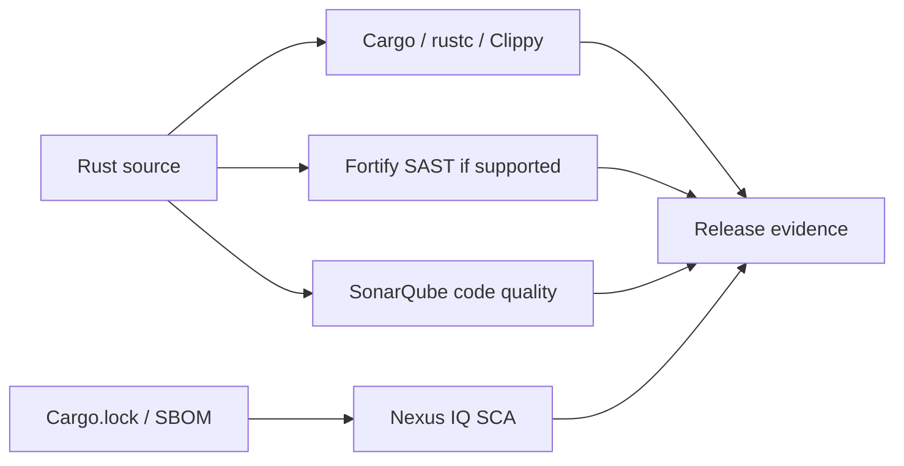

# SAST and security analysis concepts

Static application security testing (SAST) examines program structure and data flows without requiring the normal application to run. Unlike software composition analysis (SCA), which focuses on known risks in third-party components, SAST asks whether application code contains dangerous patterns: injection paths, weak cryptography, untrusted data handling, or missing authorization checks. A tool finding is evidence for review, not a complete exploit demonstration.

## Four evidence streams in the Rust pipeline

The compiler verifies Rust language constraints; Clippy reports lints; Fortify evaluates security patterns using its supported analysis engines; Nexus IQ evaluates components; SonarQube supplies code-quality evidence. These results are complementary and must not be combined as if they measure the same thing.

| Term | Practical meaning | Limit |
|---|---|---|
| Source | Code submitted for analysis | May omit generated or external code |
| Taint source | Entry of untrusted data | Identification is tool/language dependent |
| Sink | Potentially dangerous operation | Context determines exploitability |
| Data flow | Path connecting input to operation | Analyzer may approximate behavior |
| Finding | Reported potential weakness | Can be false positive |
| Severity | Priority indicator | Not proof of actual impact |

## How a data-flow finding arises

Imagine a REST endpoint accepting a path and passing it to a file operation. An analyzer may track the request parameter from the entry point through intermediate functions into a filesystem API. It may report path traversal if the path is insufficiently constrained. The reviewer must inspect actual validation, canonicalization, permissions and reachable call paths. Rust's ownership model does not eliminate this business-logic vulnerability.

## What SAST cannot prove

Static analyzers do not guarantee detection of every vulnerability. Reflection, macros, generated code, cross-language calls, complex control flow and unsupported frameworks can limit visibility. Even a zero-findings result cannot prove secure authorization or absence of runtime misconfiguration.

## Enterprise interpretation

Define who owns triage, what counts as a blocking finding, how exceptions are approved and how evidence is preserved. Keep detection distinct from enforcement: the scanner reports evidence; a policy decides what to do with it.

**Key relationship:** P8 SonarQube and P9 Nexus IQ are adjacent evidence streams, not substitutes for SAST.
