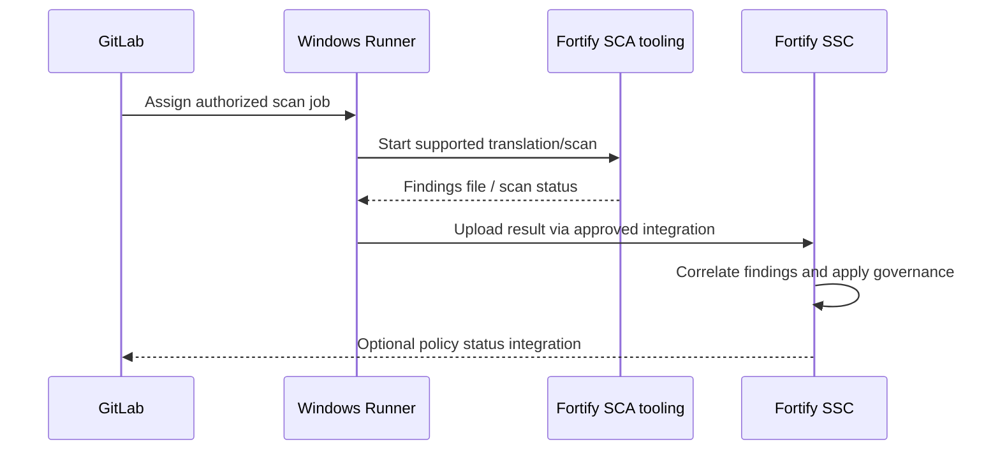

# Fortify products and architecture

Fortify is a family of application security capabilities, not one universal executable. Enterprise deployments may involve **Fortify Static Code Analyzer (SCA)**, **Fortify Software Security Center (SSC)**, **Fortify on Demand (FoD)**, or newer OpenText-branded offerings. Product names, packaging, APIs, and license entitlements change. Before designing CI, identify the actual installed product and supported version.

## Reference architecture: self-managed SCA and SSC

In a traditional SCA workflow, source translation constructs an intermediate representation and a scan produces findings. SSC is a centralized management and reporting platform; it does not replace the local analyzer. Hosted offerings may use a different upload and scan lifecycle. Do not transplant a command line from one Fortify product into another.

| Component | Primary role | Operational owner |
|---|---|---|
| GitLab | Schedule jobs, protect variables, retain artifacts | CI/platform team |
| Windows Runner | Execute tools under service identity | Windows/platform team |
| Fortify SCA | Perform supported static analysis | AppSec/tooling team |
| SSC or hosted service | Store, correlate, review, govern findings | AppSec |
| Policy integration | Translate results into CI acceptance | AppSec + release governance |

## The trust boundaries

The runner must be permitted to execute the scanner, access its license/configuration, and contact the reporting service. Scanner credentials and reporting tokens should be scoped and managed as secrets. Windows service identities may differ from developer logins; successful interactive scanning does not imply CI readiness.

## Artifact versus report server

A scan may generate a native findings file (for example, a Fortify-specific results artifact). This can be uploaded to GitLab for job-to-job handoff or to a centralized security platform for triage. GitLab artifact retention is not the same as the security platform's finding history or audit retention.

## Architecture decision record

Document the product edition, version, deployment model, scanner location, supported source languages, authentication method, outbound endpoints, reporting destination, policy authority, and expected failure behavior when the service is unavailable. Without this inventory, a pipeline diagram may be technically attractive but impossible to implement.

**Conclusion:** Fortify integration is a multi-component security workflow whose shape depends on the specific product and its supported languages.
