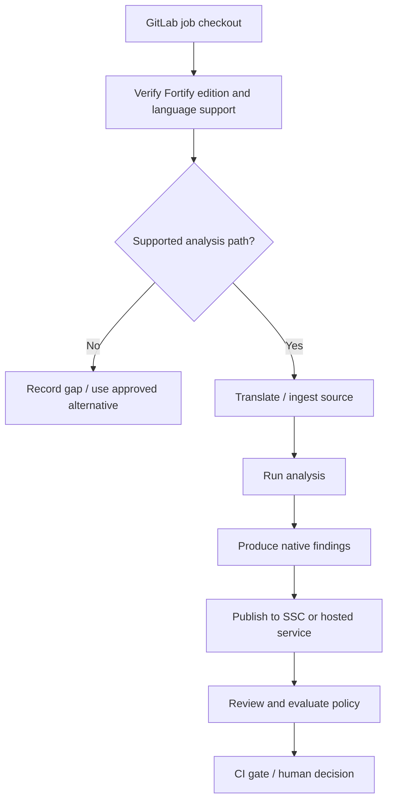

# Source analysis and execution flows

A traditional Fortify static-analysis flow has **translation**, **scan**, **result publication**, and **policy evaluation** phases. The exact commands and artifacts depend on the product, release, and language support. This chapter describes the lifecycle conceptually rather than claiming a verified Rust scanner command.



## Translation and analysis

Translation identifies source files, dependencies and language constructs to build an analyzable representation. For some supported languages, the scanner integrates with a compiler or build command; for others, source files are ingested directly. Scan then applies rules and data-flow analysis to the translated representation. Translation success does not mean the subsequent scan will be complete or successful.

## A job design without fabricated commands

```yaml
fortify_review:
  stage: security
  tags: [windows, security]
  script:
    - 'Write-Host "Fortify integration requires approved product-specific commands"'
    - 'throw "Replace this placeholder only after Rust support and licensing are verified"'
```

This intentionally fails: it is a **documentation placeholder**, not a runnable Fortify integration. Production YAML must use the exact supported CLI or API for the enterprise deployment. Silently succeeding without scanning would give misleading assurance.

## Output and handoff

The scan result may be a proprietary findings file, an API-submitted analysis, or a hosted scan identifier. The upload step can fail independently of the scan. Separate logs and statuses for each phase so that a successful analysis is not confused with successful publication or policy acceptance.

| Failure point | Example | Next evidence |
|---|---|---|
| Preflight | Unsupported Rust version | Product support matrix |
| Translation | Unresolved dependencies | Translation logs |
| Scan | Memory exhaustion | Analyzer resource logs |
| Publication | 401/403 | Token scope and endpoint |
| Policy | Blocking issue | Policy and reviewed findings |

## Windows execution considerations

A Shell runner uses the service account's PATH, file permissions, proxy settings and certificate trust. Resource-heavy scans may need memory limits and concurrency controls. A shared host may also expose security tokens to other jobs if isolation is weak.

**Conclusion:** Model Fortify as a sequence of separately verifiable stages, and do not claim analysis coverage where language support is unknown.
