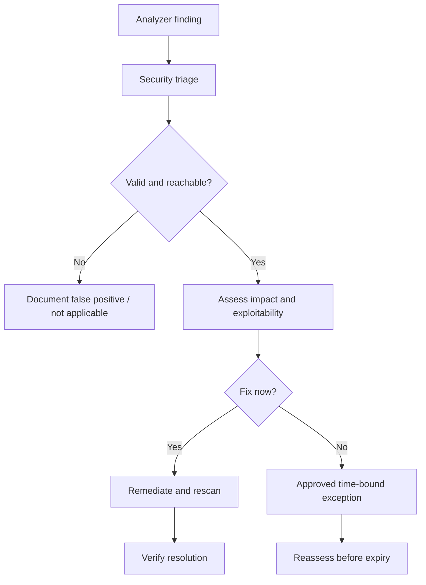

# Vulnerabilities, findings and severity

A Fortify finding typically identifies a suspected weakness, its location, category, evidence, and some form of severity or priority. The organization must distinguish *detection*, *triage*, *risk acceptance*, and *remediation*. A scanner finding should not be equated automatically with an exploitable production vulnerability.

## The finding lifecycle

## Categories and severity

Findings may be mapped to CWE categories, rule identifiers, or vendor-specific priority schemes. Severity can reflect analyzer confidence, potential impact, or organizational policy. Avoid assuming Fortify's severity values map directly to CVSS scores: CVSS is primarily used for vulnerability severity, and a static finding may lack enough context for a reliable score.

| Evidence | Question answered | Missing context |
|---|---|---|
| Rule/category | What pattern was detected? | Is it reachable? |
| File and line | Where is evidence located? | Is code generated or deployed? |
| Data-flow trace | How could input reach a sink? | Are controls effective? |
| Severity | How urgently should it be reviewed? | Actual business impact |
| Triage status | What did reviewers decide? | Is decision still valid? |

## Rust example: security beyond memory safety

Rust reduces certain memory-safety risks, but it does not automatically prevent SQL injection, command injection, insecure deserialization, path traversal, authentication bypass or accidental secret exposure. The application architecture and external API usage still determine these risks. Whether Fortify detects a particular pattern in Rust depends on verified analyzer support.

## Comparing tools

Nexus IQ may flag a vulnerable version of a third-party crate. Fortify may flag a dangerous application data flow. SonarQube may flag maintainability or supported security issues. All three could report on one release, but findings should retain their original provenance and not be deduplicated merely because labels sound similar.

## Enterprise triage governance

Record reviewer identity, rationale, supporting evidence, remediation owner, due date and exception expiry. Prefer a policy that prioritizes new critical findings while explicitly tracking accepted legacy debt. A green CI gate should mean the defined policy was met, not that the product has no security risk.

**Conclusion:** Security findings become actionable only when tied to context, ownership and a reviewable decision.
