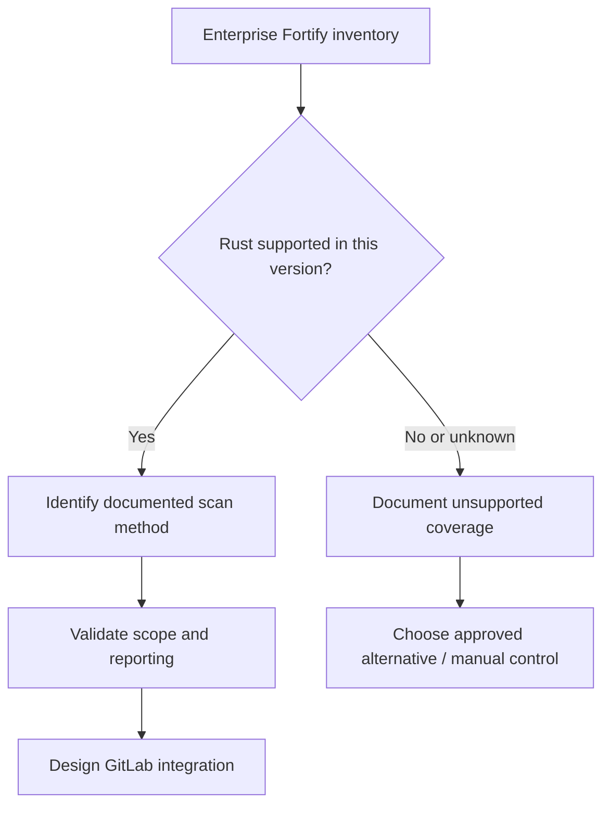

# Rust support and analysis limitations

**Do not assume Fortify SCA supports Rust simply because a pipeline uses Cargo.** Fortify's supported languages, translation methods, and capabilities vary by product and release. A vendor's general reference to Rust support may apply to a different product, an updated analyzer, or a hosted service. This is the highest-priority compatibility question in a Rust/Fortify integration.

## Verification matrix before implementation

| Question | Evidence required | Why it matters |
|---|---|---|
| Which Fortify product? | Installed edition and version | Different scan paths |
| Is Rust supported? | Official version-specific language matrix | Prevents false assurance |
| Which Rust features? | Analyzer documentation | Macros and async code may vary |
| Which input format? | Supported CLI/API documentation | Determines integration |
| Which output/report? | Supported artifact schema | Enables gating and triage |
| Which Windows runtime? | Platform prerequisites | Service compatibility |

## Rust-specific technical concerns

Cargo workspaces contain multiple crates and dependency graphs. Build scripts (`build.rs`), procedural macros, generated code, conditional compilation, feature flags, target triples, and FFI can change the code analyzed. Even a supported analyzer may only cover some of these constructs. A scan of the `src/` directory is not proof that every compiled code path was examined.

### Build configuration as evidence

Record `Cargo.lock`, Rust toolchain version, target triple, enabled features, workspace members and relevant environment flags. This makes it easier to compare what the compiler built with what the security scanner analyzed. Never infer equivalent coverage from a shared commit hash alone.

## Alternatives when unsupported

Use approved complementary controls: compiler and Clippy checks, dependency analysis, threat modeling, focused code review, tests and a Rust-capable security analyzer if sanctioned by the organization. These controls can reduce risk but must not be represented as a Fortify scan. Explicitly mark the coverage gap in release evidence.

## Why a fabricated CLI is dangerous

A CI job that exits zero while merely uploading an empty or unsupported report can produce a green pipeline without analyzing Rust. Documentation should therefore separate verified support, conceptual workflows and illustrative placeholders. The burden of proof is on the integration design.

**Conclusion:** Verify language support first, then design scanning. Never invert that order.
