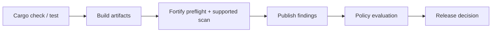

# GitLab integration and configuration

A Fortify stage should be designed as a security evidence producer with explicit inputs, outputs, permissions and gate semantics. GitLab coordinates jobs and artifacts; the Windows runner executes the approved Fortify integration; the Fortify service stores and reviews findings. The pipeline should make scan coverage and policy decisions visible rather than hiding them behind a generic successful command.

## Conceptual job graph



## Deliberately non-executable example

```yaml
stages: [build, security, release]

fortify_security:
  stage: security
  tags: [windows, security]
  variables:
    FORTIFY_ENDPOINT: "$FORTIFY_SERVER_URL"
  script:
    - 'Write-Host "Requires verified Fortify Rust integration"'
    - 'throw "Not configured: scanner commands and policy API must be approved"'
  allow_failure: false
```

The example documents intent, not a working scanner. It fails rather than falsely claiming security coverage. In a real integration, replace it with supported product-specific commands, check exit codes, preserve sanitized logs, publish scan artifacts, and explicitly evaluate the policy outcome.

## Authentication and secrets

Use protected/masked GitLab variables or approved external secret integration for tokens. The endpoint may be non-secret, but credentials must not be embedded in YAML, PowerShell scripts, cache archives or generated findings. If merge-request pipelines are untrusted, do not expose privileged upload credentials to them.

## Artifact handoff

If the scan and publication are separate jobs, pass the result through GitLab artifacts with `needs:artifacts`, not through a shared Windows directory. Decide retention based on audit requirements; GitLab's artifact expiry is not a replacement for Fortify's central finding history.

## Gating strategies

| Strategy | Strength | Concern |
|---|---|---|
| Fail on scan execution error | Detects tool failure | Not necessarily policy enforcement |
| Query server policy | Central governance | Needs API, authorization, timeout logic |
| Manual AppSec approval | Context-sensitive | Slower, requires audit trail |
| `allow_failure: true` | Nonblocking adoption | Must not be misrepresented as a security gate |

## Merge request and branch handling

Review whether a scan should run on every branch, only protected refs, or scheduled builds. Resource-heavy security scans may require a different cadence, but release policy should clearly state which commit was scanned and how results relate to the artifact being released.

**Conclusion:** Integrate only a verified Fortify scan path, and make execution failure and policy failure independently observable.
