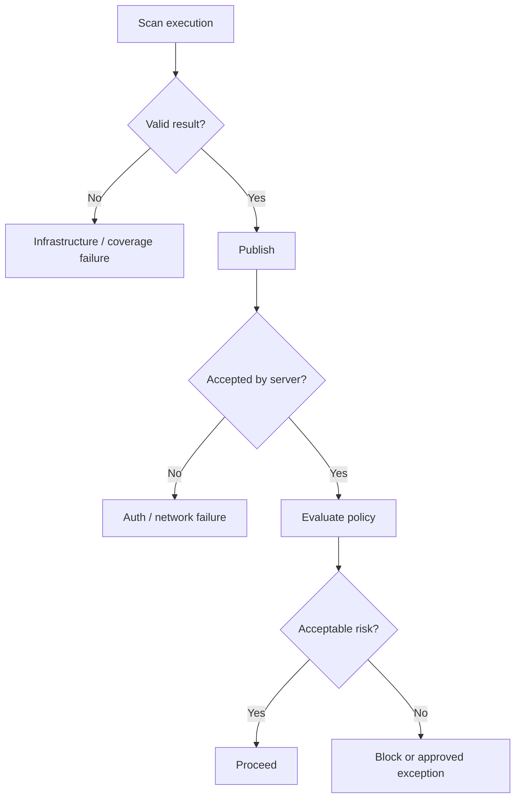

# Authentication, policies and security gates

A Fortify security gate is a **policy decision over analyzed evidence**, not merely a scanner process exit code. The gate may consider finding severity, new versus existing issues, triage state, accepted risk and the application stage. The exact policy engine depends on whether the enterprise uses SSC, FoD or another Fortify offering.

## Separate three outcomes

1. **Execution outcome:** Did the scanner complete and produce valid results?
2. **Publication outcome:** Were results accepted by the intended reporting system?
3. **Policy outcome:** Does the analysis satisfy the organization's release criteria?

## Credential model

Use separate identities where practical for scan submission, result reading and administrative policy changes. Restrict tokens to the intended application/project and rotate them under policy. Protect Windows runner `config.toml`, tool installations and filesystem access. A masked CI variable is not a sandbox: malicious job code that receives a token can attempt to use it.

## Failure semantics

An unavailable Fortify server should not silently turn a protected release green. Define whether to fail closed, retry within bounded limits or require an auditable manual exception. Timeouts and server queue delays should be distinguished from a policy rejection. The build can be technically correct yet not approved for release.

| Condition | Typical classification | Appropriate owner |
|---|---|---|
| Scanner crashed | Technical failure | CI/platform + AppSec tooling |
| Upload unauthorized | Identity/configuration | AppSec integration owner |
| Critical finding | Security policy failure | Application + AppSec |
| Exception approved | Governance decision | Authorized risk owner |
| Server unreachable | Service availability | Platform/service owner |

## Policy changes and drift

If a quality/security policy changes after a scan, historical results may need reinterpretation. Record policy version or decision context where supported. Do not rewrite history by describing a previously passing scan as proof it met today's rules.

## Relationship to GitLab protections

Protected branches and runner restrictions reduce which jobs can access privileged credentials. However, once a Shell job starts, Windows host permissions govern its reach. Use separate runners or isolated environments for sensitive security publication and release operations.

**Conclusion:** A defensible gate requires explicit identity, evidence, decision criteria, and failure behavior.
