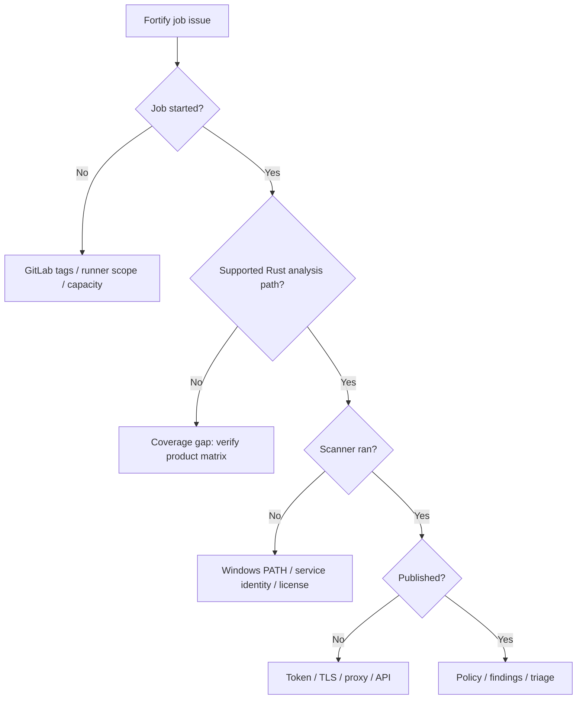

# Enterprise operations and troubleshooting

Fortify incidents should be investigated by **lifecycle phase**: eligibility, runtime preparation, language support, translation, scan, upload, server processing and policy evaluation. Each phase has different logs, permissions and owners. Changing CI YAML at random often obscures the real failure.

## Diagnostic matrix

| Symptom | First evidence | Avoid |
|---|---|---|
| Job pending | Tags, scope, protection | Reinstalling scanner |
| Executable missing | Service PATH, tool inventory | Using developer home paths |
| Unsupported language | Vendor support matrix | Fake success placeholders |
| Scan memory failure | Analyzer logs, RAM, concurrency | Unlimited retries |
| 401/403 upload | Token scope, endpoint | Printing secret |
| TLS failure | Client trust and proxy | Disabling certificate checks |
| Policy rejected | Finding list and gate rule | Changing severity blindly |
| No findings | Coverage and scan completeness | Assuming zero risk |

## Case: developer scan succeeds, CI fails

Confirm the Windows runner's service account and its PATH, license access, temp directories and network proxy. An interactive login may have permissions and certificates that the service identity lacks. Reproduce the *environmental conditions* rather than relying on an administrator's console.

## Case: upload succeeds, release gate does not change

Determine whether the pipeline waits for server-side processing, whether the result belongs to the correct application/version, and whether an explicit policy query or status integration exists. A successful HTTP upload does not equal an approved release.

## Case: scan reports no issues for Rust

This is a potential coverage incident. Confirm the product's Rust support, translation log, number of files/functions analyzed, enabled rules and actual source inclusion. Zero findings without verified analysis coverage is not meaningful assurance.

## Operations baseline

Maintain tool versions, license state, runner host inventory, scan resource requirements, network endpoints, token rotation, policy ownership, report retention and an escalation route. Security logs may contain internal paths and sensitive metadata; sanitize evidence before distribution.

## Prevention

Use preflight checks for scanner availability and language support, deterministic toolchain documentation, explicit artifact paths and bounded retries for transient publication failures. Store troubleshooting decisions in a runbook, not only in an individual engineer's shell history.

**Conclusion:** Troubleshooting should preserve evidence and distinguish missing security coverage from a clean security result.
