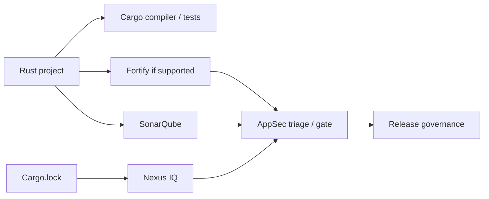

# P10 conclusions and competency validation

P10 connects static application security analysis to the existing Rust/GitLab/Windows Runner knowledge. Its most important constraint is **version-specific Rust support**: do not write a production Fortify command until the enterprise's product, edition and supported language matrix have been verified.

## Consolidated model

## The distinctions that matter

| Concept pair | Correct distinction |
|---|---|
| Fortify SAST / Nexus IQ SCA | Application-code patterns / third-party component risks |
| Scanner / SSC or hosted platform | Analyze code / central reporting and governance |
| Scan succeeded / coverage complete | Tool completed / relevant code actually analyzed |
| Findings / vulnerabilities | Suspected issues / confirmed security risk |
| Upload success / policy pass | Result stored / release criteria satisfied |
| GitLab variables / Windows account | Job-level secrets / host-level privileges |

## L1 — Understand

- [ ] Describe SAST versus SCA and code-quality analysis.
- [ ] Explain the translation, scan, publication and gate lifecycle.
- [ ] Identify the role of SCA, SSC and hosted offerings without treating them as identical.
- [ ] Explain why Rust memory safety does not eliminate application vulnerabilities.
- [ ] State why zero findings cannot prove complete coverage.

## L2 — Modify

- [ ] Identify the installed Fortify edition and supported Rust analysis path.
- [ ] Review a Windows GitLab job for secret exposure and unsafe runner sharing.
- [ ] Design artifact handoff between scan and publication jobs.
- [ ] Define explicit technical-failure and policy-failure handling.
- [ ] Document required service account permissions and network trust.

## L3 — Troubleshoot

- [ ] Diagnose scanner missing from the Windows service PATH.
- [ ] Differentiate translation failures from scan failures.
- [ ] Investigate an upload 403 without printing tokens.
- [ ] Explain a green scan step with a red security policy result.
- [ ] Recognize unsupported Rust analysis as a coverage gap.

## Three enterprise tabletop scenarios

**A.** The pipeline shows success but the Fortify report is empty. First verify that Rust analysis is supported and that actual source was analyzed; do not interpret emptiness as security.

**B.** Fortify finds a high-severity issue in a protected release. Record finding provenance, validate the data flow, assign ownership and follow the defined gate or exception workflow.

**C.** Scanner results upload but the policy service is unavailable. Apply the organization's documented fail-closed, retry or auditable exception policy; never silently treat an outage as approval.

## Relationship to P11 and P12

P11 will combine Cargo, Windows Runner, SonarQube, Nexus IQ and Fortify into one enterprise pipeline design. P12 will build cross-tool incident triage. P10 contributes the SAST evidence stream and its governance boundaries.

**Scope:** These are conceptual, version-qualified examples. No enterprise Fortify installation or scan was performed, and no product-specific Rust CLI is claimed to work without verification.
