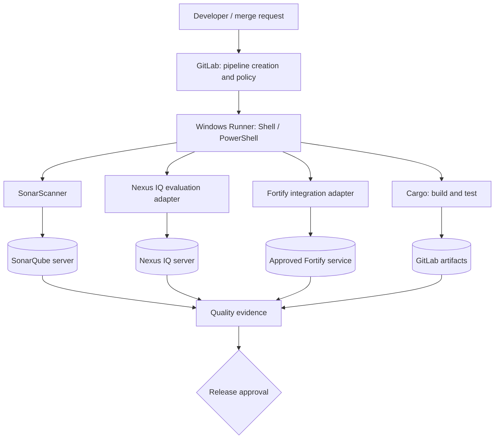

# Integrated architecture and responsibilities

## The system, not just the YAML

A Rust enterprise CI/CD pipeline is a distributed system whose control plane is GitLab, execution plane is a fleet of Windows GitLab Runners, and analysis plane includes SonarQube, Nexus IQ and Fortify. Cargo is invoked on a runner, not on the GitLab server. The GitLab YAML declares jobs and their relationships, but it cannot install approved toolchains, provision scanner accounts, repair TLS trust or define the corporate risk policy.

## Ownership matrix

| Layer | Primary owner | Contract with adjacent layers |
|---|---|---|
| GitLab project | Development team | Valid YAML, branches, job graph, versioned configuration |
| GitLab administrators | Platform team | Runner assignment, protected refs, variable policy |
| Windows Runner VM | Infrastructure team | Service account, ACLs, tools, capacity, network |
| Cargo and Rust source | Development team | Locked dependency graph, repeatable commands |
| SonarQube | Code quality team | Supported analyzer, quality profile and gate |
| Nexus IQ | Open-source governance team | Accepted manifest/SBOM format, stage and policies |
| Fortify | Application security team | Supported Rust analysis route and finding policy |
| Release gate | Delivery governance | Evidence requirements, failure behavior and exceptions |

The analysis tools answer different questions. SonarQube evaluates supported source-level maintainability, reliability and security rules; Nexus IQ evaluates third-party component risk and license obligations; Fortify provides security analysis through the supported Fortify product workflow. They should not be collapsed into a single vague “security scan” job.

## Control-plane and data-plane separation

GitLab creates the pipeline and controls scheduling. A runner requests jobs and executes scripts with its Windows service identity. Artifacts transfer build outputs and reports between independently scheduled jobs. External services process scan submissions and may produce results asynchronously. A pipeline's final status must reflect **policy evaluation**, not merely successful HTTP uploads.

### Four trust boundaries

1. **Repository to runner:** project code runs with the executor's effective privileges. Windows Shell provides weak isolation.
2. **GitLab to runner:** authenticated runner requests and protected-ref eligibility restrict scheduling, but do not sandbox processes.
3. **Runner to scanner services:** tokens and TLS trust are tool-specific; a working Git checkout proves nothing about SonarQube connectivity.
4. **Evidence to release:** the release decision must distinguish pass, fail, unavailable, unsupported and waived controls.

## Enterprise design choice

Prefer separate build/test, analysis and release jobs with explicit `needs` relationships. Build once for a given commit and reuse the exact binary through artifacts where practical. A scanner can inspect source or dependency metadata without necessarily consuming the compiled binary; do not manufacture dependencies just to produce a visually linear pipeline.

A sensitive release runner should not also execute untrusted merge-request code. If Windows Shell is mandatory, isolate trusted and untrusted workloads on different hosts or VMs, with independent credentials and storage.

## Review scenario

A pipeline is green after uploading results to three services, but Fortify findings have not yet been processed. Is the release approved? No: the evidence is incomplete. Determine whether each adapter waited for an authoritative evaluation result and whether the final gate interpreted it.

**Outcome:** Understand the pipeline as a set of contracts across teams and services. YAML is the orchestration document, not the entire architecture.
