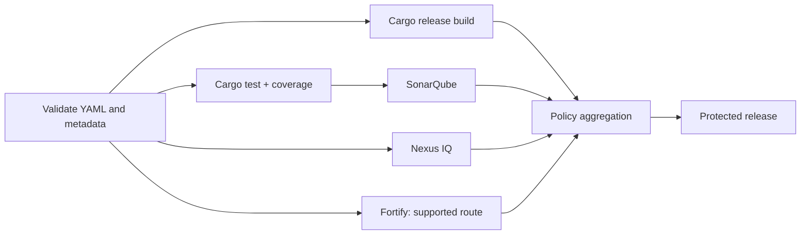

# Pipeline design and execution graph

## Stages communicate intent; `needs` expresses actual dependencies

A GitLab stage list provides coarse ordering. Jobs in the same stage may run concurrently. `needs` creates a directed acyclic graph (DAG), allowing a job to start as soon as its declared predecessors complete, even if unrelated jobs in earlier stages remain active. This is useful when SonarQube, Nexus IQ and Fortify evaluations can run independently.



The graph is conceptual. If the Fortify analyzer requires a compilation capture, that branch may depend on a dedicated build step. If Nexus IQ consumes an SBOM, its producer must run first. Dependencies should be grounded in **required inputs**, not a preference for sequential stages.

## YAML design fragment

```yaml
stages: [validate, test, build, analyze, gate, release]

cargo_test:
  stage: test
  tags: [windows, rust]
  script:
    - 'cargo test --locked'

cargo_build:
  stage: build
  tags: [windows, rust]
  script:
    - 'cargo build --release --locked'
  artifacts:
    paths:
      - target/release/example.exe
    expire_in: 7 days

sonar_analysis:
  stage: analyze
  tags: [windows, sonar]
  needs:
    - job: cargo_test
      artifacts: false
  script:
    - 'Write-Host "Scanner invocation defined by approved integration"'
```

The Sonar job above is intentionally **not** an operational analysis: its script is a placeholder. It illustrates a dependency only. A real job must use the approved scanner and reports, then enforce its result. Do not copy this as a functioning security gate.

## Job status semantics

| Status | Interpretation | Release consequence |
|---|---|---|
| Success | The configured job completed | May still lack external gate evidence |
| Failed | Script or required step failed | Block unless documented exception |
| Skipped | Rule excluded job | Acceptable only when control not required |
| Manual | Waiting for intervention | Not automatically approved |
| Allowed failure | Failure does not fail pipeline | Dangerous for mandatory gates |
| Canceled | Evaluation incomplete | Must not count as passing |

## Rules and pipeline sources

Push, merge request, scheduled and tag pipelines may need different behavior. A protected release tag might trigger signing and publication; an untrusted merge request should not access signing credentials. `workflow:rules` governs pipeline creation, whereas job-level `rules` governs inclusion of a job. Confusing them can create duplicate pipelines or omit a mandatory scanner.

## Concurrency and cost

Parallel analysis reduces wall-clock time but can overwhelm Windows hosts or scanner service quotas. Concurrency is controlled partly by runner configuration and partly by the available runner fleet. A DAG does not guarantee simultaneous execution. The pipeline should remain correct when one branch queues for capacity.

## Artifact dependencies

With `needs`, explicitly specify which upstream artifacts are downloaded. Reports needed by an analysis job should be produced and transferred as artifacts. Do not rely on files left on a shared Shell host. Keep cache usage orthogonal: a cache miss should slow work, not change correctness.

## Graph review checklist

For every edge, ask: what exact file, metadata or approval does the downstream job need? For every gate, ask: what does success prove? For every skipped branch, ask: is the skip authorized for this pipeline source? For every scanner, ask: how is asynchronous completion represented?

**Outcome:** Model the pipeline as an evidence-producing DAG, not a single long script.
