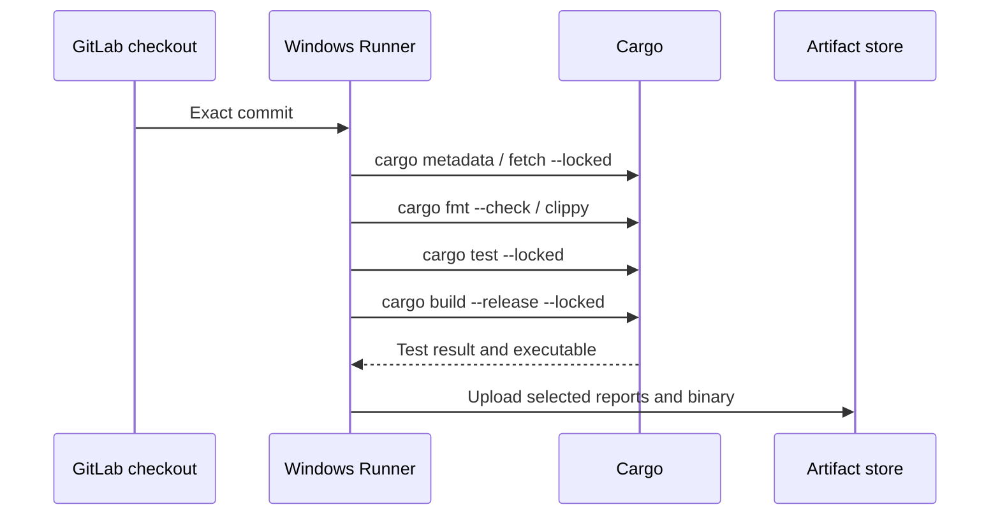

# Rust/Cargo build and test flow

## From repository state to reproducible evidence

Cargo reads `Cargo.toml` and resolves dependencies against `Cargo.lock` when present. For an application repository, committing `Cargo.lock` and using `--locked` helps prevent a pipeline from silently modifying dependency resolution. It does not by itself pin the Rust compiler, system libraries, linker or scanner versions. Those belong in the environment reproducibility plan.



## Distinguish the tools

| Command | Purpose | What it does not prove |
|---|---|---|
| `cargo metadata` | Describe package graph | Dependencies are safe |
| `cargo fmt --check` | Verify formatting | Code is correct |
| `cargo clippy -- -D warnings` | Enforce selected lints | No security flaws |
| `cargo test --locked` | Execute configured tests | All behaviors are covered |
| `cargo build --release --locked` | Produce optimized binary | Release policy is satisfied |

## Windows PowerShell example

```yaml
rust_verify:
  stage: test
  tags: [windows, rust]
  script:
    - 'cargo fmt --all -- --check'
    - 'if ($LASTEXITCODE -ne 0) { throw "Formatting failed" }'
    - 'cargo clippy --workspace --all-targets -- -D warnings'
    - 'if ($LASTEXITCODE -ne 0) { throw "Clippy failed" }'
    - 'cargo test --workspace --locked'
    - 'if ($LASTEXITCODE -ne 0) { throw "Tests failed" }'
```

This example assumes `rustfmt` and Clippy components are installed for the toolchain. The explicit `$LASTEXITCODE` checks are useful when a native executable is invoked from PowerShell; behavior can vary with shell version and runner-generated scripts.

## Dependency and compiler boundaries

Rust's `target/` contains build outputs and incremental state. Cache registry downloads under a project-relative `CARGO_HOME` when practical, but do not assume `target/` can be shared safely between toolchains, targets or Windows hosts. Release executables should be uploaded as artifacts, not delivered through a cache.

A native Windows MSVC build may require Visual Studio Build Tools, a linker, SDKs and C/C++ libraries. A successful `rustc --version` check does not prove the linker toolchain is complete. The runner service account must see these tools on its PATH and have permission to use them.

## Coverage and scanner input

Coverage is produced by separate instrumentation and test tooling, not by SonarQube. If the enterprise SonarQube analyzer accepts a particular Rust coverage format, generate that format and publish it as an artifact for the analysis job. Verify supported formats and source path mapping against the installed SonarQube edition/version.

Nexus IQ may need a supported manifest, lockfile, SBOM or resolved dependency inventory. `Cargo.lock` alone does not guarantee complete detection by the enterprise integration. Confirm the ingestion contract and validate component counts against `cargo metadata` or an independent inventory.

Fortify's Rust analysis capabilities depend on the exact product and version. Do not add an imaginary `sourceanalyzer` Rust invocation to the build; use the organization's documented supported analysis path, or explicitly record the gap.

## Reproducibility contract

Capture the commit SHA, Cargo.lock revision, Rust toolchain, target triple, build profile, significant flags and relevant tool versions. A release artifact should be traceable back to this input set. Where governance requires stronger provenance, add checksums and a signed attestation through approved infrastructure.

**Outcome:** Build correctness is the foundation, but it is only one stream of release evidence.
