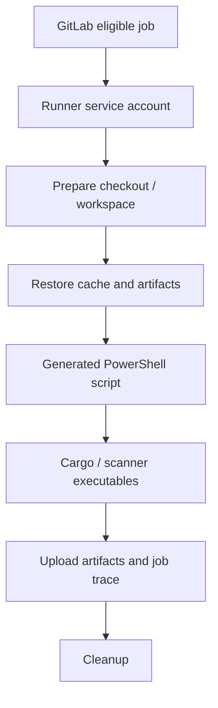

# Windows Runner execution flow

## The service account is the runtime

A GitLab Windows Shell runner executes job scripts through a configured shell such as `pwsh`. The effective user is normally the Windows service account running GitLab Runner, not the developer who installed Cargo interactively. This affects PATH, `%USERPROFILE%`, certificate stores, network shares, proxy settings and NTFS ACLs.



## Runner-side versus project-side configuration

| Concern | Location | Owner |
|---|---|---|
| Shell executor and `shell = "pwsh"` | `config.toml` | Runner administrator |
| `concurrent`, runner `limit` | `config.toml` | Runner administrator |
| Tags, `script`, `needs` | `.gitlab-ci.yml` | Repository maintainers |
| Service account, PATH, ACLs | Windows host | Infrastructure |
| Protected CI variables | GitLab settings | Authorized project/group admins |
| Scanner endpoint and credentials | CI variables + approved integrations | Platform/security teams |

## Preflight reasoning

A preflight job can check that the host exposes expected tools, without dumping secrets or changing the host:

```powershell
Write-Host "Identity: $([Security.Principal.WindowsIdentity]::GetCurrent().Name)"
Write-Host "Project: $env:CI_PROJECT_DIR"
Get-Command git, cargo, rustc -ErrorAction Stop |
  Select-Object Name, Source
cargo --version
if ($LASTEXITCODE -ne 0) { throw 'Cargo preflight failed' }
```

This is a diagnostic sketch, not a substitute for centrally managed host provisioning. Never print all environment variables because they may contain credentials.

## Runner eligibility versus execution

A pending job may be caused by tag mismatch, runner scope, protection rules, paused state or capacity. Once the job starts, failures such as “cargo not found,” PowerShell quoting errors and TLS issues belong to the execution environment. Debugging these as GitLab scheduling failures wastes time.

## Filesystem persistence

Shell jobs can leave files and processes on a persistent host. A build directory reused by another job is not a supported data-transfer contract. Explicit artifacts transfer required outputs; caches provide optional acceleration. Concurrent jobs should not rely on global writable tool directories or identical temp paths.

## TLS and corporate proxies

GitLab Runner, Git, Cargo, SonarScanner, Nexus IQ adapters and Fortify clients may each use distinct TLS implementations and proxy settings. One successful HTTPS call does not validate all others. Identify the failing client, endpoint, service identity, certificate chain and proxy route. Never disable TLS verification as an operational fix.

## Isolation recommendation

Separate untrusted merge-request jobs from privileged signing or release jobs. A protected GitLab runner limits assignment, but Windows Shell does not sandbox arbitrary code from other jobs on the same machine. Dedicated VMs and least-privilege service accounts are stronger controls.

**Outcome:** The runner is a persistent Windows execution environment with its own lifecycle and security obligations.
