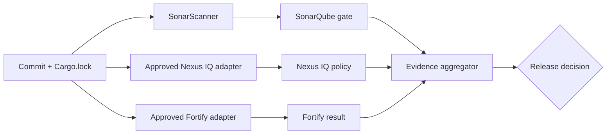

# Orchestrating SonarQube, Nexus IQ and Fortify

## Three tools, three evidence contracts

The most important integration decision is to define what constitutes an authoritative result from each scanner. An HTTP upload, successful CLI exit or report file is not necessarily equivalent to a passed policy evaluation. Enterprise integrations must identify the supported analysis route, wait for processing where needed, interpret policy outcomes and fail safely when evidence is unavailable.

| Tool | Primary question | Typical evidence | Caveat |
|---|---|---|---|
| SonarQube | Does code meet configured quality conditions? | Analysis task and quality gate | Rust analyzer and coverage support are version-dependent |
| Nexus IQ | Are components and licenses acceptable? | Application-stage policy evaluation | Rust ingestion/SBOM compatibility must be confirmed |
| Fortify | What security findings arise from supported analysis? | Findings, audit state, policy outcome | Rust support varies by Fortify product/version |

## SonarQube flow

Run the approved scanner with project metadata and optional supported coverage report. The scanner submits an analysis; the server processes it and computes a gate. The pipeline should wait for or retrieve the final gate status if it is mandatory. A scanner upload success is insufficient for a release gate.

## Nexus IQ flow

Produce an inventory through the organization's supported mechanism: manifest analysis, a supported SBOM format or a validated scanner integration. Submit to the correct application and stage, then interpret the server's policy evaluation. A warning-only policy differs from a blocking policy. Verify that the submitted inventory actually contains the expected Cargo components.

## Fortify flow

Identify the installed product (for example, a Fortify Static Code Analyzer workflow versus a cloud service), its licensed capabilities, Rust language support, approved submission format and policy. If Rust is not supported, mark the control **unsupported** and route to a documented alternative or exception. Never mark it “passed” because a placeholder job exited zero.

## Normalize statuses, preserve provenance

An aggregator can normalize vendor results into `PASS`, `FAIL`, `UNAVAILABLE`, `UNSUPPORTED` and `WAIVED`, but it should preserve native report links, timestamps, project identifiers, policy versions and finding summaries. A waiver must include authority, scope and expiry. `UNAVAILABLE` is not `PASS`.

## Timeouts and transient failures

External services may be unavailable, rate-limited or still processing. Distinguish transport retry from policy retry. Retrying a failed upload may be safe with idempotent requests; automatically retrying until a vulnerability disappears is not meaningful. Use bounded timeouts and make the release policy explicit.

## Example decision

SonarQube passes, Nexus IQ rejects a forbidden license, Fortify is still processing. The overall release result is **blocked** because Nexus IQ has failed; Fortify's pending state remains separately visible. A green Cargo build cannot override these results.

**Outcome:** Integrate scanners through explicit evidence contracts rather than a sequence of opaque commands.
