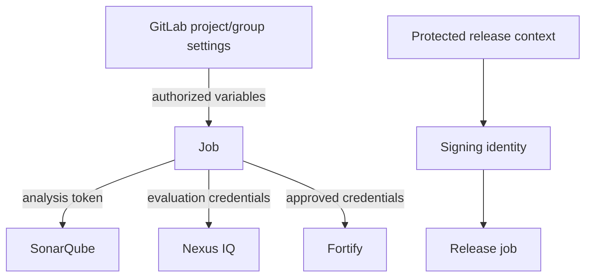

# Variables, permissions and secrets across the pipeline

## Separate identity, configuration and secret material

A pipeline commonly needs non-secret endpoints, application identifiers, scanner tokens, registry credentials and possibly release signing keys. These are not equivalent. A project key or URL can often be committed; a token must be stored through approved secret management and exposed only to the jobs that need it.

## Variable scope and protection

GitLab variables may be defined at project, group and instance levels, as well as in YAML or job context. Their precedence can be complex and version-sensitive. A job-level variable should not be assumed to override an enterprise-protected setting. Masked, hidden and protected attributes solve different problems: masking reduces accidental log disclosure, while protection restricts availability to eligible protected refs.

## Threat model for Windows Shell

A Shell job runs with the runner service account's host permissions. If credentials are permanently stored in accessible files or a shared profile, any job scheduled on that host may be able to read them. Restrict runner scope and trust level; isolate privileged jobs on separate hosts. Masking is not a sandbox against malicious scripts.

## Access-control matrix

| Actor | Needed capability | Avoid |
|---|---|---|
| Developer | Edit code and pipeline through review | Editing privileged runner host config |
| Maintainer | Manage project settings within policy | Unrestricted production signing credentials |
| Runner administrator | Maintain service, tools and config | Reusing one admin account for all jobs |
| Scanner service identity | Submit/evaluate one application | Global administrative rights |
| Release approver | Review evidence and authorize exceptions | Silent policy bypass |

## Secrets in logs, artifacts and caches

Never echo scanner tokens or write them into generated reports. A cache archive can outlive a job and be restored in a different context; it must not contain credentials. Artifacts should include only required outputs and sanitized diagnostics. Review PowerShell verbose/debug flags that might print command arguments containing tokens.

## TLS and certificate trust

A scanner's credential may be correct but unusable because its runtime rejects the server certificate. Correct the trust chain through enterprise-approved certificate stores. Do not work around this by disabling verification. Service accounts may use different trust or proxy configurations from interactive users.

## Release policy

A protected branch or tag alone is not sufficient authorization for a sensitive release. Combine protected refs, restricted runner access, approved CI variables, artifact provenance and explicit release approval where required.

**Outcome:** Design secret exposure and host trust together; GitLab variable settings alone cannot secure a privileged Windows Shell machine.
