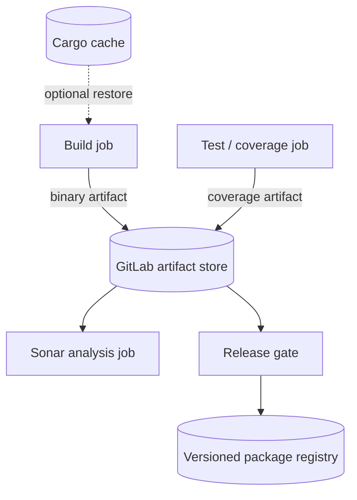

# Cache, artifacts and reporting contracts

## Why data movement must be explicit

GitLab jobs may execute on different Windows hosts. A file created in one job is not guaranteed to exist in another. Cache and artifacts solve distinct problems: a cache accelerates repeated work and may miss; an artifact transfers or retains the output of a particular job. A release package registry serves durable, versioned distribution.



## Cargo caching strategy

Cargo's registry and Git dependency directories are usually better cache candidates than the entire `target/` tree. A cache key should account for `Cargo.lock` and relevant toolchain/OS boundaries. Set `CARGO_HOME` to a project-relative path if the runner's cache implementation expects paths within the checkout.

```yaml
variables:
  CARGO_HOME: "$CI_PROJECT_DIR/.cargo"

cache:
  key:
    prefix: "windows-rust-stable"
    files:
      - Cargo.lock
  paths:
    - .cargo/registry/
    - .cargo/git/
```

The cache is optional and not a trusted dependency source by itself. Protected and unprotected pipeline contexts should not share writable privileged caches.

## Artifact contracts

| Artifact | Producer | Consumer | Retention intent |
|---|---|---|---|
| Release executable | Cargo build | Verification/release | Short CI handoff, then registry |
| Coverage report | Instrumented test job | Sonar analysis | Diagnosis and analysis |
| SBOM | Approved inventory generator | Nexus IQ adapter/governance | Audit period per policy |
| Scanner report | Scanner integration | Evidence gate/security review | According to sensitivity |
| Gate summary | Aggregation job | Release approval | Audit trail |

An artifact path is relative to the job workspace. If a Windows executable is produced under a target-triple-specific directory, the artifact path must reflect it. For a `needs` DAG, specify which producer artifacts are required rather than relying on default stage-based downloads.

## Reporting is not enforcement

A report uploaded as an artifact is useful for inspection, but a release decision needs a machine-readable authoritative outcome. Conversely, a failed scan should preserve enough sanitized evidence to explain the failure without publishing secrets. Report schema validation matters: GitLab-native report formats have defined structures, while vendor outputs may require adapters.

## Provenance and expiry

Record commit SHA, tool versions, scan timestamp, policy version and artifact checksum where governance requires traceability. GitLab artifact expiry is not an archival guarantee. Move durable release binaries to a versioned registry and maintain a retention policy for security evidence.

## Failure scenario

A packaging job cannot find the Rust binary although compilation succeeded. First check the build job's artifact upload log, exact filename and path, `needs:artifacts` declaration and expiry. Do not fix this by forcing both jobs onto the same Windows machine.

**Outcome:** Use cache for speed, artifacts for job contracts and registries for durable release assets.
