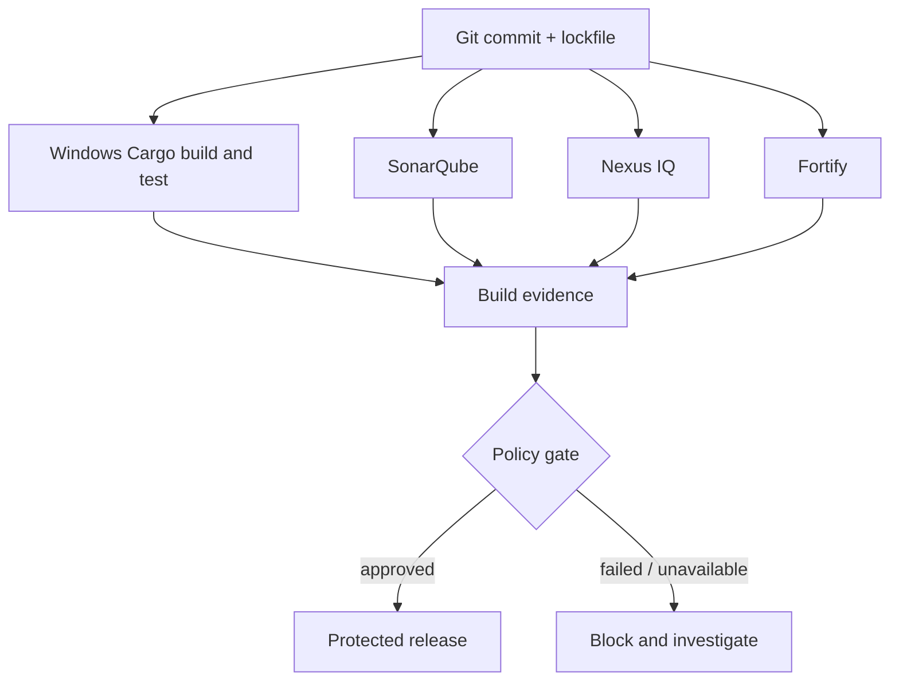

# P11 conclusions: integrated enterprise delivery

## What integration actually means

P11 combines earlier knowledge into one coherent delivery system. It is not enough to put `cargo build`, SonarQube, Nexus IQ and Fortify commands in the same YAML file. A reliable design must define inputs, outputs, permissions, ownership, policy decisions and failure semantics for each component.

## Eight architectural rules

1. **Separate control from execution.** GitLab schedules; Windows Runners execute.
2. **Make dependencies explicit.** Use `needs` for job graphs and artifact transfer.
3. **Treat cache as optional.** Cache misses must not alter correctness.
4. **Preserve provenance.** Link outputs to the exact commit, lockfile and toolchain.
5. **Use distinct analysis contracts.** Code quality, dependency risk and security findings are not interchangeable.
6. **Wait for authoritative outcomes.** Scanner upload success does not mean a passing gate.
7. **Fail closed for mandatory controls.** Unsupported or unavailable is not passed.
8. **Isolate privileged Windows jobs.** Protected variables do not sandbox Shell executors.

## Cross-phase relationship table

| Earlier phase | Contribution to P11 |
|---|---|
| P1–P2 Rust/Cargo | Build/test semantics and dependency reproducibility |
| P3 GitLab CI | Rules, stages, jobs and DAG dependencies |
| P4 Variables/permissions | Credential scope and protected execution |
| P5 Cache/artifacts | Optional acceleration and explicit handoffs |
| P6 Windows Runners | Service identity, PowerShell, filesystem and TLS |
| P7 Migration | Translate GitHub Actions assumptions into GitLab contracts |
| P8 SonarQube | Code-quality evidence and gate |
| P9 Nexus IQ | Component inventory, license and vulnerability policy |
| P10 Fortify | Supported application-security analysis and findings |

## L1 — Understand

- [ ] Trace a commit from pipeline creation to a release decision.
- [ ] Explain why a scanner job may succeed before the external policy result exists.
- [ ] Identify the Windows service account as the runtime security identity.
- [ ] Distinguish cache, artifact and package registry.
- [ ] Explain why the three scanners provide complementary evidence.

## L2 — Modify

- [ ] Add an explicit artifact producer/consumer relationship.
- [ ] Choose tags and rules for protected release jobs.
- [ ] Identify which values belong in GitLab secret variables.
- [ ] Extend a DAG without serializing independent analysis jobs.
- [ ] Replace a fail-closed adapter only after validating its actual integration.

## L3 — Troubleshoot

- [ ] Diagnose a pending job separately from a failing PowerShell command.
- [ ] Explain why a green upload job does not prove a green quality gate.
- [ ] Identify a Cargo cache miss as performance rather than correctness.
- [ ] Separate a missing SBOM from an IQ policy violation.
- [ ] Recognize unsupported Fortify Rust analysis as a governance gap.

## Decision scenarios

**Scenario A:** Build and SonarQube pass; Nexus IQ reports a forbidden license. The release must be blocked unless a properly authorized and recorded exception applies.

**Scenario B:** Fortify analysis is unsupported for the installed product. Do not fabricate a passing result. Record the unsupported state and seek an approved alternative or waiver.

**Scenario C:** A protected release job uses the same Windows Shell host as untrusted merge-request jobs. Reevaluate host isolation even if GitLab variables are marked protected.

## What remains for P12

P12 should build a systematic incident method across job creation, runner assignment, Windows execution, Cargo, cache/artifacts, scanners and TLS. It should teach how to collect evidence, identify the first failing boundary, distinguish root cause from symptoms and prevent recurrence.

**Final principle:** A trustworthy pipeline is a traceable chain of evidence and authorized decisions, not a sequence of green-looking commands.
