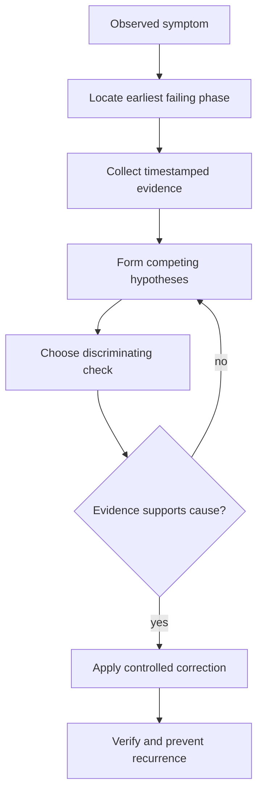

# Troubleshooting concepts and methodology

An enterprise CI/CD failure is an observation, not a diagnosis. A job marked failed may reflect an invalid pipeline definition, unavailable Windows Runner, broken Cargo build, inaccessible dependency registry, rejected scanner report, or an intentionally failing quality gate. The same visible status can have very different owners and remedies.

## An evidence-first investigation

Use a bounded sequence: identify the **first failing lifecycle boundary**, record the expected and observed behavior, enumerate plausible causes, gather discriminating evidence, test the smallest safe hypothesis, and verify the fix with the same conditions. Record residual uncertainty rather than presenting a plausible explanation as a proven root cause.

## Classify the failure boundary

| Layer | First diagnostic question | Evidence owner |
|---|---|---|
| Pipeline creation | Was a job created at all? | GitLab rules / YAML |
| Scheduling | Did an eligible runner accept it? | GitLab runner settings |
| Preparation | Did checkout and downloads finish? | Runner trace / network |
| Execution | Which command first failed? | PowerShell / Cargo / scanner |
| Submission | Was output uploaded and accepted? | Artifact store / analysis server |
| Policy | Did the tool succeed but gate reject? | Quality or security platform |

**Temporal ordering matters.** A cache miss followed by `cargo: command not found` does not mean caching caused the failure. The cache miss may be normal; the fatal failure is the missing executable. Similarly, a scanner upload that succeeds does not prove server-side quality gate approval.

## Scope and reproducibility

Record commit SHA, pipeline and job IDs, runner identity, toolchain version, GitLab configuration revision, relevant timestamps, affected branch or merge request, and whether the incident is intermittent. Reproduce in a comparable environment, not by changing multiple variables simultaneously. A failure seen only on one Windows Runner suggests host drift, identity, storage, or network differences.

## Hypothesis table

| Hypothesis | Evidence that supports it | Evidence that weakens it |
|---|---|---|
| Wrong job tags | Job pending, no matching runner tags | Eligible runner accepts identical tags |
| Cargo missing on service PATH | `Get-Command cargo` fails in job | Cargo resolves in same service context |
| Invalid analysis token | 401/403 at scanner submission | Server accepts the same scoped token |
| Policy rejection | Explicit gate violation | No evaluation or submission occurred |

## Avoid destructive shortcuts

Do not disable TLS verification, print full secret-bearing environments, give the runner administrator rights, remove security gates, or globally flush caches before understanding the failure. Such actions can hide symptoms while expanding risk. Prefer read-only checks, sanitized traces and scoped changes.

## Incident narrative template

Write a concise statement: *At commit X, job Y on runner Z failed during phase P. Expected E; observed O. Evidence A and B eliminate hypotheses H1/H2. Hypothesis H3 remains pending check C.* After correction, include verification evidence and a preventive action with an owner.

**Key distinction:** a workaround restores throughput; a verified root-cause fix explains why the original failure occurred and prevents it under comparable conditions.
