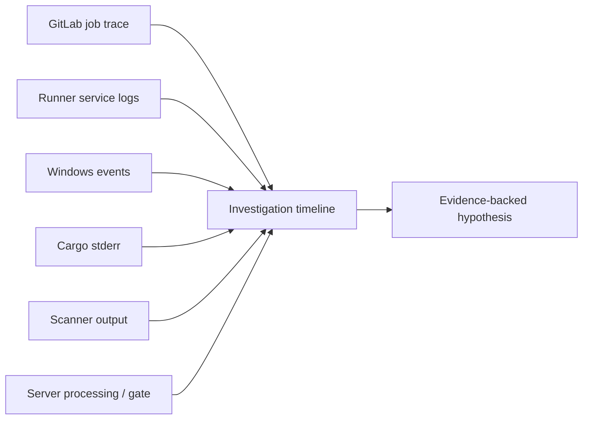

# Evidence, logs and diagnostic flows

Logs are only useful when tied to the component that produced them. GitLab pipeline views, runner service logs, generated PowerShell traces, Cargo diagnostics, Windows Event Viewer, proxy logs and scanner-server task histories describe different portions of one execution. Combine them by identifiers and timestamps rather than treating the longest log as the most authoritative.

## Evidence topology



## Minimal evidence bundle

| Evidence | Why it matters | Common pitfall |
|---|---|---|
| Pipeline ID and commit | Fixes the analyzed source revision | Comparing different commits |
| Job ID and stage | Identifies lifecycle location | Confusing stage and job names |
| Runner ID, executor, shell | Identifies host and runtime | Assuming tags prove OS |
| First fatal message | Locates failure onset | Following later cascade errors |
| Tool versions | Detects drift | Relying on developer workstation |
| Remote task/status ID | Links asynchronous scan | Treating upload as completion |

## Trace versus service log

A GitLab job trace shows job-side output and phase messages. A runner service log can reveal connectivity, executor setup and registration issues not fully visible in the job trace. Windows Event Viewer may show service crashes or permission failures. Server-side logs and analysis task status are necessary when SonarQube, Nexus IQ or Fortify accepts an upload but processing later fails.

## Safe diagnostic PowerShell

```powershell
Write-Host "Runner: $env:CI_RUNNER_DESCRIPTION"
Write-Host "Project dir: $env:CI_PROJECT_DIR"
Write-Host "PowerShell: $($PSVersionTable.PSVersion)"
Get-Command git,cargo -ErrorAction SilentlyContinue |
  Select-Object Name,Source
```

The example deliberately does not print all environment variables. Secrets can appear in command arguments, file paths or verbose output even when GitLab masking is enabled. Redact tokens, internal credentials and personal information before sharing evidence. For certificate problems, record issuer, endpoint and error category, not private keys.

## Correlate asynchronous systems

A SonarScanner job can report a successful submission while SonarQube processes it later. Nexus IQ policy evaluation and Fortify scan submission may similarly involve remote processing. Capture remote task identifiers and the precise result of the downstream policy decision. A timeout waiting for a server is different from a completed evaluation that rejects the build.

## Timeline example

1. 10:01: pipeline created for commit A.
2. 10:02: Windows runner accepted build job.
3. 10:03: Git checkout and cache restoration completed.
4. 10:04: Cargo compilation failed with a linker error.
5. 10:05: artifact upload reported no matching binary.

The earliest substantive failure is the linker error; the missing artifact is a consequence. Investigating artifact retention first would waste time.

## Evidence quality

Prefer original, timestamped traces and reproducible commands over screenshots of a final red status. Preserve both negative evidence (e.g., no matching runner tags) and positive evidence (successful authentication or download). Note when evidence is incomplete. Distinguish correlation from causation: two simultaneous failures may share a proxy outage, but that requires verification.

**Outcome:** a useful diagnostic record allows another engineer to repeat the reasoning without needing the original investigator.
