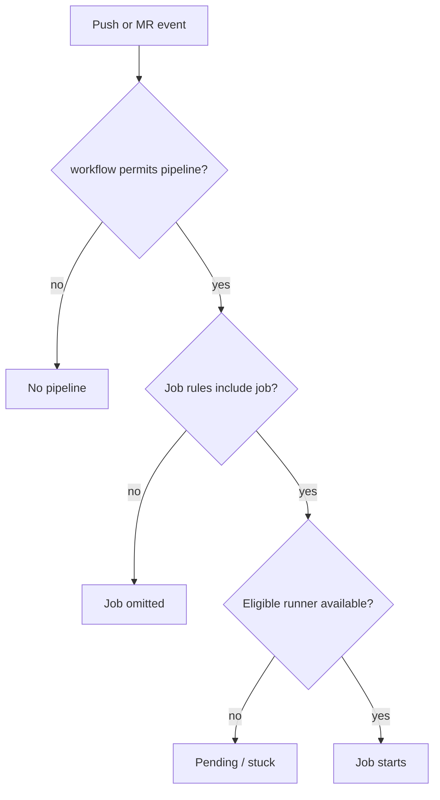

# Pipeline creation and scheduling failures

A pipeline that never materializes and a job that remains pending are different failures. GitLab evaluates workflow rules and job rules before a runner is involved. Runner eligibility is evaluated only after a job exists. Keeping these phases separate is the fastest way to diagnose apparently idle CI/CD.

## Creation and assignment decision tree



## GitLab YAML example

```yaml
workflow:
  rules:
    - if: '$CI_PIPELINE_SOURCE == "merge_request_event"'
    - if: '$CI_COMMIT_BRANCH == $CI_DEFAULT_BRANCH'

windows_build:
  tags: [windows, rust]
  rules:
    - if: '$CI_COMMIT_BRANCH == $CI_DEFAULT_BRANCH'
  script:
    - cargo build --locked
```

This configuration may create an MR pipeline while omitting `windows_build`, because the job rule targets the default branch. The missing job is not a runner outage. Rules should be reviewed in the context of the pipeline source and variable values available at evaluation time.

## Runner eligibility matrix

| Symptom | Likely cause | Discriminating check |
|---|---|---|
| No pipeline | `workflow:rules`, trigger constraints | CI configuration evaluation |
| Pipeline but no build job | Job `rules`, `only/except` | Job inclusion conditions |
| Job pending, tagged | Runner lacks one required tag | Compare complete tag sets |
| Job pending on protected ref | Runner protection mismatch | Protected-runner settings |
| Job waiting despite match | Concurrency/capacity | Runner busy and limits |
| Job assigned, then fails | Executor/runtime | Read first execution error |

A runner must match **all** tags required by a job. A label such as `windows` is a convention, not proof of the installed operating system or toolchain. Runner scope, paused state, protected-ref restrictions and whether untagged jobs are accepted can also prevent scheduling.

## DAG configuration errors

`needs` establishes explicit job dependencies and can allow jobs to run before earlier stages finish. If a job needs another job that is omitted by conditional rules, pipeline creation may fail unless the dependency is modeled appropriately (for example with `optional: true` where supported and semantically correct). Never add `optional: true` blindly: if the missing upstream job produces a required binary, optionalizing it hides a real contract violation.

## GitHub Actions migration trap

A GitHub Actions `on:` trigger does not translate mechanically to a GitLab job's `rules`. GitLab distinguishes pipeline creation (`workflow`) from job inclusion (`rules`). Test push, default-branch, merge-request and tag scenarios separately. A YAML file that parses successfully can still express the wrong execution policy.

## Safe investigation order

Read the exact pipeline source, commit/ref, evaluated configuration and job rules. Confirm job existence. Only then inspect runner tags, scope, protection and capacity. Do not restart Windows services to fix a rule that prevented job creation.

**Conclusion:** diagnose pipeline creation first, job inclusion second, runner assignment third, and executor failures last.
