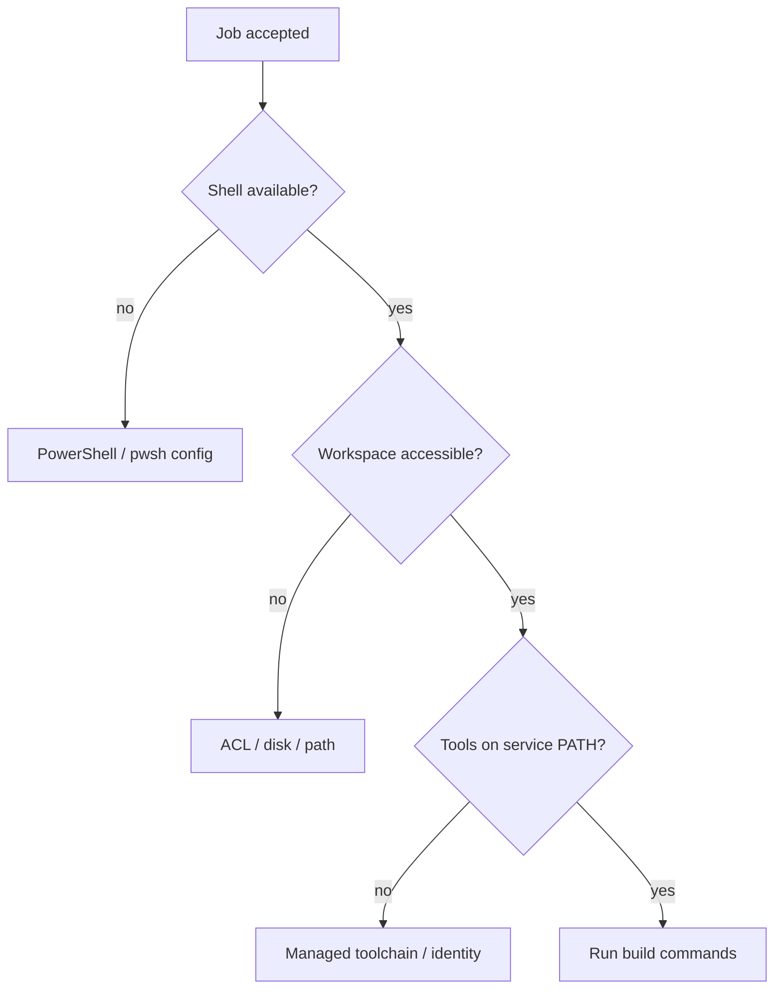

# Runner, executor and Windows failures

A Windows GitLab Runner can be online but unable to execute a Rust build. Connectivity to GitLab, runner eligibility, Shell executor preparation, service identity and installed tools are separate requirements. Troubleshooting must be performed in the **service account context**, not only from an administrator's interactive desktop.

## Failure boundaries



## Service context diagnostics

```powershell
Write-Host "Identity: $([Security.Principal.WindowsIdentity]::GetCurrent().Name)"
Write-Host "Shell version: $($PSVersionTable.PSVersion)"
Write-Host "Workspace: $env:CI_PROJECT_DIR"
Get-Command cargo,git -ErrorAction SilentlyContinue |
  Select-Object Name,Source
```

Run these only in an authorized diagnostic job. Avoid dumping `$env:PATH` if enterprise policy considers internal paths sensitive; never dump all variables. `cargo --version` can succeed in a user's terminal and fail in CI because rustup was installed under the user's profile, while the service runs as another account.

## `config.toml` boundaries

| Setting | Failure if wrong | Correct owner |
|---|---|---|
| `executor = "shell"` | Wrong execution model | Runner administrator |
| `shell = "pwsh"` | PowerShell 7 not installed | Runner/Windows owner |
| `builds_dir` | Cannot create workspace | Host filesystem owner |
| `cache_dir` | Cache access failures | Runner/cache owner |
| `concurrent` and `limit` | Queue or resource contention | Runner administrator |

A GitLab job cannot safely fix an inaccessible runner executable or a misconfigured service account merely by editing application YAML. Keep infrastructure and project configuration ownership separate.

## Windows-specific causes

NTFS ACLs, antivirus file locks, long or space-containing paths, stale processes, disk exhaustion, corporate endpoint controls, and missing MSVC linker components can produce failures that are absent on Linux. For native Rust Windows targets, confirm the compiler target and required linker toolchain. The presence of `rustc` alone is not sufficient for every Windows build.

## Distinguish connectivity from readiness

`gitlab-runner verify` can validate runner registration/connectivity but cannot prove that Cargo, Git, PowerShell, certificates or scanners work in an actual job. A successful end-to-end readiness check needs a controlled job under the intended service identity, with safe diagnostics and no privileged secrets.

## Incident: intermittent access denied

Two jobs share a persistent Shell host. One sometimes fails deleting files in `target/`. Investigate concurrent builds, open handles, antivirus scanning and workspace reuse. Do not grant broad administrator rights as the first fix. Consider reducing concurrency, isolating workspaces or dedicating hosts to different trust levels.

## Security consideration

Shell jobs run directly on the host. Projects sharing a runner may gain access to host resources permitted to the service identity. Protected GitLab variables do not automatically protect credentials stored permanently on the Windows machine. Keep untrusted merge-request code away from privileged release hosts.

**Conclusion:** runner online status is necessary but far from sufficient; isolate the exact host/runtime boundary that failed.
