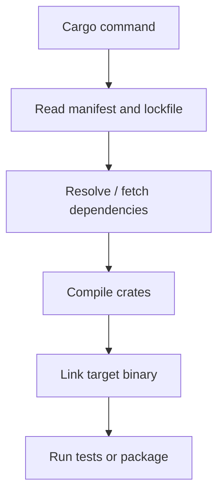

# Cargo build and dependency failures

Cargo failures can originate in manifest parsing, dependency resolution, registry access, Rust compilation, linking, test execution or output packaging. A single `cargo build` command spans all these phases. Diagnose the first failed phase instead of assuming every Cargo error is a source-code defect.

## Cargo failure map



## Failure signatures

| Symptom | Candidate causes | Evidence |
|---|---|---|
| Lockfile mismatch with `--locked` | Manifest changed without lock update | Cargo lock diagnostic |
| Dependency fetch timeout | Proxy, registry, DNS, TLS | Registry URL and client error |
| `rustc` unsupported feature | Toolchain version mismatch | `rustc --version`, lockfile |
| Linker not found | Windows target/MSVC tools missing | Target triple, linker error |
| Test failure | Logic, fixture, environment | Test name, assertion, logs |
| Binary missing | Wrong package/target/output path | Cargo metadata and artifact path |

## Windows toolchain check

```powershell
rustc --version
cargo --version
rustup show active-toolchain
cargo metadata --no-deps --format-version 1
```

These commands are illustrative; `rustup` may not be installed in managed enterprise toolchains. Always check the versions under the Runner service identity. Cargo workspaces can have multiple packages, so a presumed `target/release/app.exe` path may be incorrect even after a successful build.

## Dependency resolution versus network

A version conflict is different from a failed HTTPS connection to crates.io or an enterprise mirror. The former requires reviewing `Cargo.toml`, `Cargo.lock`, features and compatible versions; the latter requires examining proxy configuration, registry credentials, DNS and certificate trust. Changing dependency versions to solve a TLS error is the wrong intervention.

## Cache interference

A cache miss normally slows a job but should not break a reproducible build. If a build succeeds only when a stale cache exists, the pipeline has an undeclared dependency. Reproduce with a clean cache and a locked dependency graph. Cache keys should account for platform and toolchain compatibility; the lockfile alone may not capture all compiler-output differences.

## Compiler and linker distinction

Rust source can compile into object code yet fail during linking because the MSVC linker, Windows SDK or native library is missing. On Windows, distinguish `*-windows-msvc` from `*-windows-gnu` targets. A Linux runner passing the same source does not prove Windows linking will succeed.

## Test evidence

Record the failing test, environment assumptions, exit code and any dependency services. Avoid rerunning until green without preserving the first failure: intermittent tests require correlation with timing, concurrency, filesystem state and network dependencies.

## Java analogy

`Cargo.lock` supports reproducible resolution in a way Maven dependency mediation and dependency-lock approaches may differ. Cargo registry caches resemble Maven repository caches; Cargo's `target/` holds build outputs. Do not use either as an undeclared cross-job artifact store.

**Conclusion:** classify Cargo failures as configuration, fetch, compile, link, test or packaging before choosing a fix.
