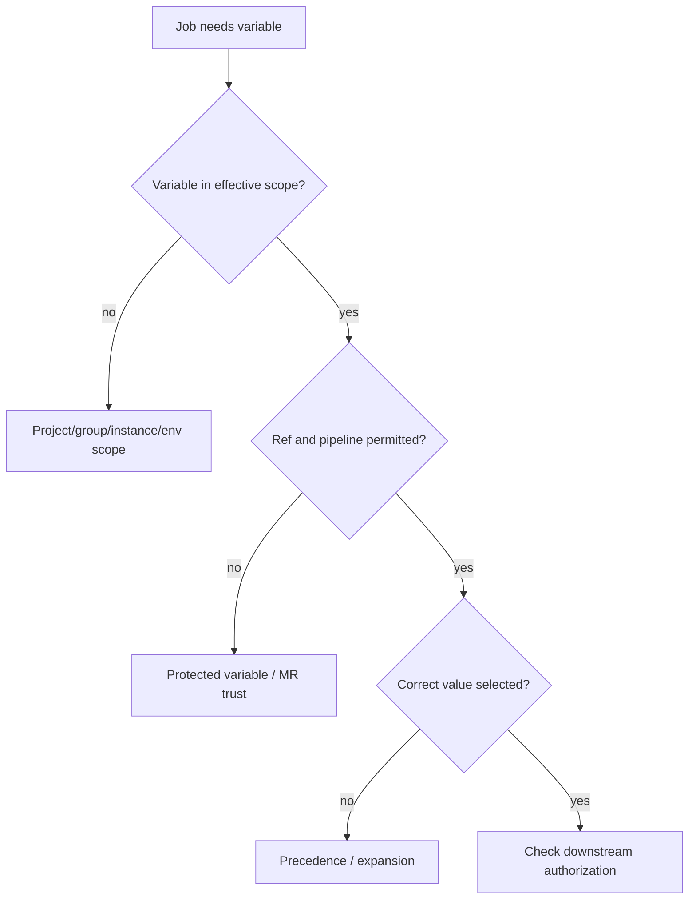

# Variables, permissions and secret failures

A CI variable can be correctly defined yet unavailable to a particular job. Its effective value depends on scope, precedence, environment targeting, protection rules and the pipeline context. The same applies to credentials: an HTTP 401 is not automatically an expired token, and a 403 is not automatically a network failure.

## Variable resolution investigation



## Frequent failure patterns

| Observation | Candidate cause | Safe check |
|---|---|---|
| Token absent on MR pipeline | Protected variable not exposed | Variable metadata and ref protection |
| Token present but 401 | Invalid/expired token or wrong endpoint | Server response and token metadata |
| 403 from SonarQube | Missing project analysis permission | Project authorization, not token value |
| Wrong registry selected | Variable precedence or expansion | Names, scopes and resolved nonsecret settings |
| Runner denied host file | Windows ACL, not GitLab role | Effective service identity and ACL |

## Never log secrets to debug presence

Avoid `Get-ChildItem Env:` or echoing tokens. A safer test may confirm a variable is present without revealing its content:

```powershell
if ([string]::IsNullOrEmpty($env:SONAR_TOKEN)) {
    throw "Required SonarQube token is unavailable"
}
Write-Host "SonarQube token is configured for this job"
```

Even a presence check should not be exposed to untrusted code when it reveals sensitive configuration. GitLab masking is a log-redaction feature, not an authorization boundary. A malicious script with access to a token can attempt to use or exfiltrate it.

## GitLab permissions versus Windows permissions

GitLab roles govern who may configure pipelines, variables, runners and protected refs. Windows service account permissions govern which files and processes a running job can access. A GitLab Maintainer cannot automatically grant NTFS permissions, and a powerful Windows account may expose host-level secrets despite narrow GitLab project permissions.

## Scope and precedence

Variable precedence can be subtle, especially when pipeline-level variables, project variables, group variables, job-level variables and dotenv reports coexist. Consult the GitLab version's documented precedence rules before claiming a value is overwritten. Record the variable **name and origin**, not its secret value.

## Rotation incident

After rotating a Nexus IQ credential, some branches work and others fail. Determine whether different variable scopes or environment-specific settings supply different values. Confirm the scanner job runs on the intended protected ref and whether its token has the right application/stage permission. Avoid globally expanding permissions to hide the inconsistency.

## Security fix versus quick fix

Turning off protection to make an MR pipeline pass can expose credentials to untrusted code. Prefer a deliberate lower-privilege analysis path or protected-branch-only privileged job. Document the tradeoff and owner.

**Conclusion:** debug variable availability, effective configuration and downstream authorization as separate questions.
