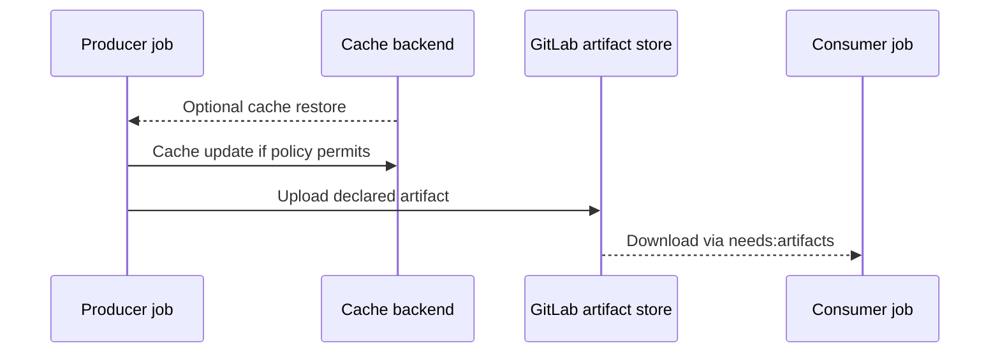

# Cache and artifact failures

Caches and artifacts can both appear as uploaded archives in job logs, but they solve different problems. A cache is an optional optimization whose absence must not invalidate a correct build. An artifact is a declared output that downstream jobs may require. Confusing them leads to fragile pipelines that work only on one persistent Windows host.

## Data lifecycle



## Diagnostic matrix

| Symptom | First checks | Typical correction |
|---|---|---|
| Cache miss on one runner | Runner identity, backend, key | Shared backend or accept cold build |
| Cache upload empty | Path under checkout, CARGO_HOME | Project-relative cache path |
| Build slower with cache | Archive size, transfer time | Cache fewer files |
| Artifact “no matching files” | Producer output path, target triple | Correct artifact path |
| Consumer cannot find binary | `needs`, upload success, expiry | Explicit artifact dependency |
| Report rejected | Report format and file content | Generate supported report |

## Example: Cargo registry cache

```yaml
variables:
  CARGO_HOME: "$CI_PROJECT_DIR/.cargo"

build:
  tags: [windows, rust]
  cache:
    key:
      prefix: windows-cargo
      files: [Cargo.lock]
    paths: [.cargo/registry/, .cargo/git/]
  script:
    - cargo build --locked --release
  artifacts:
    paths:
      - target/release/example.exe
    expire_in: 1 week
```

This is a conceptual example; the executable name and effective `CARGO_HOME` require verification. A project-relative Cargo home is important because runner cache paths are generally relative to the project workspace.

## Key and backend are independent

Two jobs can compute the same cache key yet have different results because Windows runners use separate local cache directories. Distributed caching requires runner-side backend configuration. Changing YAML cache keys does not magically make two hosts share a filesystem.

## `needs` changes artifact assumptions

With DAG execution, downstream jobs should explicitly declare required artifact downloads. A job that starts early cannot rely on every previous stage's artifacts being present. Verify both the producer's artifact upload and the consumer's declared dependency.

## Cache poisoning and trust

Untrusted merge-request jobs must not be able to overwrite privileged release caches. Cache archives may include executable scripts or generated build state. Separate trust boundaries and use protected runner and cache policies as appropriate. Never cache credentials.

## Retention and release outputs

An artifact may expire or be deleted under instance policy. A release binary required long-term belongs in controlled package or release storage, with checksums and provenance where required. Do not treat a short-lived CI artifact as permanent archival storage.

**Conclusion:** fix correctness with explicit artifacts and deterministic builds; tune caches only after the pipeline works without them.
