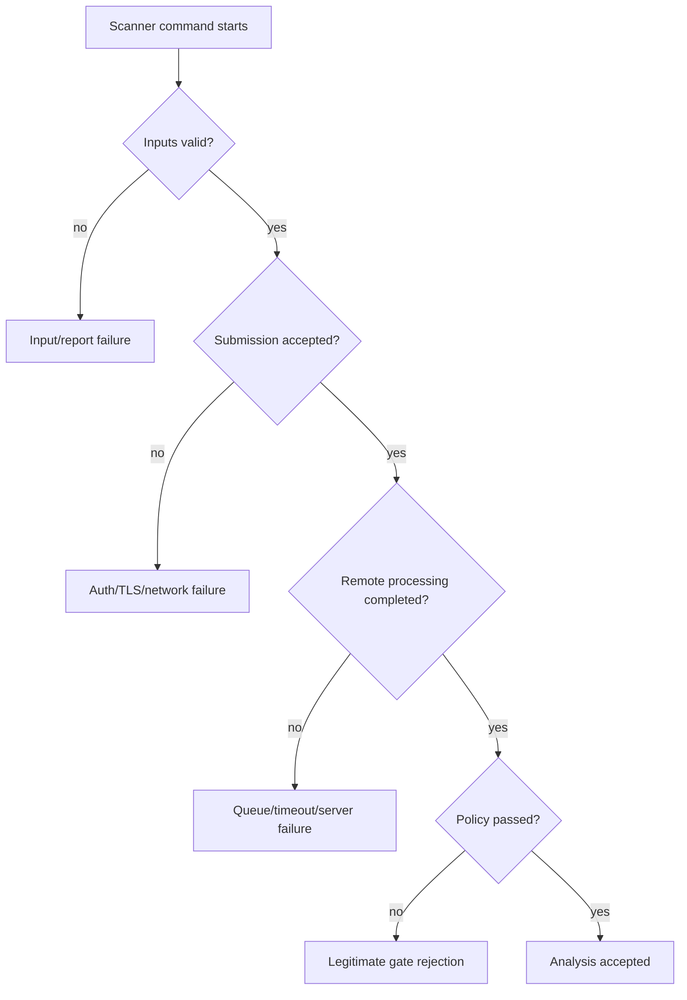

# SonarQube, Nexus IQ and Fortify failures

Security and quality integrations often fail at one of four boundaries: tool startup, input preparation, remote submission/processing, or policy evaluation. These stages must be distinguished for each product. A completed upload is not the same as a completed analysis, and a rejected quality gate is not a scanner malfunction.

## Three complementary tools

| Tool | Primary question | Typical evidence |
|---|---|---|
| SonarQube | What source quality/security issues are detected? | Analyzer findings, measures, quality gate |
| Nexus IQ | What risks exist in third-party components? | Component inventory, license/vulnerability policies |
| Fortify | What source-security findings are identified? | SAST findings, scan status, policy decisions |

Exact Rust support, scanner invocation and report ingestion depend on product edition/version and configured enterprise integrations. Do not assume a Java scanner command works for Rust.

## Analysis state machine

## SonarQube example

A scanner job succeeds but the server shows a red gate. Check whether the job waits for the gate or whether another integration enforces the status. Do not relax thresholds to make CI green. If coverage is zero, verify the Rust coverage report was generated, transferred and imported using a supported format; SonarQube does not execute Cargo tests itself.

## Nexus IQ example

A policy evaluation flags a vulnerable transitive crate. Confirm the component identity, dependency path, policy stage, advisory and available remediation. Distinguish an actionable policy violation from a component-identification ambiguity or missing SBOM ingestion. A successful `cargo build` does not invalidate a dependency-risk finding.

## Fortify example

A scan job fails before uploading results. Check whether the installed Fortify product/version supports the intended Rust analysis workflow, whether required translation/scan phases exist, and whether the Windows host has necessary tools. If a scan completes but reports findings, classify those separately from scanner execution failures.

## Shared infrastructure failures

A corporate proxy outage may affect all three scanners. A missing token or insufficient project permission usually affects one integration. TLS trust stores may differ between Java-based tools, native clients and PowerShell. Use the precise endpoint, error category and tool version to distinguish common-cause infrastructure failures from product-specific issues.

## Gate enforcement

Document whether a failure means “scan unavailable,” “scan completed with policy violation,” or “unsupported analysis configuration.” An enterprise release policy may treat these differently. Never convert a scan outage into a false green result with `allow_failure: true` unless a documented exception process explicitly authorizes it.

**Conclusion:** identify the tool, phase, remote task state and policy outcome before proposing a correction.
