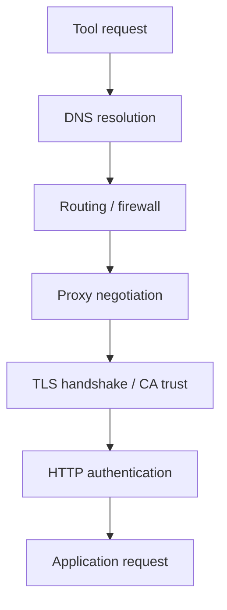

# TLS, network, proxy and certificate failures

A Windows GitLab Runner may communicate successfully with GitLab while Cargo, Git, SonarQube, Nexus IQ or Fortify fails to reach another endpoint. These tools can use different HTTP libraries, proxy discovery methods and certificate stores. “The network works” is therefore not a useful diagnosis without naming the failing client and destination.

## Connection stack



## Symptom-to-layer map

| Error class | Likely layer | Evidence to gather |
|---|---|---|
| Name resolution failure | DNS | Hostname, resolver response |
| Connection timeout | Routing/firewall/proxy | Destination, port, timeout |
| Proxy authentication required | Proxy | HTTP 407, service account context |
| Unknown certificate authority | TLS trust | Certificate chain, client trust store |
| Certificate name mismatch | TLS identity | Requested hostname and SAN |
| HTTP 401/403 | Application authorization | Token scope and endpoint |

## Windows service context

Interactive browser proxy settings and certificates may not match the service account's environment. A corporate root certificate installed only in a user certificate store may be invisible to a service or Java runtime. Cargo, Git and scanner distributions may each require distinct configuration. Diagnose the actual process, not the workstation's browser.

## Safe diagnostics

```powershell
Resolve-DnsName gitlab.example.invalid
Test-NetConnection gitlab.example.invalid -Port 443
```

The domain is a placeholder. DNS and TCP checks cannot establish that the TLS chain or application credentials are valid. Avoid testing by disabling certificate verification. For real environments, use approved endpoints and redact internal topology in shared reports.

## Proxy distinctions

Environment variables such as `HTTP_PROXY`, `HTTPS_PROXY` and `NO_PROXY` may be interpreted differently across tools. Some clients use system proxy settings or their own configuration. A proxy that intercepts TLS may require an approved enterprise CA to be trusted by each client. Verify whether the request actually traverses the proxy before changing trust stores.

## Certificates are not credentials

A certificate trust failure occurs before application authentication. Replacing an API token cannot fix an untrusted CA. Conversely, a valid TLS handshake does not prove the token is authorized for the target project. Preserve this ordering during diagnosis.

## Root-cause example

GitLab checkout succeeds, Cargo dependency fetch fails with a certificate error, and SonarQube upload works. The evidence points to Cargo-specific registry endpoint/trust configuration, not a universal runner outage. Confirm registry URL, certificate issuer and Cargo's effective settings under the service identity.

## Prevention

Maintain an endpoint inventory, approved CA distribution, proxy configuration ownership, certificate renewal monitoring and a controlled change process. Validate affected clients after corporate proxy or CA changes. Do not store private keys in job artifacts or caches.

**Conclusion:** TLS failures are client-and-endpoint specific; test each boundary independently.
